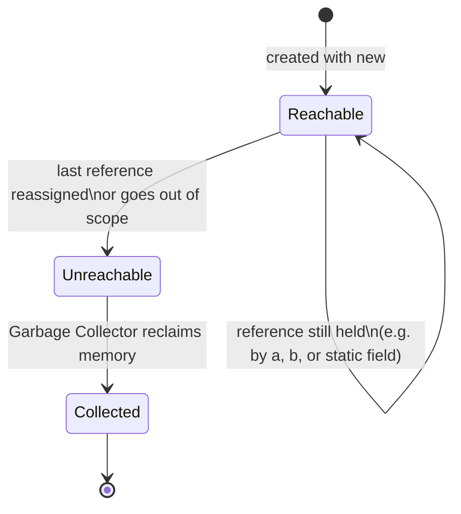

## Definition

The **Garbage Collector** (§0.8.4.2) destroys all objects automatically and
frees memory automatically, reducing the risk of memory leaks (*Gefahr von
Speicherlecks reduziert*). It is controlled by the Java Virtual Machine, and
normally requires no programmer intervention. As a direct consequence: "Es
entfällt die Notwendigkeit eines Destruktors" (the necessity of a destructor is
eliminated) — **there is NO destructor in Java.**

## Problem it solves

Manual memory management in C++ requires the programmer to track object
lifetime and explicitly release resources (`delete`, destructors), which is a
major source of bugs (leaks, double-frees, dangling pointers). Java's garbage
collector removes this responsibility from the programmer entirely by having
the JVM detect when an object is no longer reachable and reclaiming its memory
automatically.

## What replaces RAII

C++'s [[concepts/destructor]] is the backbone of RAII (*Resource Acquisition Is
Initialization*): a destructor runs deterministically at scope exit or `delete`,
so resource cleanup (file handles, locks, memory) is tied to object lifetime.
Java has no destructor and no deterministic cleanup hook described in this
source — the garbage collector reclaims *memory*, driven by reachability, not
by scope. The script does not describe any Java equivalent of RAII-triggered
cleanup for non-memory resources (no `finalize()` or try-with-resources is
mentioned in the transcribed pages).

## Diagram: object reachability and collectability



### Worked example of reachability change (from the References example, §0.8.5.2–0.8.5.3)

```java
MyInt a = new MyInt(1);
MyInt b = a;        // b points to the SAME object as a (still reachable via a and b)
MyInt c = new MyInt(6);
b = c;               // b now points to c's object; a's object still reachable via "a"
                     // c's PREVIOUS binding is irrelevant here, no object becomes
                     // unreachable in this particular step
```

### Numbered pseudocode: when an object becomes collectable

```
1. An object is created with `new` and is reachable through at least one
   variable/reference, a field, or a static member.
2. As long as any reachable path (a local variable, an object field, a static
   field) still points to the object, it remains reachable.
3. When the LAST reference to the object is reassigned (pointed elsewhere) or
   goes out of scope, the object becomes unreachable.
4. The Garbage Collector, running under control of the JVM, detects
   unreachable objects and reclaims their memory automatically.
5. No destructor runs at any point in this process — the source states
   explicitly that Java has no destructor construct.
```

## Compared with C++

| Aspect | C++ | Java |
|---|---|---|
| Who frees memory | The programmer, via `delete` / RAII-driven destructors | The Garbage Collector, run by the JVM |
| Cleanup hook on destruction | [[concepts/destructor]] (`~ClassName()`), deterministic | None — "Es gibt keinen Destruktor in Java!" |
| Timing of reclamation | Deterministic (scope exit / explicit `delete`) | Non-deterministic, driven by reachability, timing not specified by the script |
| Risk reduced | N/A (manual) | Memory leaks (*Gefahr von Speicherlecks reduziert*) |
| Ownership tooling | [[concepts/smart-pointers]] (RAII-based ownership models) | No equivalent described — GC replaces the need for ownership-tracking smart pointers |

See [[concepts/destructor]] for the full C++ destructor mechanics this page
contrasts against, [[concepts/memory-model]] for where objects live and how
lifetime is tracked in C++, and [[concepts/smart-pointers]] for the C++
ownership-based alternative to garbage collection.

## Consequences / trade-offs

- Eliminates an entire class of manual-memory bugs (leaks, double-free,
  dangling destructor calls) at the cost of deterministic, scope-tied cleanup.
- Because there is no destructor, any cleanup logic that in C++ would live in
  `~ClassName()` has no direct Java equivalent in the material transcribed
  here — programmers must look elsewhere (not described in this source) for
  deterministic resource cleanup of non-memory resources.

## Misuse & anti-patterns

- Expecting a Java class's logic to run "on destruction" the way a C++
  destructor would — no such hook is described in this source.
- Assuming the garbage collector's timing is predictable or immediate upon the
  last reference being dropped; the script only states that it runs, not when.

## Open questions

- The script does not mention `finalize()`, try-with-resources, or
  `AutoCloseable` — these are known Java mechanisms from general knowledge but
  are **not** stated in the transcribed source, so they are intentionally
  omitted here per the no-fabrication rule.
- No detail is given on the GC algorithm (mark-sweep, generational, etc.).

## Related

- [[concepts/java-vs-cpp]]
- [[concepts/destructor]]
- [[concepts/memory-model]]
- [[concepts/smart-pointers]]
- [[concepts/java-references-and-primitives]]
- [[concepts/java-classes-and-members]]

## Sources

[[sources/grigat-java]] §0.8.4.2
