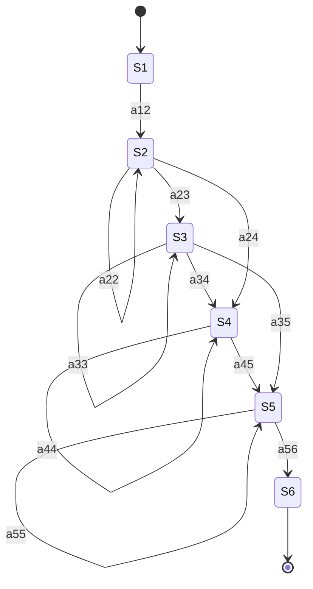
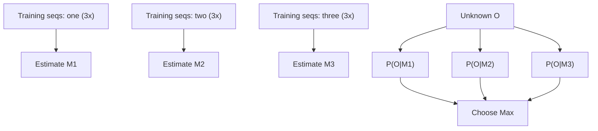
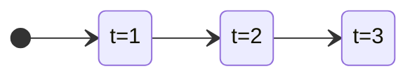

A **Hidden Markov Model (HMM, *Verdecktes Markov Modell*)** is a state automaton (*Zustandsautomat*) that emits an observation vector at each time step according to a state-dependent probability density, where the generating state sequence is unknown (*verdeckt* / hidden) and only the observation sequence is known.

## Definition: Markov model (§0.16.3.4)

A Markov model *M* is a state automaton:

- At every integer time point *t* in the interval 0 ≤ t ≤ T+1, a state transition occurs.
- The transition from state *i* to state *j* has probability a_{ij}, with Σ_j a_{ij} = 1.
- At every time point *t*, when a state *j* is reached, an observation vector o_t is generated according to the (amplitude) probability density b_j(o_t).
- Exception: the input state x(0) and output state x(T+1) generate no observation vectors — this facilitates chaining (*Hintereinanderschaltung*) of Markov models.

Only the observation sequence **O** = o_1, o_2, …, o_T is known; the state sequence *X* is concealed ⇒ **Hidden Markov Model**.

An HMM *M* is fully characterized by:

1. Number of states N_M.
2. Transition probabilities a_{ij}.
3. Probability densities b_j(o_t) for the amplitudes of the observation vectors upon reaching state *j*.

## Example model (§0.16.3.5, Abbildung 135)

A non-hidden example: states 1→2→3→4→5→6 in sequence, each with a self-loop (a_22, a_33, a_44, a_55) and a forward transition (a_12, a_23, a_34, a_45, a_56), plus skip transitions a_24 (2→4) and a_35 (3→5). Observation sequence O = o_1..o_7 is emitted from states via b_2(o1), b_2(o2), b_3(o3), b_4(o4), b_4(o5), b_5(o6), b_5(o7): N_M = 6 states, N_T = 7 observations. For this example the state sequence is X = ⟨1,2,2,3,4,4,5,5,6⟩ — x(0)=1 is the input state (no observation), x(1)=2 … x(T)=5, x(T+1)=6 is the output state (no observation).



The joint probability density that observation sequence O was generated by state sequence X of model M (eq. 34):

```
P(O,X|M) = a_{12}·b_2(o_1)·a_{22}·b_2(o_2)·a_{23}·b_3(o_3)· …
```

## Application context: word recognition (§0.16.3.3)

**Abbildung 134**: a spoken word produces a *Speech Waveform*, which a *Parametrierer* turns into a sequence of *Sprachvektoren* (speech vectors) — an observation sequence **O** = o_1, o_2, …, o_T, where o_t is the speech vector observed at time point *t* — which a *Recognizer* (*Erkenner*) module then processes.

**Assumptions**: each speech signal corresponds to exactly one symbol (word); all words stem from a given dictionary (*Wörterbuch*); every spoken word is represented by exactly one such observation sequence O.

## Maximum-likelihood classification (§0.16.3.6)

The probability density P(O|M) needed for classification is a sum over all possible state sequences X = ⟨x(0), x(1), …, x(T), x(T+1)⟩:

```
P(O|M) = Σ_X a_{x(0)x(1)} · Π_{t=1}^{T} b_{x(t)}(o_t) a_{x(t)x(t+1)}       (35)
```

P(O|M) is approximated by its most probable state sequence X:

```
P̂(O|M) = max_X { a_{x(0)x(1)} · Π_{t=1}^{T} b_{x(t)}(o_t) a_{x(t)x(t+1)} }   (36)
```

- If an observation o_t is improbable for a suboptimal state sequence X, then b_{x(t)}(o_t) ≈ 0 and hence P(O|M) ≈ 0.
- Naive complexity of computing P(O|M) is **O(N_T · N_M^{N_T})**: N_M possible states per time point ⇒ O(N_M^{N_T}) possible state sequences, and O(N_T) multiplications per sequence. See [[concepts/big-o-notation]], [[concepts/complexity-classes]].
- Equation (36) can be computed efficiently with the **[[algorithms/viterbi|Viterbi algorithm]]** (dynamic programming), avoiding the exponential enumeration above — exactly the overlapping-subproblems argument from [[concepts/dynamic-programming]].
- Assumption: parameters {a_{ij}} and b_j(o_t) are known; parameters of models M_k are determined automatically from a given training set (*Trainingsmenge*).

The classification result is the word ω_K whose model M_K has the greatest maximum likelihood among all words {ω_k}:

```
P̂(O|M_K) = max_k { P̂(O|M_k) }    (37)
```

### Recognition pipeline summary (§0.16.3.7–0.16.3.8)

1. Train one Hidden Markov Model M_k per word ω_k from the dictionary (several training speech signals per word are needed).
2. Approximate the probability that model M_k generated observation sequence O as P̂(O|M_k).
3. The model with the greatest probability identifies the spoken word.

Example dictionary {"one", "two", "three"}: 3 training sequences per word estimate M_1, M_2, M_3; an unknown observation O is scored against all three models, and "Choose Max" selects the recognized word.



## Trellis view

Decoding an HMM (finding the most probable X, or the value P̂(O|M)) is visualized as finding the best path through a **trellis**: a directed graph whose vertical axis is the HMM's states *j* and whose horizontal axis is the observation/time index *t*. Node weights are the log-emission-probabilities log b_j(o_t); edge weights are the log-transition-probabilities log a_{ij}. See [[algorithms/viterbi]] for the recurrence and pseudocode that computes this efficiently.



## Related

- [[algorithms/viterbi]] — the DP decoding algorithm for the most probable state sequence.
- [[concepts/dynamic-programming]] — the general technique Viterbi instantiates.
- [[concepts/big-o-notation]]
- [[concepts/complexity-classes]]

## Sources

- [[sources/grigat-graphs-dynamic-programming]] §0.16.3.3–§0.16.3.8
