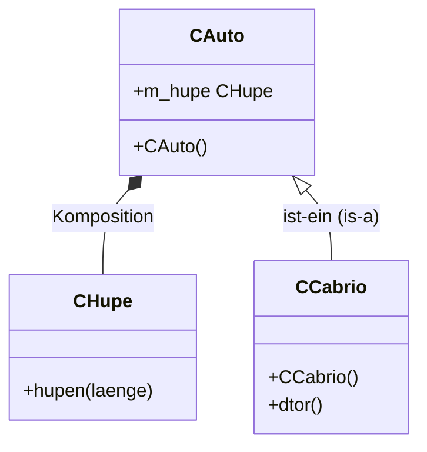
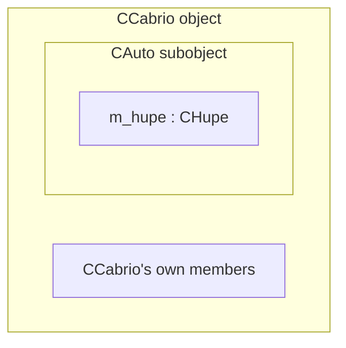

Inheritance (*Vererbung*, also *Ableitung* — derivation) is the "is-a" relationship (*ist-ein*): a derived class additionally possesses — i.e. inherits — the member functions and member variables of its base class (§0.3.5).

## Problem it solves

Some classes are specializations of a more general class: a convertible *is a* car, with all the car's behavior plus something extra. Re-declaring all the car's members inside the convertible class would duplicate logic; inheritance lets the convertible class acquire them automatically (§0.3.5).

## Syntax: `class Derived : public Base`

```cpp
// cauto.hpp
class CAuto
{
public:
  CAuto();
  CHupe m_hupe; // Auto hat Hupe (Komposition)
};

// chupe.hpp
class CHupe
{
public:
  void hupen(int laenge);
private:
  std::string m_ton;
  int m_staerke;
};

// ccabrio.hpp
class CCabrio : public CAuto // Cabrio ist Auto
{
public:                      // Vererbung
  CCabrio();
  ~CCabrio();
};
```

`: public CAuto` is read "Cabrio ist ein Auto" (Cabrio is a car) — public inheritance (*öffentliche Vererbung*) (§0.3.5.1).



### Memory layout: the base subobject

A derived object physically contains its base class as a leading subobject;
the derived class's own members follow it in memory.



This is why a `CCabrio*` can be implicitly converted to a `CAuto*` (upcast,
see [[concepts/polymorphism]]) without adjusting the address in this simple
single-inheritance case: the base subobject starts at the same address as the
whole object.

> Figure 8 ("UML-Diagramm: Vererbung (und Komposition): 'Cabrio ist ein Auto'") shows `CAuto` connected to `CHupe` via a composition diamond, and `CCabrio` connected upward to `CAuto` via a hollow triangular arrowhead — the UML inheritance/generalization symbol.

A derived class can itself serve as a base class for further derivation, so class hierarchies (*Klassenhierarchie*) can be nested arbitrarily deep (§0.3.5).

## What is inherited

`CCabrio` inherits `CAuto`'s members, including [[concepts/composition|member objects]] acquired through composition. This is demonstrated by calling the inherited public member `m_hupe` directly on a `CCabrio` instance:

```cpp
// ccabrio.cpp continuation
// main.cpp
CCabrio sportwagen;
sportwagen.m_hupe.hupen(5);
```

`m_hupe` (the horn, itself composed into `CAuto`) becomes accessible on `CCabrio` purely through inheritance, without `CCabrio` declaring anything about horns itself (§0.3.5.1).

## Base class initialization

Because a derived class's own constructor cannot directly initialize members that belong to the base class, the base class's own constructor must run — a derived class constructor invokes the base class constructor via its member initializer list. (Full mechanics and syntax are covered under [[concepts/multiple-inheritance]], where this is first shown explicitly with multiple base classes; the same principle already applies to a single base class here: `CCabrio`'s constructor is responsible for seeing `CAuto`'s constructor invoked, either explicitly in the initializer list or implicitly via `CAuto`'s default constructor.)

### Procedure: construction and destruction order through a hierarchy

Construction runs top-down (base first), destruction runs bottom-up (base last) —
the exact reverse order:

1. Construct `CAuto` (the base subobject): run its member objects' constructors, then its own constructor body.
2. Construct `CCabrio`'s own members, then run `CCabrio`'s own constructor body.
3. ... object is now fully alive and usable ...
4. Destruct `CCabrio`: run `CCabrio`'s own destructor body, then destroy `CCabrio`'s own members (reverse declaration order).
5. Destruct `CAuto` (the base subobject): run `CAuto`'s destructor body, then destroy its member objects (reverse declaration order).

This ordering is also why [[concepts/polymorphism]] forbids calling virtual
functions meaningfully from constructors/destructors: at step 1 the derived
part doesn't exist yet, and at step 5 it no longer does — see
[[synthesis/special-member-functions]] for the full set of special member
functions (including why the destructor must be `virtual` for polymorphic
base classes).

## How inheritance differs from composition

| | Composition ("has-a") | Inheritance ("is-a") |
|---|---|---|
| Relationship | object **contains** another object as a member | object **is** a specialized kind of another class |
| Access to the "other" part | only through the member object's own public interface, via the member's name (`m_hupe.hupen(...)`) | directly, as if the base class's members were the derived class's own |
| UML symbol | filled diamond | hollow triangular arrowhead |
| Typical use | reuse behavior without exposing an "is-a" claim | model a genuine specialization / subtype |

See [[concepts/composition]] for the "Auto hat Hupe" example that `CCabrio` builds on here.

## Consequences / trade-offs

- Inheritance gives a derived class the base class's full public (and, with `protected`, partially its non-public) interface "for free", reducing duplication across a class hierarchy.
- Unlike composition, inheritance exposes the base class's interface directly on the derived class, which couples the derived class tightly to the base class's design — changes to the base ripple more directly into derived classes than changes to a merely-composed member object would.
- C++ permits a class to inherit from more than one base class at once (unlike, e.g., Java) — see [[concepts/multiple-inheritance]] for the complications this introduces.

## Misuse & anti-patterns

- Using inheritance where the relationship is really "has-a" (e.g. making `CAuto` inherit from `CHupe` instead of containing one) — this exposes the horn's interface as if it were the car's own, which is not what "Cabrio is an Auto" or "Auto has a Hupe" actually mean.
- Assuming a derived class can access a base class's `private` members directly — it cannot; only `protected` or `public` members are reachable (see [[concepts/access-modifiers]]).

## Related

- [[concepts/composition]]
- [[concepts/multiple-inheritance]]
- [[concepts/class-and-object]]
- [[concepts/access-modifiers]]
- [[concepts/overriding-vs-overloading]]
- [[synthesis/special-member-functions]]

## Sources

[[sources/grigat-oop-teil1]] §0.3.5, §0.3.5.1
