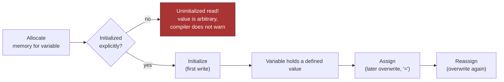
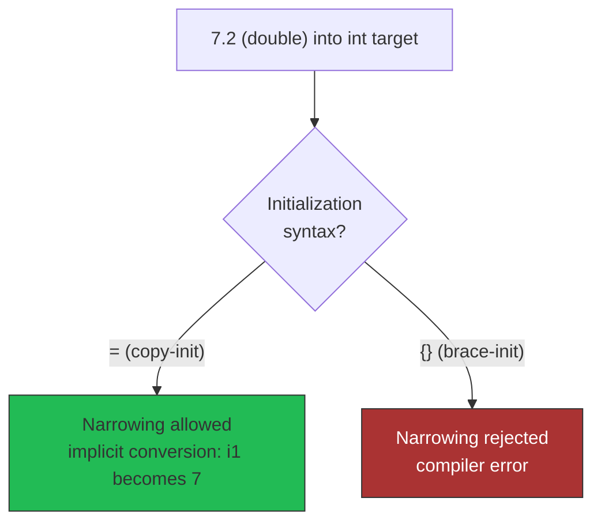

# Initialization and Assignment

Two operations that look alike and are not.

- **Initialization** (*Initialisierung*) — the *first-time* writing of a value to
  a variable, at the point memory is allocated to it.
- **Assignment** (*Zuweisung*) — overwriting a variable that already holds a value.

## Why this matters in C++

> [!warning] The classic C++ bug source
> - In C++ variables are generally **not** automatically initialized — the content
>   of an uninitialized variable is arbitrary.
> - The compiler generally does **not** check whether a variable was initialized
>   before being read (unlike Java).
> - ⇒ **Always initialize variables.**

Constants must be initialized; see [[concepts/const-and-volatile]].



## Initializer lists

Brace initialization `{}` uses `initializer_list<T>` and **prevents narrowing
conversions**, which plain `=` does not:



```cpp
int i1 = 7.2 ;   // i1 wird zu 7
int i2 {7.2};    // Fehler, Umwandlung von Gleitkommazahl in Ganzzahl
int i2 = {7.2};  // Derselbe Fehler, das = ist redundant
int i3[] = {2,4,6} // Array initialisieren mit initializer_list<int>
```

## `auto`

`auto` deduces the type from the initializer. It is especially helpful for long
type names.

```cpp
auto b = true;   // Typ ist bool
auto ch = 'x';   // Typ ist char
auto i = 1;      // Typ ist integer
auto j {1};      // Aber: Typ ist Liste initializer_list<int>
auto d = 1.2;    // Typ ist double
```

> [!warning] `auto` + braces
> `auto i = 3;` gives an `int`, but `auto i{3};` gives an `initializer_list<int>`.
> With `auto`, prefer the `=` syntax — no type conversion occurs there anyway, so
> the narrowing protection of `{}` buys you nothing.

`auto` also serves as a placeholder for function return types — see
[[concepts/function-overloading]].

## Range-based loops and copies

Whether a loop variable is a copy or a reference is an initialization question:

```cpp
int v[] = {0,1,2,3,4,5,6,7,8,9};

for (auto i=0; i!=10; ++i)
    std::cout << v[i] << ", ";

for (auto x: v)   // x ist Kopie der Elemente aus v
    std::cout << x << ", ";

for (auto& x: v)  // x ist keine Kopie sondern Referenz
    ++x;
```

Only the third loop modifies `v`. See [[concepts/pointers-and-references]].

## Related

- [[concepts/type-declaration-definition]]
- [[concepts/const-and-volatile]]
- [[concepts/pointers-and-references]]
- [[concepts/scope-and-storage-classes]]
- [[concepts/constructor]]
- [[concepts/value-categories]]
- [[concepts/type-conversions]] (narrowing is a conversion-rules question)

## Sources

- [[sources/grigat-oop-teil1]] §0.2.1.2 (Initialisierungliste und auto),
  §0.2.1.4 (Zuweisung vs. Initialisierung), §0.2.1.6 (For-Schleifen)
