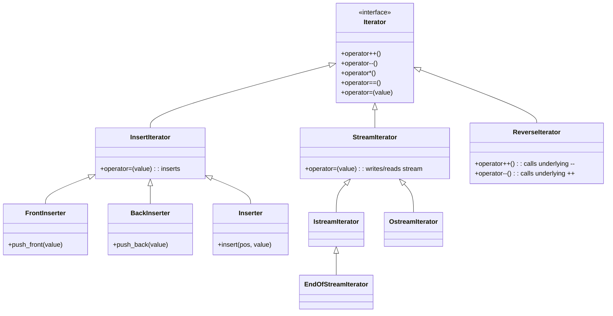
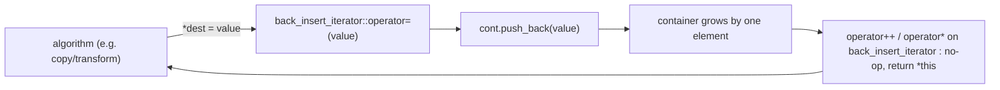

**Iterator adapters** (*Iterator-Adapter*) are classes that expose the *interface* of an [[concepts/iterators|iterator]] (`++`, `--`, `==`, `!=`, `*`, `=`) but implement fundamentally *different behavior* (*abweichendes Verhalten*) underneath. The three families covered here are insert iterators, stream iterators, and reverse iterators.

## Problem it solves

"Ordinary" iterators are pure abstractions over container traversal. But some situations need an object that *looks* like an iterator to an [[algorithms/stl-algorithms|algorithm]] (because algorithm signatures require iterators) while actually doing something else entirely — inserting instead of overwriting, reading/writing a stream instead of a container, or walking a container backwards. Iterator adapters let existing algorithms be reused unchanged in these situations.

> **Key insight**: adapters have the *interface* of an iterator but a fundamentally different *behaviour* — assignment (`iter = value`) becomes **insertion**, stream I/O, or reversed traversal, rather than plain overwrite.

## 0.5.10.1 / 0.5.10.2 Insert iterators

Properties of insert iterators (*Insert-Iteratoren*):

- Assigning a value to the insert iterator does **not** overwrite the target value, but **inserts** a new element.
- This lets algorithms operate in "insert mode" (*Insertmodus*) instead of "overwrite mode" (*Überschreibemodus*).
- Especially used for algorithms working on multiple sequences (e.g. `copy`, `transform`, see [[algorithms/stl-algorithms]]): elements of container A are copied into container B without overwriting B's existing values, and without risking access to invalid memory because B was too short.

Three kinds of insert iterators:

| Factory | Effect of `iter = value` | Underlying call |
|---|---|---|
| `front_inserter(cont)` | inserts `value` at the front of `cont` | `cont.push_front(value)` |
| `back_inserter(cont)` | inserts `value` at the end of `cont` | `cont.push_back(value)` |
| `inserter(cont, pos)` | inserts `value` at the position given by iterator `pos` | `cont.insert(pos, value)` |

- The container must provide the required member function (`push_front`, `push_back`, or `insert`), otherwise behavior is undefined.
- A member function cannot be passed directly to an algorithm — the algorithm's signature requires *iterators* — hence the adapter wrapping.

## 0.5.10.3 Insert iterators: operator behavior

- `++`, `--`, and `*` (dereference) exist syntactically but have no real function for insert iterators — more precisely, they just return `*this`.
- The assignment `iter = value` inserts `value` into the container associated with `iter`, at the position determined by the *kind* of insert iterator (front for `front_inserter`, a given position for `inserter`, etc.).

```cpp
#include <list>
#include <algorithm>
using namespace std;
int main()
{
        list<int> lst;
/* ... */
        copy (lst.begin(), lst.end(), // Quellsequenz
          front_inserter(lst))     // Ziel
} // Alle Argumente von copy müssen Iteratoren sein!
```

`copy` copies a sequence; `front_inserter` is the destination iterator here, specifying that every element of `lst` is copied to the beginning of `lst`. The list `1 2 3 4 5` becomes `5 4 3 2 1 1 2 3 4 5` — the list *grows*, i.e. memory for additional elements is reserved via internal calls to `push_front`.

## Numbered pseudocode: assignment through an insert iterator

```
1. operator=(insert_iterator<Container>& self, value):
2.     if self.kind == front:
3.         self.container.push_front(value)
4.     else if self.kind == back:
5.         self.container.push_back(value)
6.     else if self.kind == positional:
7.         self.pos = self.container.insert(self.pos, value)
8.     return self   // supports chained use by the algorithm
```

## 0.5.10.4 Stream iterators

*Istream iterators* read from a stream; *ostream iterators* write to a stream:

```cpp
istream_iterator<int> intReader(cin);     // reads ints from standard input
ostream_iterator<int> intWriter(cout);    // writes ints to standard output
```

**End-Of-Stream iterator**: created by the parameterless constructor of an istream iterator, e.g. `istream_iterator<int> myEOF;`. Every istream iterator becomes an End-Of-Stream iterator after encountering invalid input (e.g. `intReader` becomes one after a letter is entered). This makes it suitable for catching invalid inputs.

```cpp
istream_iterator<int> intReader(cin);
ostream_iterator<int> intWriter(cout, ", "); // ostream_iterator mit
                                              // Komma als Trennzeichen
istream_iterator<int> intReaderEOF;  //Erzeugen eines
                                      //End-Of-Stream-Iterators
                                      //mittels Default-Konstruktor
while(intReader!=intReaderEOF)
{
  *intWriter = (*intReader)*2;
  ++intReader;
  ++intWriter;
}
```

Every entered `int` is doubled and output, separated by `", "`; the `while` loop terminates as soon as an invalid value is entered (see [[concepts/cpp-streams]]).

## 0.5.10.5 Reverse iterators

- Reverse iterators (*Reverse-Iteratoren*) internally swap the meaning of `++` and `--`.
- Containers provide them via the member functions `rbegin()` and `rend()`.
- This lets algorithms operate "backwards" without any special-casing in the algorithm itself.

```cpp
list<int> lst;
/* ... */
copy(lst.rbegin(), lst.rend(),                     // Quelle
     ostream_iterator<int>(cout, " <-- "));          // Ziel
```

This copies the elements of `lst` in reverse order to `cout`, separated by `" <-- "`.

## Mermaid: adapter families



## Mermaid: how `back_inserter` turns assignment into `push_back`



## Consequences / trade-offs

- Insert iterators remove the need to pre-size a destination container, at the cost of repeated reallocation/insertion overhead compared to pre-sized assignment.
- Stream iterators let I/O streams masquerade as sequences, so the same [[algorithms/stl-algorithms|algorithms]] used on containers work for `cin`/`cout` — but error handling becomes "detect End-Of-Stream" rather than exceptions.
- Reverse iterators are a zero-additional-algorithm way to traverse backwards, but only make sense for containers whose iterators support `--`.

## Misuse & anti-patterns

- Passing a container's member function (`push_back`) directly where an iterator is expected does not compile; the adapter wrapper (`back_inserter(cont)`) is required.
- Using `front_inserter`/`inserter` on a container lacking `push_front`/`insert` is undefined behavior, not a compile error, if the container happens to expose a similarly named but semantically different member.
- Forgetting that insert-iterator `++`/`--`/`*` are no-ops can lead to confusion when porting overwrite-mode code to insert-mode.

## Related

- [[concepts/iterators]]
- [[concepts/iterator-traits]]
- [[algorithms/stl-algorithms]]
- [[concepts/cpp-streams]]
- [[concepts/stl-containers]]

## Sources

- [[sources/grigat-cpp-concepts-generic]] §0.5.10.1, §0.5.10.2, §0.5.10.3, §0.5.10.4, §0.5.10.5
