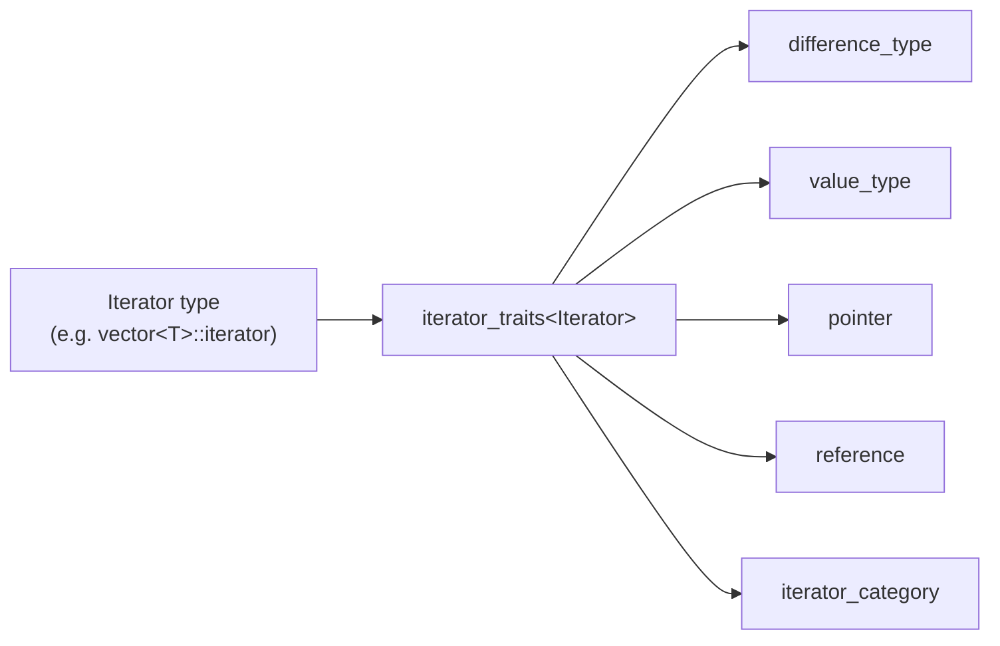

## One-sentence definition

`iterator_traits` is a standard-library Traits template that bundles the
associated types of an [[concepts/iterators|iterator]] (its value type,
difference type, pointer/reference types, and category) into one place so
generic code can query them uniformly (§0.5.8.2).

## Problem it solves

A generic algorithm written over an arbitrary iterator type `Iter` (e.g. a
`search` function working on any container) needs to name types that depend
on `Iter` — "the type of value this iterator points to", "the type used to
measure distance between two iterators" — without hard-coding a concrete
container's type names. [[concepts/type-traits]] in general, and
`iterator_traits` specifically, solve this by defining a small set of
dependent type names (*Typfunktionen*, type functions) that every
conforming iterator type exposes the same way.

## Traits of the standard library (§0.5.8.1)

Traits (*Merkmale*, *Eigenschaften* — features/properties) serve to bind
properties to a type; they are a kind of bundle of type functions. The
standard library makes heavy use of them, for example: `allocator_traits`,
`char_traits`, `iterator_traits`, `regex_traits`, `pointer_traits`,
`time_traits`, `type_traits`. See [[concepts/type-traits]] for the general
mechanism this specializes.

## `iterator_traits` (§0.5.8.2)

The template class `iterator_traits` defines the properties of an iterator
type by forwarding its nested type names:



> [!note] Scope of this diagram
> The notes list exactly these five associated types for `iterator_traits`
> (§0.5.8.2) and give no further structure to draw: they do not mention an
> iterator-category hierarchy (input/output/forward/bidirectional/
> random-access) and do not show a `iterator_traits<T*>` pointer
> specialization anywhere in §0.5.8.2–§0.5.8.3. Both are standard-library
> features in principle, but inventing them here would go beyond what this
> source states, so they are intentionally omitted rather than guessed.

```cpp
template<typename Iterator> struct iterator_traits {
    using difference_type = typename Iterator::difference_type;
    using value_type = typename Iterator::value_type;
    using pointer = typename Iterator::pointer;
    using reference = typename Iterator::reference;
    using iterator_category= typename Iterator::iterator_category;
};
```

Because `Iterator::difference_type` and friends are *types* (Typen), not
values, and the compiler would otherwise interpret a dependent name
(*abhängige Variable*) as a value, the `typename` keyword is required
directly in front of each one.

```cpp
template<typename Iter>
Iter search(Iter p, Iter q,
            typename iterator_traits<Iter>::value_type val) {
    typename iterator_traits<Iter>::difference_type m = q-p;
    // ...
}
```

## Iterator with a simple type function (§0.5.8.3)

The same `search` example, made leaner by introducing alias templates
("simple type functions") instead of using `iterator_traits<Iter>::X`
inline each time:

```cpp
template<typename T>
using Value_type = typename std::iterator_traits<T>::value_type;
template<typename T>
using Diff_type = typename std::iterator_traits<T>::difference_type;
template<typename T>
using Iter_category= typename std::iterator_traits<T>::iterator_category;
template<typename Iter>
Iter search(Iter p, Iter q, Value_type<Iter> val) {
    Diff_type<Iter> m = q-p;
    ... }
```

Even leaner, the notes show replacing Traits entirely with `decltype()`
where the exact type does not need to be *named* at all, only used:

```cpp
template<typename Iter, typename Val>
Iter search(Iter p, Iter q, Val val) {
    auto x = *p; // wenn wir den Typ von *p nicht benennen müssen
    auto m = q-p; // wenn wir den Typ von q-p nicht benennen müssen
    using value_type = decltype(*p); // wenn wir Typ von *p benennen müssen
    using Diff_type = decltype(q-p); // wenn wir Typ von q-p benennen müssen
    ... }
```

Read: "`auto`/`decltype` when we do/don't need to name the type of `*p` or
`q-p`."

## Consequences / trade-offs

- `iterator_traits<Iter>::value_type` (and friends) let a template function
  declare local variables and parameters of "whatever type this iterator
  works with" without the caller needing to spell that type out.
- The alias-template form (`Value_type<Iter>`) is purely a readability
  improvement over writing `typename iterator_traits<Iter>::value_type`
  everywhere — it does not change what is computed.
- `decltype()` can replace Traits entirely for the specific cases where the
  type only needs to be *used* (via `auto`), not *named* — but naming is
  still needed wherever the type must appear in a signature or declaration
  that is not itself an expression's result.

## Misuse & anti-patterns

- Forgetting the `typename` keyword in front of a dependent type name such as
  `Iterator::value_type` inside a template — the compiler treats a dependent
  name as a value by default, so this is a compile error, not silently wrong
  code (§0.5.8.2).

## Related
- [[concepts/iterators]]
- [[concepts/type-traits]]
- [[concepts/templates]]
- [[concepts/stl-containers]]

## Sources
- [[sources/grigat-cpp-concepts-generic]] §0.5.8.1, §0.5.8.2, §0.5.8.3
