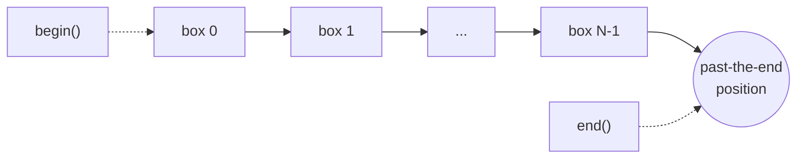

## One-sentence definition

An iterator (*Iterator*) is an abstraction of a pointer to an element of a
sequence (container), letting code traverse (*Traversierung*) a container
uniformly regardless of its internal structure (§0.5.7.1).

## Problem it solves

A [[structures/vector]] stores elements contiguously, a [[structures/list]]
stores them as linked nodes, and [[structures/set-and-map]] store them in a
sorted structure — yet code that just wants to "visit every element in
order" should not need a different access style for each. Iterators give a
single small interface (dereference, advance, compare) that works across all
of them, so algorithms in [[concepts/stl-containers]] can be written once
against iterators instead of once per container.

## Iterator definition (§0.5.7.1)

- Iterators of the standard library (std) are classes, defined in the
  namespace of their container, for traversing it.
- Each instance of a std-iterator represents a *position* in a container.
- Every container "knows" two iterator classes:
  1. `container::iterator` — traverses elements in read/write mode.
  2. `container::const_iterator` — traverses elements in read-only mode.

## Operators for iterators (§0.5.7.2)

For iterators `pos1`, `pos2`:

| Operator | Name | Meaning |
|---|---|---|
| `*pos1` | Inhaltsoperator (dereference) | access the element at the current position |
| `++pos1` / `--pos1` | increment/decrement | step forward/backward |
| `pos1==pos2` / `pos1!=pos2` | comparison | compare the positions represented by two iterators |
| `pos1=pos2` | Zuweisungsoperator (assignment) | assigns the position represented by `pos2` to `pos1` |

These operators correspond initially to the equivalent operators for raw
pointers in C and C++ (see [[concepts/pointers-and-references]]). The
difference: iterators are "intelligent" pointers that can iterate over
arbitrarily complicated data structures (e.g. a tree-backed
[[structures/set-and-map]]), not just flat arrays.

## Containers and iterators: begin()/end() (§0.5.7.3)

- `begin()` returns an iterator pointing to the *first* element.
- `end()` returns an iterator pointing to the position *behind* (hinter) the
  last element — one-past-the-end.
- `begin()` and `end()` are members of every container.
- The range `[begin(), end())` is therefore **half-open**: `begin()` is
  included, `end()` is not a valid dereferenceable position.



## Pseudocode: generic traversal loop

```
1. procedure traverse(container):
2.     pos ← container.begin()
3.     while pos != container.end():
4.         visit(*pos)        // dereference: access element at pos
5.         pos ← pos + 1      // increment: advance to next position
6.     // loop stops before dereferencing end(); the range is half-open
```

## Reference implementation / usage examples (§0.5.7.3)

```cpp
vector<int>::const_iterator pos;
for(pos = vec.begin(); pos != vec.end(); ++pos){
  cout<< *pos << ' ';
}
cout << endl;
```

```cpp
std::map<int, std::string> Student;
Student.insert(std::make_pair(18789, "Daniel"));
Student.insert(std::make_pair(16945, "Anna"));
Student.insert(std::make_pair(20852, "Patrik"));
Student.insert(std::make_pair(21953, "Michael"));

std::map<int, std::string>::iterator pos;
for(pos = Student.begin(); pos != Student.end(); ++pos)
{
  std::cout << pos->first << ':';
  std::cout << pos->second << std::endl;
}
std::cout << std::endl;
```

`pos->first` is translated by the compiler into `(*pos).first`, exactly as
with raw pointers; `first` and `second` are the member variables of
`pair<T1, T2>` (§0.5.7.3).

## `iterator` vs. `const_iterator`

| | `iterator` | `const_iterator` |
|---|---|---|
| Access mode | read/write | read-only |
| Use when | the loop body mutates elements | the loop body only inspects elements |

## Consequences / trade-offs

- Writing algorithms against the small, uniform iterator interface
  (dereference/increment/compare/assign) rather than against each
  container's native access style is what lets the free functions in
  [[algorithms/stl-algorithms]] work across [[structures/vector]],
  [[structures/list]], [[structures/set-and-map]], etc. unmodified.
- The half-open convention `[begin(), end())` means `end()` itself must never
  be dereferenced — only compared against.

## Misuse & anti-patterns

- Mixing `begin()`/`end()` iterators obtained from two *different* container
  instances in one algorithm call is syntactically valid but produces
  undefined behavior — the compiler will not catch it (§0.5.9.2, noted on the
  closely related topic of algorithm ranges).
- Using a plain `iterator` where a `const_iterator` would document
  read-only intent more precisely.

## Related
- [[concepts/stl-containers]]
- [[concepts/iterator-traits]]
- [[structures/vector]]
- [[structures/list]]
- [[concepts/pointers-and-references]]
- [[algorithms/stl-algorithms]]

## Sources
- [[sources/grigat-cpp-concepts-generic]] §0.5.7.1, §0.5.7.2, §0.5.7.3
