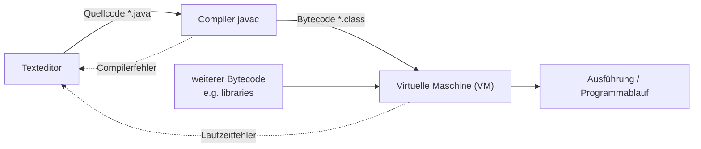

## Definition

Java source files (`*.java`) are translated by the `javac` **compiler** into
**bytecode** (`*.class`), which is not executed by the operating system directly
but **interpreted by the Java Virtual Machine (VM)** (§0.8.3.1–0.8.3.3). This
compile/run pipeline has no equivalent step in C++'s direct-to-machine-code
model (§0.8.1.1).

## Problem it solves

Compiling straight to native machine code (C++'s model) ties the compiled
artifact to one CPU/OS combination. Java instead compiles to a portable
intermediate representation (bytecode) and defers the final interpretation step
to a virtual machine, so the same `.class`/`.jar` files can run wherever a
compatible JVM exists.

## The pipeline (Abbildung 50: "Java: Schritte vom Quelltext zum Programm")



### Numbered pseudocode of the pipeline

```
1. Kompilierung von *.java-Dateien zu *.class-Dateien
   (Compilation of *.java files into *.class files)
2. Interpretierung der *.class-Dateien durch die Virtual Machine
   (Interpretation of the *.class files by the Virtual Machine)
```

## The compiler (§0.8.3.2)

- Each class from a `*.java` file is compiled into a **separate** `*.class`
  file. If a `*.java` file contains multiple class definitions, multiple
  `*.class` files are produced.
- Each `*.java` file may contain only **one** `public` class.
- Bytecode cannot be executed directly by the operating system — this rule has
  no C++ counterpart (C++ allows an arbitrary number of classes per file
  freely, and compiles straight to native machine code).

## The Virtual Machine (§0.8.3.3)

- A Java program consists, in principle, only of `*.class` files.
- Multiple `*.class` files can be bundled (and compressed) into one `*.jar`
  file (**Java Archive**).
- `*.class` and `*.jar` files are interpreted at runtime by the VM.
- Search paths for these files are set via the system variable **CLASSPATH**;
  the current directory `.` must be explicitly added to CLASSPATH.
- To start a Java program, the VM is given the name of a class, and the
  static `main` method of that class is executed.

```java
// HelloWorldApp.java
public class HelloWorldApp
{
        public static void main(String[] args)
        {
                System.out.println("Hello World!");
        }
}
```

```cpp
// C++
#include <iostream>
using namespace std;
int main()
{
        cout << "Hello World!" << endl;
        return 0;
}
```

**Hello World contrasts (§0.8.1.2–0.8.1.3):**

| Aspect | C++ | Java |
|---|---|---|
| Placement of `main` | Global function, outside any class | Static method inside a class |
| File naming | Arbitrary | Must match the public class name exactly |
| Return type of `main` | Always `int` | Always `void`, never returns a value |
| Uniqueness of `main` | Exactly one per program | Every public class may contain one — potentially several in a program |

## Compared with C++

See [[concepts/modularization-and-build-pipeline]] for the C++ side of
compilation and linking: C++ translates each translation unit directly to
object code, then links those object files and libraries into one native
executable that the OS runs directly. Java instead keeps a VM between compiled
code and execution for every run, trading a build step (linking to one binary)
for a portability/indirection step (interpreting bytecode under a VM). Also see
[[concepts/java-vs-cpp]] for the full comparison table.

## Consequences / trade-offs

- Portability: the same `.class`/`.jar` runs on any machine with a compatible
  JVM, unlike a natively-compiled C++ binary.
- Indirection cost: an interpretation/VM layer sits between compiled bytecode
  and actual execution, which has no equivalent in the C++ pipeline.
- Build granularity: one `.class` file per class (vs. one object file per
  translation unit in C++, which can contain many classes).

## Misuse & anti-patterns

- Putting more than one `public` class in a single `.java` file — this is a
  compile error in Java, with no equivalent restriction in C++.
- Forgetting to add `.` to CLASSPATH and then being unable to find classes in
  the current directory.

## Open questions

- The script does not state how the JVM interprets bytecode (interpreter vs.
  JIT compilation) — no claim about execution strategy beyond "interpreted" is
  made here, since the source does not elaborate.

## Related

- [[concepts/java-vs-cpp]]
- [[concepts/java-packages]]
- [[concepts/modularization-and-build-pipeline]]

## Sources

[[sources/grigat-java]] §0.8.3.1, §0.8.3.2, §0.8.3.3, §0.8.1.2, §0.8.1.3
