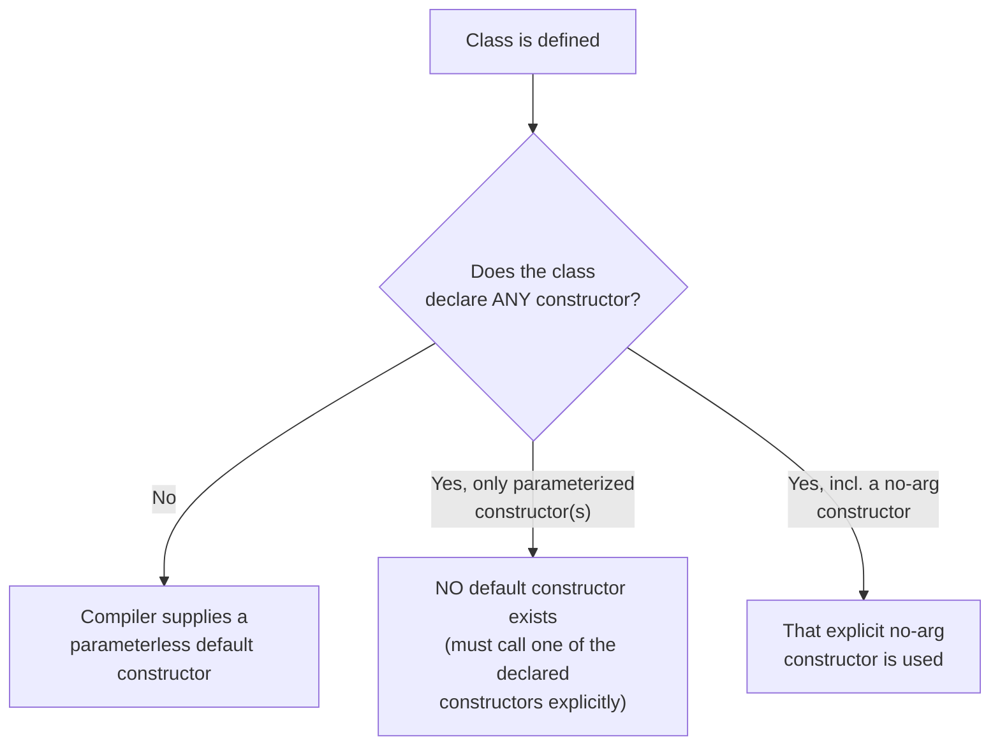
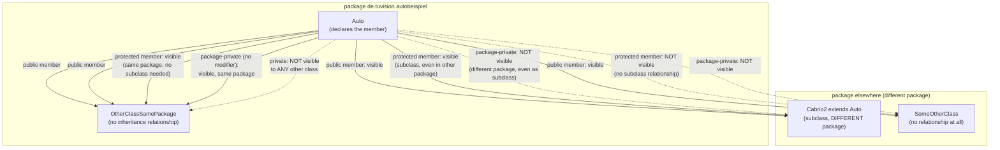
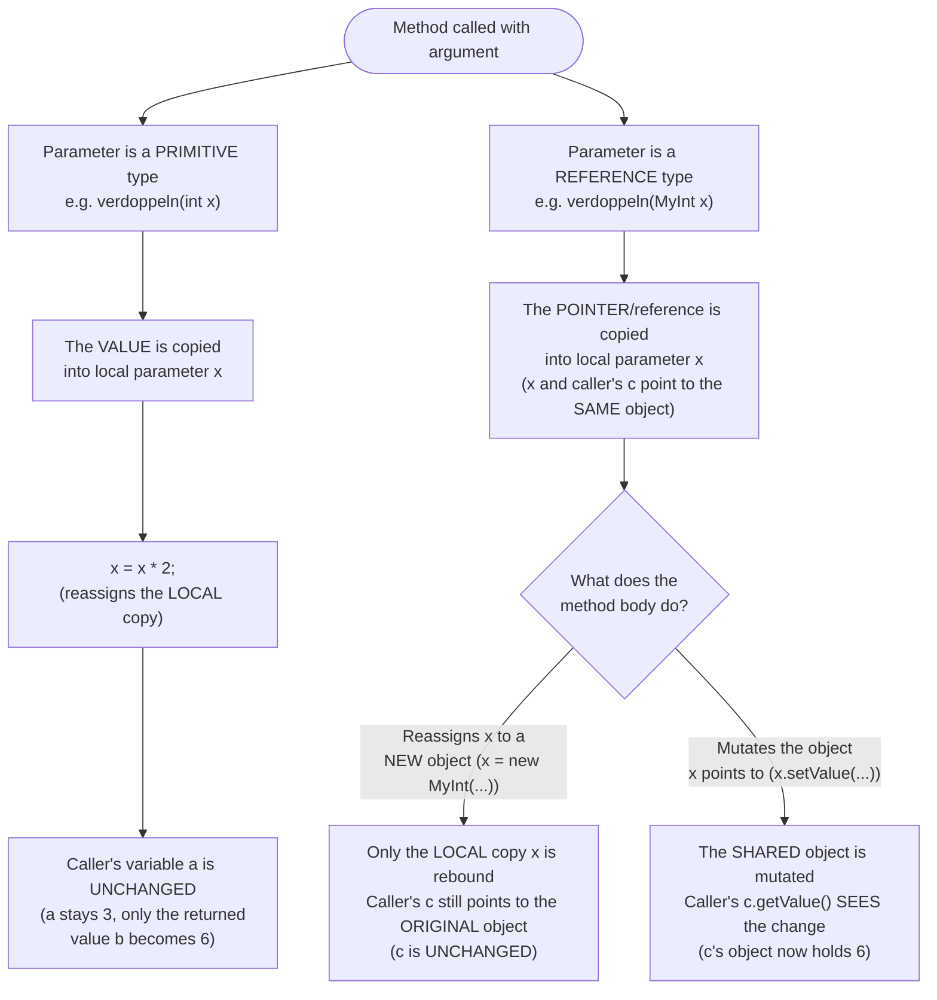

## Definition

In Java there is **no separation** of class definition and method definition
(§0.8.4): methods are always defined *inside* a class, with no header files.
This page covers constructors, the visibility-modifier system, static members,
and call-by-value-only parameter passing — the structural rules for a Java
class and its members.

## Constructors (§0.8.4.1)

- Called upon creation of an object (*Erzeugung eines Objektes*).
- Allows initial assignment of variables.
  - Without explicit initialization in the declaration, member and static
    variables are **automatically** initialized (`0`, `\0`, `false`, `null`).
    An assignment inside the constructor is therefore considered a
    *Zuweisung* (assignment), not an initialization.
  - This does **not** apply to local variables: they must be explicitly
    initialized before first use, or the compiler raises an error.
- Has no return value; its name is identical to the class name.
- The compiler supplies a parameterless **default constructor** if no own
  constructor is defined.
- **Default values as arguments are NOT allowed in Java** — unlike C++, there
  are no default parameter values for constructors (or methods, §0.8.6).



```java
// Auto.java
package de.tuvision.autobeispiel;
public class Auto {
  public Auto () {
    farbe = "rot"; // Zuweisung
  }
  public Auto (String farbe) {
    this.farbe = farbe; // Zuweisung
                        // this: Referenz auf aktuelle Instanz,
                        // noetig wegen Doppeldeutigkeit von farbe
                        // (Parameter bzw. Instanzvariable)
  }
  public String farbe (){
    return farbe;
  }
  public void lackiere (String farbe) {
    this.farbe = farbe;
  }
  private String farbe; // Instanzvariable
}
```

`this` is explicitly explained as "Referenz auf aktuelle Instanz" (a reference
to the current instance), needed here because of the ambiguity between the
parameter name `farbe` and the instance variable `farbe` of the same name.

## Visibility modifiers table (§0.8.4, §0.8.8.3)

| Sichtbarkeit | von Klassen(typ) | von Variablen und Methoden |
|---|---|---|
| kein Modifikator (no modifier) | im eigenen Paket (package-private) | im eigenen Paket (package-private) |
| `public` | öffentlich (public everywhere) | öffentlich (public everywhere) |
| `private` | nur inner class: sichtbar in äußerer Klasse | nur in eigener Klasse |
| `protected` | nur inner class: sichtbar wie protected Var. | in eigener Klasse, abgeleiteten Klassen, allen Memberfunktionen des eigenen Pakets |
| `final` | Vererbung verhindert | Konstanten; kein Überschreiben der Methode in Subklassen |
| `abstract` | abstrakte Klasse | abstrakte Methoden |
| `static` | nur static nested class | statische Variablen (Klassenvariablen), statische Methoden (Klassenmethoden) |

Top-level classes: **no** `private` or `protected` top-level classes exist in
Java — only inner classes may be `private`/`protected` (see
[[concepts/java-nested-classes]]). Package-private (no modifier) visibility has
**no direct equivalent keyword in C++**, which only has `public`/`protected`/
`private`. The script explicitly compares package-private access to C++
`friend`: "vgl. `friend` in C++: expliziter Zugriff für Klassen erlauben" —
Java's package-private is analogous in spirit, implemented at package
granularity instead of via an explicit friend declaration.

```java
//Hupe.java
package de.tuvision.autobeispiel;
class Hupe {           // nicht public — nur innerhalb Paket sichtbar
  Hupe (String ton, int staerke) {
     this.ton = ton;
     this.staerke = staerke;
  }
  void hupen (int laenge) { /* ... */ }
  private String ton;        //nur in Hupe sichbar
  private int staerke;
}
```

`final` serves double duty in Java: it prevents inheritance (on a class) and
prevents method overriding / marks constants (on methods/variables) —
partially analogous to C++ `const` (constants) and C++11 `final` (prevent
overriding/inheriting), but Java unifies both under one keyword.

### Diagram: who can see a member?

The non-obvious parts of the table above are that **package-private is the
default** (no modifier at all) and that **`protected` also grants access to
the whole owning package**, not just to subclasses — unlike C++ `protected`,
which never grants access by package/directory, only to derived classes.



The two dotted-vs-solid contrasts to notice: a package-private member is
invisible to a subclass sitting in another package (inheritance alone does not
cross the package boundary), while a `protected` member *is* visible to a
plain, non-subclass sibling class as long as it shares the same package — in
C++, `protected` never grants that sibling-in-same-translation-unit access;
only derivation does.

## Static members (§0.8.6.3–0.8.6.4)

```java
//Auto.java
package de.tuvision.autobeispiel;
public class Auto {
  public Auto () {
    this.farbe = "rot"; // Initialisierung
  }

  public static void setTacho_kmph(boolean x){
    tacho_kmph = x;
  }
  private static boolean tacho_kmph = true;
    // Initialisierung direkt in Klassendefinition,
    // in C++: Initialisierung immer außerhalb Klassendef.
  private String farbe;

  public static void main (String[] args) {
    Auto.setTacho_kmph(false); // noch kein Objekt erzeugt
                   //in C++: Auto::setTacho_kmph(false);
    Auto erstwagen = new Auto ();
  }
}
```

| Aspect | C++ | Java |
|---|---|---|
| Static member initialization | Always **outside** the class definition (e.g. in the `.cpp` file) | Directly **inside** the class definition |
| Static method call syntax | `Auto::setTacho_kmph(false);` (scope-resolution `::`) | `Auto.setTacho_kmph(false);` (dot notation on the class name) |
| Static method callable before any instance exists | Yes | Yes (demonstrated: `Auto.setTacho_kmph(false)` called before `new Auto()`) |
| Static methods and non-static members | Static methods cannot access non-static member variables — "ebenso wie in C++" (just as in C++) | Same rule |

## Method parameter passing — call-by-value only (§0.8.6, §0.8.6.1–0.8.6.2)

Methods are always part of a class; overloading and overriding are both
possible; **default arguments are not allowed**, consistent with constructors.
For parameter passing:

- Primitive types: *call by value*.
- Reference types: *call by value* **(!)** — "kein call by reference in
  Java!" (no call-by-reference in Java).

### Diagram: two parallel call-by-value paths



**Primitives — a true copy:**

```java
//Verdoppler.java
package de.tuvision.beispiel;
public class Verdoppler {
  public Verdoppler () {}
  public int verdoppeln (int x) {
    x = x * 2;
    return x;
  }
  public static void main (String[] args) {
    Verdoppler v = new Verdoppler ();
    int a = 3;
    int b = v.verdoppeln (a); // call by value
    System.out.println (a + ", " + b);  // prints: 3, 6
  }
}
```

```
Pseudocode: parameter passing for primitives
1. Define method verdoppeln(int x): sets local copy x = x*2, returns x
2. Call b = v.verdoppeln(a) with a=3
3. Inside method, x is a COPY of a; modifying x does not affect caller's a
4. a remains 3 after the call; b receives the returned doubled value (6)
```

**Reference types — a copy of the pointer (shallow copy of a pointer):**

```java
class MyInt {
  int x;
  public MyInt(int x) { this.x = x; }
  public int getValue(){ return this.x; }
  public void setValue(int x){ this.x = x; }
}

public class Verdoppler {
  public MyInt verdoppeln (MyInt x) {
    x.setValue(x.getValue()*2);
    return x;
  }
  public static void main (String[] args) {
    Verdoppler v = new Verdoppler ();
    MyInt c = new MyInt(3);
    v.verdoppeln(c); //call by value
    System.out.println (c.getValue());  // prints: 6
  }
}
```

```
Pseudocode: parameter passing for reference types
1. Define method verdoppeln(MyInt x): calls x.setValue(x.getValue()*2); returns x
   (x here is a COPY of the pointer/reference passed in, but it still points
    to the SAME underlying object as the caller's variable)
2. Call v.verdoppeln(c) with c pointing to an object with value 3
3. Inside method, x (copy of pointer) and c (original pointer) point to the SAME object
4. Modifying the object through x.setValue(...) is visible through c too
5. After the call, c.getValue() returns 6 (the object was mutated, not the pointer rebound)
```

This cements the core message: Java "call by value" for object/reference-type
parameters passes a **copy of the pointer** — the callee can mutate the
pointed-to object (visible to the caller) but cannot rebind the caller's
variable to a different object. This is functionally like passing a raw
pointer by value in C++ (`void f(T* p)`), **not** like passing by reference in
C++ (`void f(T& r)`).

## Composition ("hat eine") (§0.8.7)

```java
//Hupe.java
package de.tuvision.autobeispiel;
public class Hupe {
  public Hupe(String ton, int staerke) {
    this.ton = ton;
    this.staerke = staerke;
  }
  public void hupen (int laenge) { /* ... */ }
  private String ton;
  private int staerke;
}
```

```java
//Auto.java
package de.tuvision.autobeispiel;
public class Auto {
  public Auto () {
    this.farbe = "rot";
  }
  public Hupe hupe = new Hupe("hohes C", 128);
  private String farbe;
}
```

Java allows field initializers inline in the class body (including calling
`new`) to express "has-a" composition directly, similarly expressible in C++
via member initializer lists or in-class default member initializers (C++11+).

## Compared with C++

| Aspect | C++ | Java |
|---|---|---|
| Method bodies | Can live outside the class (`.cpp` file) | Always live inside the class body |
| Default parameter values | Allowed | **Not allowed**, for constructors or methods |
| Static member initialization | Outside the class definition | Inside the class definition |
| Static access syntax | `Class::method()` | `Class.method()` |
| Package-private visibility | No equivalent (closest analogue: `friend`) | A first-class visibility level |
| Parameter passing | Call-by-value, call-by-reference, call-by-pointer | Call-by-value only (incl. for references — a copy of the pointer) |

See [[concepts/constructor]], [[concepts/access-modifiers]],
[[concepts/static-members]], and [[concepts/parameter-passing]] for the C++
mechanics this page contrasts against, and [[concepts/java-vs-cpp]] for the
master table.

## Consequences / trade-offs

- No default parameter values forces explicit overloads for every parameter
  combination a C++ constructor/method would otherwise cover with defaults.
- Package-private visibility gives a coarse-grained, filesystem-tied access
  level with no C++ equivalent keyword.
- Call-by-value-only for references is simpler to reason about than C++'s
  three parameter-passing mechanisms, at the cost of true call-by-reference
  semantics (rebinding the caller's variable) being unavailable.

## Misuse & anti-patterns

- Expecting `new Auto` to compile without parentheses, by analogy to C++.
- Trying to give a Java constructor/method a default argument value.
- Assuming a Java method parameter of reference type can rebind the caller's
  variable — it can only mutate the shared object, never rebind the caller.

## Open questions

- The script does not elaborate on constructor overloading resolution rules
  beyond what's implied by the examples; no additional claim is made here.

## Related

- [[concepts/java-vs-cpp]]
- [[concepts/constructor]]
- [[concepts/access-modifiers]]
- [[concepts/static-members]]
- [[concepts/parameter-passing]]
- [[concepts/java-nested-classes]]
- [[concepts/java-inheritance-and-interfaces]]
- [[concepts/this-pointer]]

## Sources

[[sources/grigat-java]] §0.8.4, §0.8.4.1, §0.8.6, §0.8.6.1, §0.8.6.2, §0.8.6.3,
§0.8.6.4, §0.8.7, §0.8.8.3
