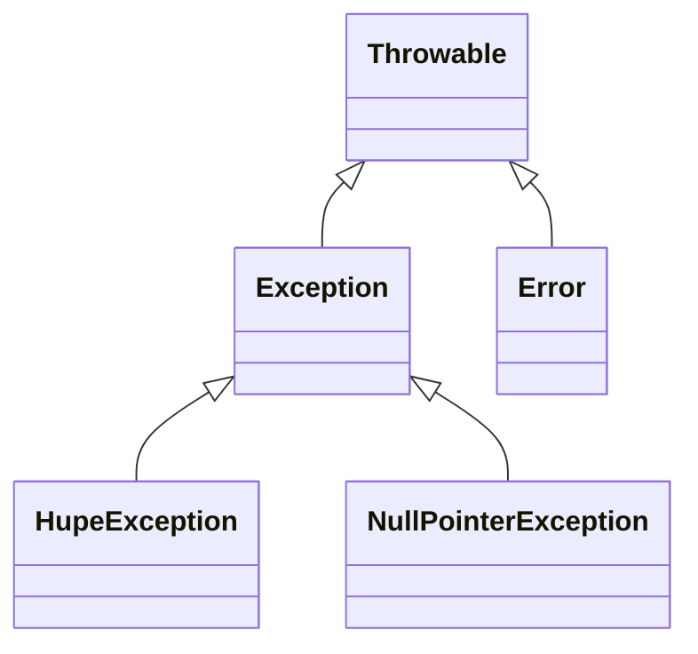

## Definition

Java exception handling (§0.8.10, *Ausnahmen*) uses `throw`/`try`/`catch`, an
optional `finally` block, and `throws` in a method declaration to list
propagated exception types. Java additionally enforces **checked exceptions**:
the compiler verifies that checked exceptions are either caught or declared,
which has **no C++ equivalent**.

## Throwing an exception (§0.8.10.1)

Throwing is done with `throw`. Like all objects, an exception must be created
with `new`. All exceptions are derived from class `Exception`.

```java
if(t == null)
  throw new NullPointerException();
```

## Catching an exception (§0.8.10.2–0.8.10.3)

`try { Anweisungsblock }` and `catch` catch exceptions; Java additionally has
an optional `finally` block, executed either when all statements in `try`
executed successfully, or when the corresponding `catch` block is exited
(even via a renewed `throw`).

```java
void hupen (int laenge) {
  try{
    if (laenge > 5) throw new Exception ("zu lang ");
      /* ... */
  }
  catch (Exception e){
    System.err.println("Fehler in Hupe: " + e.getMessage());
  }
  finally{ // wird in jedem Fall ausgeführt
    System.out.println("Hupen beendet");
  }
}
```

`Exception.getMessage()` returns the String ("zu lang") passed to the
constructor.

## The Throwable hierarchy (§0.8.10.4)

Java allows multiple `catch` blocks; only the *first* block whose parameter
type matches the thrown exception is executed (same matching order as C++).
All exceptions derive from `Exception` and are also caught by
`catch (Exception e)`. All critical runtime errors that cannot be reliably
caught derive from `Error` and should **not** be caught. `Exception` and
`Error` are both derived from `Throwable`.



## Custom exceptions (§0.8.10.5)

Custom error classes must be derived from `Exception`. `super` can explicitly
call the constructor of `Exception`, passing an error message, retrievable
later via `getMessage()`.

```java
// HupeException.java
package de.tuvision.autobeispiel;
public class HupeException extends Exception{
  public HupeException () {}
  public HupeException (String meldung){
    super (meldung); // expliziter Aufruf des Konstruktors von Exception
  }
}
```

## Propagating exceptions — `throws` and checked exceptions (§0.8.10.6–0.8.10.8)

Exceptions can be propagated from inside a method to the outside. With
`throws`, the exception classes a method can throw/propagate outward are
listed in the method declaration. Calling a method whose declaration lists
`throws E` must either:

- stand within a `try` block with a matching `catch` (propagation terminates
  here), or
- itself stand within an outer method whose own declaration also lists `throws
  E` (propagation continues recursively upward).

**Case 1 — `throws` in the callee, `try` one level up:**

```java
class Hupe {
  void hupen (int laenge) throws HupeException {
      if (laenge > 5) throw new HupeException ("zu lang ");
      /* ... */     // nicht verwechseln: throws und throw
  }
}
```
```java
class Auto {
  public void hupenAuto (int laenge) {
   try{   // Fall 1: throws in hupen, try in Stufe darüber
      this.hupe.hupen (laenge);     // this. kann auch weggelassen werden
   }
   catch (HupeException e){
     System.err.println ("Hupenfehler: " + e.getMessage ());
   }
  }
  private Hupe hupe = new Hupe ("hohes C", 128);
}
```

**Case 2 — `throws` propagated through both callee and caller, no `try` yet:**

```java
class Hupe {
  void hupen (int laenge) throws HupeException { //aufgerufene Methode
      if (laenge > 5) throw new HupeException ("zu lang ");
      /* ... */
  }
}
```
```java
class Auto { // Fall 2: throws in hupen und auch in hupenAuto darüber
  public void hupenAuto (int laenge) throws HupeException{
                 // aufrufende Methode
                 // Compilerfehler, falls throws HupeException fehlt
                 // try-Block weiter außerhalb erforderlich
     this.hupe.hupen (laenge);
  }
  private Hupe hupe = new Hupe ("hohes C", 128);
}
```

### Pseudocode: checked-exception propagation rule

```
1. Method M calls method N, where N declares `throws E`.
2. IF the call to N is wrapped in a try { } with a matching catch(E), THEN:
     propagation of E terminates at this level.
   ELSE:
     M itself must declare `throws E` in its own signature,
     so the compiler allows the unguarded call to N;
     E propagates further up to M's caller (go to step 1, with M in place of N).
3. Compiler error if a checked exception is neither caught nor declared via throws.
```

## Compared with C++

| Aspect | C++ | Java |
|---|---|---|
| Throw / catch | `throw`, `try`/`catch` | `throw`, `try`/`catch`, matching order identical |
| Guaranteed cleanup | No `finally` keyword — RAII/destructors fill this role | Explicit `finally` block, always executed |
| Checked exceptions | None — exception specifications were deprecated/removed; all exceptions are effectively unchecked | `throws` is compiler-enforced: checked exceptions must be caught or declared |
| Exception hierarchy root | No single root exception type mandated by the language | `Throwable`, with `Exception`/`Error` beneath it, mandatory |
| Custom exceptions | Derive from `std::exception` (or anything throwable) | Must derive from `Exception` |

C++'s RAII/destructor model (see [[concepts/destructor]]) is explicitly the
role-filler for Java's `finally`: C++ guarantees cleanup by tying it to object
lifetime (scope exit), whereas Java guarantees it by syntactically requiring a
`finally` block. See [[concepts/exceptions]] for the full C++ mechanics, and
[[concepts/java-vs-cpp]] for the master comparison table.

## Consequences / trade-offs

- Checked exceptions force every call site to acknowledge an exception type
  (catch or declare), at the cost of "throws-clause proliferation" up a call
  chain (Case 2 above).
- `finally` gives a syntactic, always-run cleanup block without relying on
  object destructors — useful in a language that has no destructors at all
  (see [[concepts/garbage-collection]]).

## Misuse & anti-patterns

- Confusing `throws` (declaration) and `throw` (statement) — the script
  explicitly flags this ("nicht verwechseln: throws und throw").
- Catching `Error` subclasses, which the script states should **not** be
  caught (critical runtime errors).
- Forgetting to declare `throws E` on an intermediate method when a checked
  exception is neither caught nor otherwise declared — a compiler error.

## Open questions

- The script does not state whether Java distinguishes checked vs. unchecked
  (`RuntimeException`) exceptions explicitly in the transcribed pages beyond
  implying `Exception`/`Error` are the two main branches — the checked/
  unchecked split under `Exception` itself (e.g. `RuntimeException` being
  unchecked) is not described here and is not asserted.

## Related

- [[concepts/java-vs-cpp]]
- [[concepts/exceptions]]
- [[concepts/destructor]]
- [[concepts/java-inheritance-and-interfaces]]
- [[concepts/java-classes-and-members]]

## Sources

[[sources/grigat-java]] §0.8.10, §0.8.10.1, §0.8.10.2, §0.8.10.3, §0.8.10.4,
§0.8.10.5, §0.8.10.6, §0.8.10.7, §0.8.10.8
