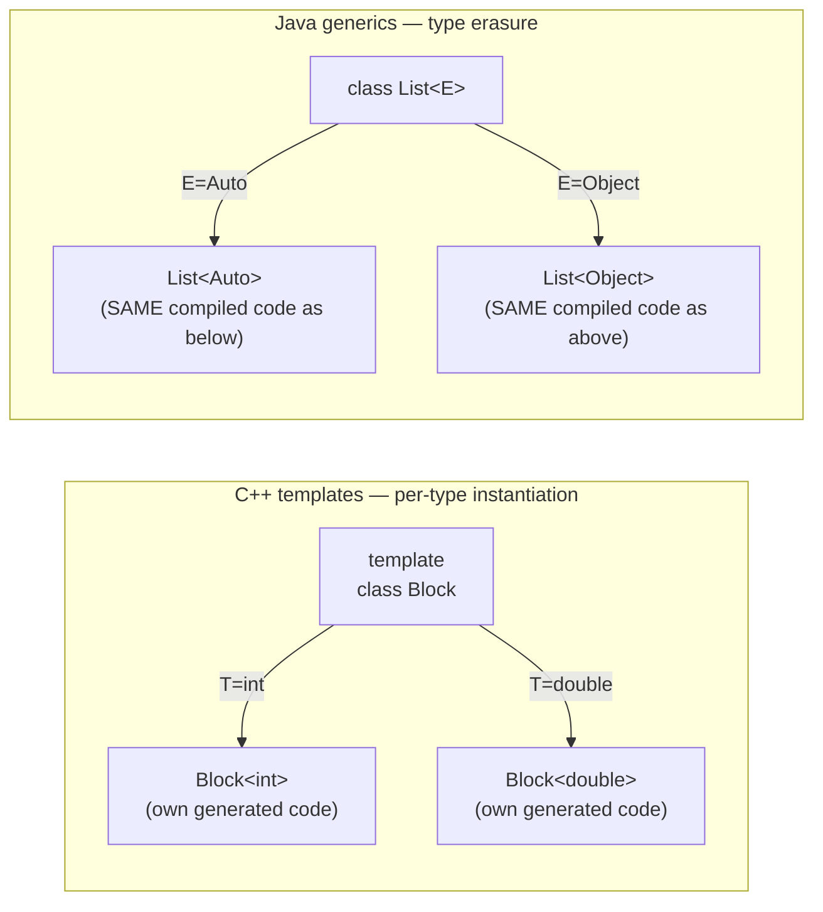

## Definition

§0.8.12 ("Generische Programmierung in Java") introduces Java **Generics**,
available since JDK 1.5, explicitly flagged as **not to be confused with C++
Templates** (*nicht verwechseln mit C++ Templates*). Reference cited by the
script: Gilad Bracha, "Generics in the Java Programming Language" (2004,
java.sun.com/j2se/1.5/pdf/generics-tutorial.pdf); a JVM 1.5 or higher is
required to run programs using Generics.

## Problem it solves

Without Generics, Collections (Java's analogue of C++ Containers, see
[[concepts/stl-containers]]) always store the type `Object`, forcing an
explicit cast back to the concrete type at every retrieval (§0.8.12.1):

```java
List autoListe = new LinkedList(); // LinkedList abgeleitet von List
autoListe.add (new Auto());
Auto erstwagen = (Auto) autoListe.iterator().next(); // Cast zwingend
```

**With Generics**, the element type is declared once and the compiler removes
the need for a cast (§0.8.12.2):

```java
List<Auto> autoListe = new LinkedList<Auto>();
autoListe.add (new Auto ());
Auto x = autoListe.iterator().next();          // Kein Cast nötig
```

## Definition of a Generic type (§0.8.12.2)

```java
public interface List<E> {
  void add (E x);
  Iterator<E> iterator ();
}
public interface Iterator<E> {
  E next ();
  boolean hasNext ();
}
```

Convention: for Collections, `<E>` is often used as the type parameter (stands
for *Element*).

## TYPE ERASURE — the critical contrast with C++ templates (§0.8.12.2)

`List<Auto>` creates **no** additional program code in which `<E>` is replaced
by `<Auto>`. Every definition of a Generics class exists **exactly once**.

> **Stated difference to C++ Templates:** C++ templates are instantiated per
> concrete type (generating separate code for each instantiation — see
> [[concepts/templates]]), whereas Java Generics compile to a **single shared
> implementation** (type erasure) regardless of the type parameter used.



## Non-covariance of generics (§0.8.12.3)

```java
List<Auto> autoListe = new LinkedList<Auto>();
List<Object> objectListe = autoListe; // Fehler!
```

- Line 1 is allowed: `List<E>` is a base interface to `LinkedList<E>`.
- Line 2 is **not** allowed: even though `Object` is a base class of `Auto`,
  `List<Object>` is **not** a base type of `List<Auto>`.

**Why this rule exists** — if line 2 were allowed:

```java
objectListe.add(new Object());
```

would let an arbitrary `Object` be added into what is really an `autoListe`
(which should only ever hold `Auto` or subtypes). The compiler rejects line 2
precisely to prevent this — a type-safety guarantee. This differs from array
covariance in Java (arrays *are* covariant, unlike generics).

## Wildcards (§0.8.12.4–0.8.12.6, §0.8.12.8)

**Problem:** `List<Object>` is not a base type of `List<Auto>`, so a method
typed `List<Object>` cannot be called with a `List<Auto>` argument:

```java
void printListe (List<Object> liste) { /* ... */ }  // cannot accept List<Auto>
```

**Solution — wildcards (`?`, "unknown type"):**

```java
void printListe (List<?> liste) {
 Iterator i = liste.iterator ();
 for (int k = 0; k < liste.size (); k++) {
   System.out.println (i.next ());
 }
}

void printCollection (Collection<?> c) {
 Iterator i = c.iterator ();
 for (int k = 0; k < c.size (); k++) {
   System.out.println (i.next ());
 }
}
```

Such a method can be called with all classes derived from `Collection`.
Collections can contain any reference type (**no primitive types** — *keine
Grundtypen*); see [[concepts/java-references-and-primitives]] for wrapper
classes/boxing. All classes being derived from `Object` means it is allowed to
store elements from `Collection<?>` into variables of type `Object` — but the
reverse is rejected:

```java
Collection<?> c = new LinkedList<Auto>(); // <?> wird <Auto>
c.add( new Object() );  // Compilerfehler — wrong direction, Auto is not a base of Object
```

**Fazit:** Wildcards are *type-safe* (*typsicher*).

## The enhanced for-loop, since Java 1.5 (§0.8.12.7)

```java
void printCollection (Collection<?> c) {
  for(Object e : c){
    System.out.println(e);
  }
}
```

`for(Object e : c)` reads "for all e from c" (*„Für alle e aus c"*), removing
the need for a counting variable (*Zählvariable*). This is Java's equivalent of
C++11's range-based for loop (`for (auto& e : c)`), though introduced earlier
(Java 1.5, 2004, predates C++11's 2011 range-based for).

## Bounded wildcards (§0.8.12.9–0.8.12.11)

**Problem:** a method for a base class and classes derived from it:

```java
public void alleWaschen (List<Auto> autos) {
  for (Auto a: autos) { a.waschen(); }
}
```

`alleWaschen` can only be called for `List<Auto>`; `alleWaschen(List<Cabrio>)`
is **not** allowed, since `List<Auto>` is not a base type for `List<Cabrio>`
(non-covariance again).

**Solution — bounded wildcards:**

```java
public void alleWaschen (List<? extends Auto> autos) {
  for (Auto a: autos) { a.waschen (); }
}
```

`List<? extends Auto>` means "unknown type that is (directly) derived from
Auto"; `Auto` is the **upper bound** (*obere Schranke*) of the unknown type.
Now both `alleWaschen(List<Cabrio>)` and `alleWaschen(List<Auto>)` are allowed.

**Restriction on bounded wildcards** — the following is **not** allowed:

```java
public void addCabrios (List<? extends Auto> autos) {
  autos.add(new Cabrio());   // Fehler
}
```

`List<? extends Auto>` could be a `List<Bus>`; a `Cabrio` cannot be stored into
a `List<Bus>` since `Bus` is not a base class to `Cabrio`. The parameter type
must instead be `List<Cabrio>` for this to work.

## Generic methods (§0.8.12.12–0.8.12.15)

**Problem:** copy objects from an Array into a List. The naive attempt fails:

```java
static void vonArrayNachList (Object [] array, List<?> liste) {
  for (Object o : array) {
    liste.add (o);   // Fehler — Object cannot be stored into List<?>
} }
```

**Solution — a generic method**, introducing its own type parameter `<T>`:

```java
static <T> void vonArrayNachList (T [] array, List<T> liste) {
  for (T o : array) {
    liste.add (o);
} }

Cabrio [] cabrioArray = new Cabrio[50];
List <Cabrio> cabrioList = new LinkedList<Cabrio> ();
vonArrayNachList (cabrioArray, cabrioList);
    // T ist jetzt vom Typ Cabrio
```

- Generic methods do **not** have to be `static` — `vonArrayNachList` is
  `static` here only because it does not depend on a concrete object instance
  (reminder: static methods can only access static members).
- The type parameter is implicitly determined from the argument type passed,
  **not** explicitly specified; compiler error if it cannot be resolved.
- **Rule of thumb:** type parameters in generic methods express dependencies
  between parameter types (and the return type). If no such dependency exists,
  use a wildcard instead; if one does (as here — array element type and list
  element type must match), use a generic method.

## Compared with C++

| Aspect | C++ Templates | Java Generics |
|---|---|---|
| Code generation | Instantiates separate code per concrete type at compile time | **Type erasure** — one compiled implementation shared by all type arguments |
| Can parameterize over primitives | Yes, directly (`std::vector<int>`) | No — must box into wrapper classes (see [[concepts/java-references-and-primitives]]) |
| Default type arguments | Allowed (`template <typename T=double, int n=10>`) | Not available |
| Non-type template parameters | Allowed (constants, pointers to globals, references to globals) | No equivalent described |
| Covariance of container types | Not applicable the same way (template instantiations are distinct types) | Generics are **not covariant** (`List<Auto>` is not a `List<Object>`) |
| Unknown/placeholder types | Explicit template parameter deduction / specialization | Wildcards (`?`, `? extends Auto`) and generic methods (`<T>`) |
| Range-based iteration | C++11 range-based `for (auto& e : c)` | Enhanced `for (Object e : c)`, since Java 1.5 (predates C++11) |

See [[concepts/templates]] for the full C++ template-instantiation model this
page's type-erasure contrast is built on, [[concepts/template-specialization]]
for the C++ per-type specialization mechanism Java generics have no equivalent
of, and [[concepts/stl-containers]] for the C++ container side of the
primitive-vs-wrapper-class contrast. See [[concepts/java-vs-cpp]] for the
master table.

## Consequences / trade-offs

- Type erasure means Generics add zero extra compiled code per type argument,
  unlike C++ templates (smaller bytecode footprint, at the cost of losing
  type-argument information at runtime — not elaborated further by the
  script, so no further runtime-reflection claim is made here).
- Non-covariance is a type-safety guarantee but requires wildcards/bounded
  wildcards/generic methods to regain the flexibility a covariant type system
  would offer directly.
- Collections cannot hold primitives directly, unlike STL containers, forcing
  wrapper-class boxing overhead.

## Misuse & anti-patterns

- Assuming `List<Auto>` is a subtype of `List<Object>` because `Auto` is a
  subtype of `Object` — it is not; this is the single most common Java
  generics misconception the script addresses directly.
- Adding elements to a `List<? extends Auto>` parameter — not allowed, since
  the compiler cannot guarantee the exact runtime subtype.
- Using a wildcard where a generic method is needed (i.e., where two
  parameter types must be constrained to match each other) — wildcards alone
  cannot express that dependency.

## Open questions

- The script does not describe lower-bounded wildcards (`? super T`) — only
  upper-bounded (`? extends Auto`) wildcards are shown in the transcribed
  pages, so no claim about `super` wildcards is made here.

## Related

- [[concepts/java-vs-cpp]]
- [[concepts/templates]]
- [[concepts/template-specialization]]
- [[concepts/stl-containers]]
- [[concepts/java-references-and-primitives]]

## Sources

[[sources/grigat-java]] §0.8.12, §0.8.12.1, §0.8.12.2, §0.8.12.3, §0.8.12.4,
§0.8.12.5, §0.8.12.6, §0.8.12.7, §0.8.12.8, §0.8.12.9, §0.8.12.10, §0.8.12.11,
§0.8.12.12, §0.8.12.13, §0.8.12.14, §0.8.12.15
