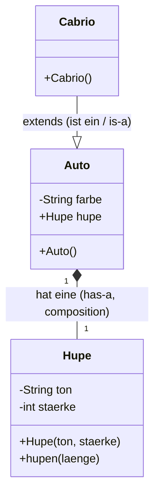
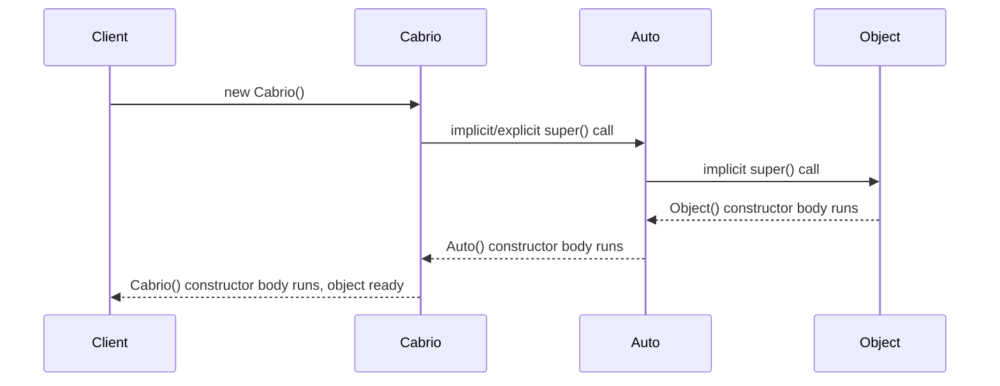
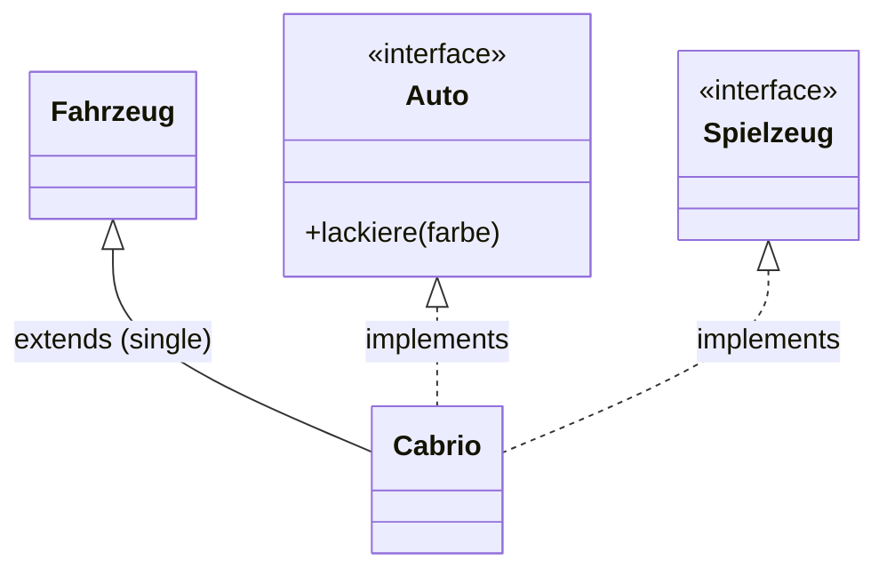

## Definition

Java inheritance (§0.8.8, *Vererbung*) uses the keyword **`extends`** and
supports only **single inheritance of classes**: "Cabrio 'ist ein' Auto"
(Cabrio **is-a** Auto). Every class implicitly inherits, at the root, from
`Object`. Interfaces (`interface`, §0.8.8.7) provide Java's replacement for
C++'s true multiple inheritance: a class may `extends` exactly one class but
`implements` many interfaces.

```java
//Auto.java
public class Auto {
  public Auto () { this.farbe = "rot"; }
  Hupe hupe = new Hupe("hohes C", 128);
  private String farbe;
}
```
```java
//Cabrio.java
public class Cabrio extends Auto {
  public Cabrio () { /* ... */ }
}
```

## Class hierarchy diagram (has-a vs. is-a)



```java
//AutoApp.java
Cabrio sportwagen = new Cabrio();
sportwagen.hupe.hupen (7);
```

The `hupe` field is inherited onto `Cabrio` — demonstrated by calling
`sportwagen.hupe.hupen(7)` directly on the subclass instance, since `hupe` is a
(package-visible) field of `Auto`.

## Constructor chaining via `super()` (§0.8.8.1–0.8.8.2)

- In the constructor of a **derived** class, a constructor of the **base
  class** is always called **first** — either explicitly via a chosen
  signature, or otherwise *implicitly* the parameterless constructor, which
  must exist or it is a compiler error.
- This continues recursively up to `Object()`; constructors are processed
  **top→down**, with `Object()` executing first.
- Constructors are **not inherited** in Java — unlike *all other methods*,
  which can be inherited.
- Explicit call with parameters is done via `super(a, b, c)`.
- If a base class defines **only** a parameterized constructor, no default
  constructor exists there anymore; a subclass must then explicitly call that
  constructor via `super(...)` or compilation fails.

```java
// Auto.java
public class Auto {
  public Auto () { this.farbe = "rot"; }
  public Auto (String farbe) { this.farbe = farbe; }
  private String farbe;
}
```
```java
// Cabrio.java
public class Cabrio extends Auto {
   public Cabrio () {}                  //impliziter Aufruf von Auto()
   public Cabrio (String farbe) {
    super (farbe);                      //expliziter Aufruf des Konstruktors Auto(farbe)
   }
}
```

### Pseudocode: constructor chaining in Java inheritance

```
1. new Cabrio() is called
2. Before Cabrio's own constructor body runs, a constructor of Auto is invoked:
   a. If Cabrio's constructor explicitly calls super(...), that specific Auto
      constructor runs.
   b. Otherwise, the implicit no-arg constructor of Auto is called automatically
      (and must exist, or compilation fails).
3. This chains upward: Auto's constructor itself first invokes a constructor of
   its own base class, continuing up to Object().
4. Execution order is therefore TOP → DOWN through the class hierarchy:
   Object() runs first, then each level's constructor body, ending with
   Cabrio's own constructor body last.
```



## Overriding methods and `super` (§0.8.8.4)

In a derived class, a method with the same name and signature as in the base
class **overrides** it; the base-class method can no longer be called from
outside via the derived class. Inside the overriding method, the base-class
method can still be invoked via `super`, e.g. `super.lackiere("rot")`. `super`
is a reference to the current instance, specifically to the sub-object of the
immediately superior base class. Chaining (e.g. `super.super.lackiere()`) is
**not** possible, even with multiple inheritance levels.

```java
//Cabrio.java
public class Cabrio extends Auto {
  public Cabrio () {}
  public void lackiere (String farbe) {
    System.out.println("Dach mit Folie schützen");
    super.lackiere (farbe);   // ruft Auto.lackiere(farbe) der aktuellen Instanz auf
  }
}
```

## `final` (§0.8.8.5)

- On **classes**: prevents further inheritance.
- On **methods**: prevents overriding. **In Java, all methods are virtual by
  default** (*standardmäßig virtuell*) — the script explicitly reminds the
  reader: "in C++ macht erst das Schlüsselwort `virtual` eine Methode
  virtuell" (in C++, only the keyword `virtual` makes a method virtual). This
  is one of the sharpest stated contrasts: Java is virtual-by-default, C++ is
  non-virtual-by-default.
- On **variables**: constant. For a constant reference in Java, only the
  pointer/reference itself is constant; the referenced content remains
  changeable (unless the referenced object itself is immutable, e.g. `String`).

```java
public final void hupen (int laenge) throws HupeException{
    //Ueberschreiben von void hupen (int) verhindern
    this.hupe.hupen (laenge);
}
private final String farbe = "rot";   // farbe ist jetzt konstant
```

## Abstract classes (§0.8.8.6)

An abstract class defines an interface/contract (*Schnittstelle*); instances
are only permitted for derived classes. Realized with `abstract`. May contain
abstract methods (no implementation) alongside concrete methods/variables.

```java
public abstract class Auto {               // Abstrakte Klasse
  public void lackiere (String farbe) { this.farbe = farbe; }
  public abstract void waschen();           //Abstrakte Methode
  private String farbe;
}
```

This mirrors C++ abstract base classes (classes with at least one pure virtual
function), but Java requires the explicit `abstract` keyword on both the class
and the unimplemented method, rather than `= 0` pure-virtual syntax.

## Interfaces (§0.8.8.7–0.8.8.8)

Only abstract methods (no implementation) and constants are permitted inside
an `interface`. All methods are implicitly `public` and `abstract`; all
variables are implicitly `static`, `final`, and `public`.

```java
public interface Auto {
 void lackiere (String farbe);
}
```
```java
public class Cabrio implements Auto {
  public Cabrio () { this.farbe="rot"; }
  public void lackiere (String farbe) { this.farbe = farbe; }
  private String farbe;
}
```

A concrete class must override all abstract methods, can implement multiple
interfaces (`implements A, B, ...`), and can simultaneously inherit from one
class (`extends` + `implements` together):

```java
public class Cabrio extends Fahrzeug implements Auto, Spielzeug { /* ... */ }
```

This single-inheritance-of-classes + multiple-interfaces model stands in
contrast to C++'s true multiple inheritance from multiple classes — interfaces
are Java's mechanism replacing C++'s multiple inheritance / abstract base
classes with only pure virtual functions.

## Polymorphism via interfaces (§0.8.9)

```java
public interface Auto { void waschen (); }
```
```java
public class Bus implements Auto {
  public Bus () {}
  public void waschen () { System.out.println("wasche Bus"); }
}
// Polymorphie auch bei Vererbung von Basisklasse Auto möglich, z.B. Bus extends Auto
```
```java
public class Cabrio implements Auto {
  public Cabrio () {}
  public void waschen () { System.out.println("wasche Cabrio"); }
}
```
```java
Auto auto1 = new Cabrio();
Auto auto2 = new Bus();
auto1.waschen();   // dynamic dispatch: "wasche Cabrio"
auto2.waschen();   // dynamic dispatch: "wasche Bus"
```

Calling `waschen()` through the interface reference type `Auto` invokes the
implementation specific to each runtime object — the same dynamic-dispatch
principle as C++ virtual dispatch through a base-class pointer/reference,
except here the static type is an **interface**, not a class.

## Access rights for classes (§0.8.8.3)

- `public`: visible everywhere.
- no modifier (package-private): visible only within the own package.
- There are **no** `private` or `protected` top-level classes in Java; only
  inner classes may carry those modifiers (see [[concepts/java-nested-classes]]).

## Single inheritance + interfaces model



## Compared with C++

| Aspect | C++ | Java |
|---|---|---|
| Inheritance syntax | `class Cabrio : public Auto` (colon), supports multiple base classes | `extends` (single class base only) |
| Multiple-inheritance-like behavior | True multiple inheritance from multiple classes | `implements` many interfaces + `extends` one class |
| Virtual dispatch default | Non-virtual unless `virtual` is written | Virtual by default; `final` opts out |
| Universal root class | None | `Object`, implicit for every class |
| Pure-virtual / abstract syntax | `virtual void f() = 0;` | `abstract` keyword on class and method |
| Constructor chaining | Base classes constructed before derived body; no universal root class to chain to | `super(...)` (explicit) or implicit no-arg call, recursively up to `Object()` |
| Constructors inherited? | N/A (constructors are not "inherited" conceptually in either language) | Explicitly **not inherited**, unlike all other methods (stated contrast with "all other methods ARE inherited in Java") |

See [[concepts/inheritance]], [[concepts/multiple-inheritance]],
[[concepts/polymorphism]], [[concepts/abstract-class]], and
[[concepts/overriding-vs-overloading]] for the C++ mechanics this page
contrasts against, and [[concepts/java-vs-cpp]] for the master table.

## Consequences / trade-offs

- Restricting class inheritance to a single base avoids the diamond problem
  inherent to true multiple inheritance, at the cost of needing a second
  mechanism (interfaces) for multi-faceted behavior.
- Virtual-by-default removes the risk of "forgot to mark `virtual`" bugs
  common in C++, at a (not quantified by the script) potential dispatch-cost
  trade-off.

## Misuse & anti-patterns

- Trying `super.super.method()` to reach a grandparent method — not possible
  in Java, even across multiple inheritance levels.
- Assuming a derived class constructor can skip invoking any base constructor
  — impossible; an implicit or explicit `super(...)` call always happens.
- Forgetting that interfaces do **not** derive from `Object` — "Interface
  classes are **not** derived from class `Object`!" (stated explicitly on the
  related object-copying page, §0.8.11.1, relevant here too).

## Open questions

- The script does not describe default/static interface methods (a modern
  Java feature) — not claimed here since it is not in the transcribed source.

## Related

- [[concepts/java-vs-cpp]]
- [[concepts/inheritance]]
- [[concepts/multiple-inheritance]]
- [[concepts/polymorphism]]
- [[concepts/abstract-class]]
- [[concepts/overriding-vs-overloading]]
- [[concepts/java-nested-classes]]
- [[concepts/java-classes-and-members]]
- [[concepts/java-exceptions]]

## Sources

[[sources/grigat-java]] §0.8.8, §0.8.8.1, §0.8.8.2, §0.8.8.3, §0.8.8.4,
§0.8.8.5, §0.8.8.6, §0.8.8.7, §0.8.8.8, §0.8.9
