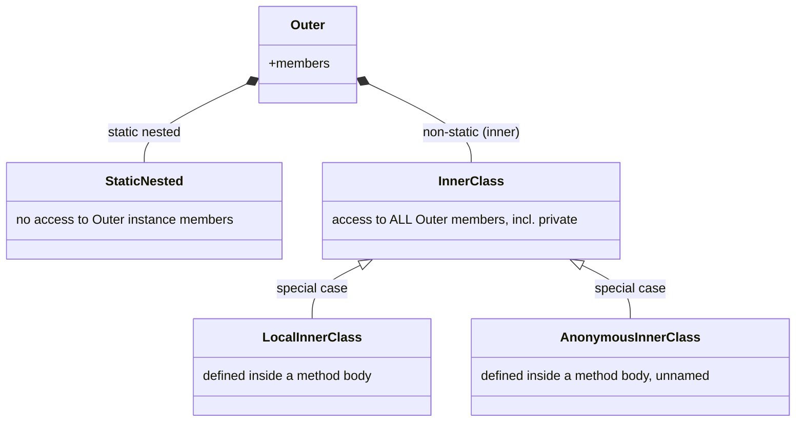

## Definition

In Java there is **no separation** of class definition and method definition
(unlike C++'s header/.cpp split) — methods are always defined *inside* a class,
and there are **no header files** (*Headerdateien*) in Java at all. Class
definitions can themselves contain class definitions (§0.8.4, "Nested
Classes"), which can be static or non-static:

- **Static Nested Classes** (*static nested*) have **no** access to members of
  the enclosing class.
- **Non-static Nested Classes**, called **inner classes** (*innere Klassen*),
  have access to **all** members of the enclosing class, including private
  ones. Inner classes can additionally be `protected` or `private`.
- **Local inner classes** (*lokale innere Klassen*) and **anonymous inner
  classes** (*anonyme innere Klassen*) are special cases of inner classes,
  defined inside a member function (method body).

## Problem it solves

Nesting a class inside another expresses that the nested class is a tightly
coupled implementation detail of the enclosing class. The static/non-static
distinction further controls whether that nested class needs access to the
enclosing *instance's* state or is just scoped inside the enclosing class for
organizational purposes.

## Diagram: the four kinds of nested class

## Access-modifier interaction

Nested/inner classes are the *only* place Java allows `private` or `protected`
on a class-level construct (§0.8.8.3): there are **no** `private` or
`protected` top-level classes in Java — only `public` or package-private
(no modifier) at the top level. `private`/`protected` nested classes are
permitted precisely because they live inside an enclosing class.

## Compared with C++

C++ also supports nested classes, but the source notes do not describe C++
nested classes as having this static/non-static access-to-enclosing-instance
distinction — in C++, a nested class is simply scoped inside the enclosing
class's namespace, and it does not automatically gain access to the enclosing
*instance's* members at all (a C++ nested class needs an explicit pointer/
reference to an enclosing object to reach its members, since nesting in C++ is
purely a scoping/namespace mechanism, not an implicit membership relationship).
Java formalizes a richer, four-way model (static nested / inner / local inner /
anonymous inner) with access rules baked into the language itself. See
[[concepts/java-vs-cpp]] for the master comparison and
[[concepts/access-modifiers]] for the general C++ visibility model nested
classes interact with.

## Consequences / trade-offs

- Inner (non-static) classes implicitly hold a reference to their enclosing
  instance, enabling access to all its members — convenient, but it means an
  inner-class instance cannot outlive conceptual decoupling from its outer
  instance the way a fully independent class could.
- Static nested classes behave like an ordinary top-level class that merely
  happens to be scoped inside another class's name — no implicit access, no
  implicit enclosing-instance coupling.

## Misuse & anti-patterns

- Expecting a **static** nested class to access the enclosing class's instance
  members — it cannot, by definition.
- Confusing Java's access-rich inner-class model with C++'s simpler,
  access-to-enclosing-instance-free nested classes when porting code mentally
  between the two languages.

## Open questions

- The script states the existence and access rules of all four forms but does
  not give worked code examples for local or anonymous inner classes in the
  transcribed pages — no code example is fabricated here beyond what the
  source states in prose.

## Related

- [[concepts/java-vs-cpp]]
- [[concepts/java-classes-and-members]]
- [[concepts/access-modifiers]]
- [[concepts/class-and-object]]

## Sources

[[sources/grigat-java]] §0.8.4
