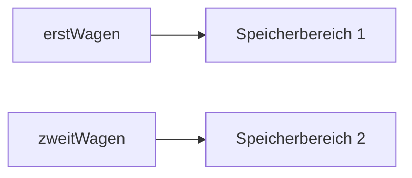
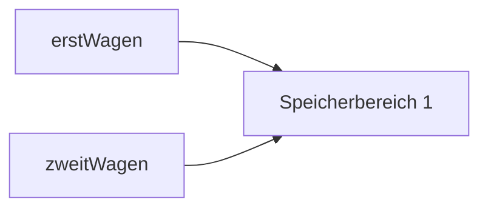

## Definition

§0.8.11 ("Objekte kopieren") describes how Java objects are copied. Unlike C++,
plain assignment (`=`) on a class-type variable in Java **never copies the
object** — it only copies the reference (pointer). To obtain an independent
copy, a class must override `Object`'s `clone()` method and implement the
marker interface `Cloneable`.

## The class `Object` and `clone()` (§0.8.11, §0.8.11.1)

`Object` is the base class for all classes in Java. Among its methods:
`protected Object clone()` — creates a copy of an object; it can be overridden
in one's own classes.

- `clone()` returns an object of type `Object`.
- It is declared `protected` in `Object`, so should be overridden as `public`
  (the return type stays `Object`!).
- For `clone()` to be permitted, the class must implement **`Cloneable`**.
  - `Cloneable` is empty — no method declarations or constants (a "marker
    interface").
  - It tells the compiler that instances of the class may be copied.
  - `CloneNotSupportedException` is thrown if `Cloneable` is not implemented.
- Calling `super.clone()` reserves memory for the copy.

```java
public class Auto implements Cloneable{  // zusätzlich wäre "extends Basisklasse" möglich
  public Object clone (){ // überschreiben, Rückgabetyp muss Object bleiben
    Object o = null;
    try {
      o = super.clone (); // Basisklasse ist Object, nicht das Interface
      // hier können weitere Anweisungen für Kopiervorgang stehen
    }
    catch (CloneNotSupportedException e){
      System.err.println ("clone not supported");
    }
    return o;
  }
}

Auto erstwagen = new Auto ();
Auto zweitwagen = (Auto) erstwagen.clone (); //clone liefert Typ Object
```

- A copy of `erstwagen` is created; the return type `Object` must be cast to
  `Auto`.
- An interface (here `Cloneable`) does **not** count as a base class.
- **Interface classes are not derived from class `Object`!**

## Reference vs. value assignment — three diagrams

**C++ — implicit copy constructor (value semantics, two separate memory areas):**

```cpp
// C++ - Impliziter Aufruf des Kopierkonstruktors
Auto erstWagen;
Auto zweitWagen = erstWagen;
```



**Java — plain assignment (reference semantics, same memory area, no copy):**

```java
// Java - Zuweisung einer Referenz.
Auto erstWagen = new Auto();
Auto zweitWagen = erstWagen;
```



**Java — `clone()` (explicit, reserves new memory, two separate memory areas):**

```java
// Java clone - Reservierung neuen Speichers.
Auto erstWagen = new Auto();
// clone gibt ein Objekt vom Typ Object zurück und muss gecastet werden.
Auto zweitWagen = (Auto)erstWagen.clone();
```


### Key stated difference

In C++, `Auto zweitWagen = erstWagen;` (a value-type variable) implicitly
invokes the **copy constructor**, producing a new, independent memory area. In
Java, the same-looking line is merely a **reference assignment** — both
variables end up pointing at the *same* memory area; no new object is created.
To get an independent copy in Java requires explicitly calling `.clone()`,
which is the Java analogue of C++'s implicit copy-constructor behavior, but
must be opted into explicitly, requires `Cloneable`, and requires a cast.

## Only shallow copies, in both languages (§0.8.11.1)

Both C++'s copy constructor and Java's `clone()` create only **shallow
('flache') copies**: only the addresses pointing to memory areas are copied,
not the memory area itself (not a deep copy). This affects, as member
variables: pointers (*Zeiger*) in C++, and references (*Referenzen(Java)*,
which are also pointers) in Java. Neither language's default/standard copy
mechanism recursively deep-copies pointed-to objects automatically.

## Compared with C++

| Aspect | C++ | Java |
|---|---|---|
| Plain `=` on a class-type variable | Invokes the copy constructor; value semantics, independent copy | Reference assignment only; both variables alias the same object |
| Getting an independent copy | Automatic, via the (possibly compiler-generated) copy constructor | Must explicitly implement `Cloneable` and call `.clone()` |
| Return type / cast needed | No cast needed, the copy constructor returns the concrete type | `clone()` returns `Object`; must be cast back to the concrete type |
| Depth of default copy | Shallow (member pointers copied, not pointed-to data) | Shallow (member references/pointers copied, not pointed-to data) |
| Smart-pointer / RAII tooling | [[concepts/smart-pointers]] manage ownership of copied/moved resources | No equivalent — Java relies entirely on the garbage collector, see [[concepts/garbage-collection]] |

See [[concepts/copy-constructor]] and [[synthesis/special-member-functions]]
for the full C++ copy-constructor mechanics this page contrasts against, and
[[concepts/assignment-operator]] for the C++ `operator=` that Java's plain `=`
does **not** have an equivalent of (Java's `=` on reference types is always a
reference assignment, never a user-overloadable operation, since Java has no
operator overloading at all). See [[concepts/java-vs-cpp]] for the master
table.

## Consequences / trade-offs

- Java's reference-assignment-by-default means accidental aliasing (two
  variables unintentionally sharing one object) is easy unless `.clone()` is
  used deliberately — in C++, the opposite risk exists (accidental *copies* via
  value semantics where a reference/pointer was intended).
- Both languages' default copy mechanisms are shallow, so deep-copy logic must
  be hand-written in both — this is a genuine similarity, not a difference.

## Misuse & anti-patterns

- Writing `Auto b = a;` in Java expecting an independent copy, as one might in
  C++ — it only creates a second alias to the same object.
- Forgetting to implement `Cloneable` before calling `clone()` — raises
  `CloneNotSupportedException`.
- Forgetting to cast `clone()`'s `Object` return value back to the concrete
  type.
- Assuming an interface like `Cloneable` makes a class derive from `Object`
  via the interface itself — interfaces are never derived from `Object`.

## Open questions

- The script does not discuss `Cloneable`'s interaction with inheritance
  hierarchies beyond the single-level `Auto` example, nor does it mention
  Java's copy-constructor idiom (writing a constructor that takes another
  instance of the same class) as an alternative to `clone()` — not claimed
  here since it is not in the transcribed source.

## Related

- [[concepts/java-vs-cpp]]
- [[concepts/copy-constructor]]
- [[concepts/assignment-operator]]
- [[synthesis/special-member-functions]]
- [[concepts/garbage-collection]]
- [[concepts/java-references-and-primitives]]
- [[concepts/pointers-and-references]]

## Sources

[[sources/grigat-java]] §0.8.11, §0.8.11.1
