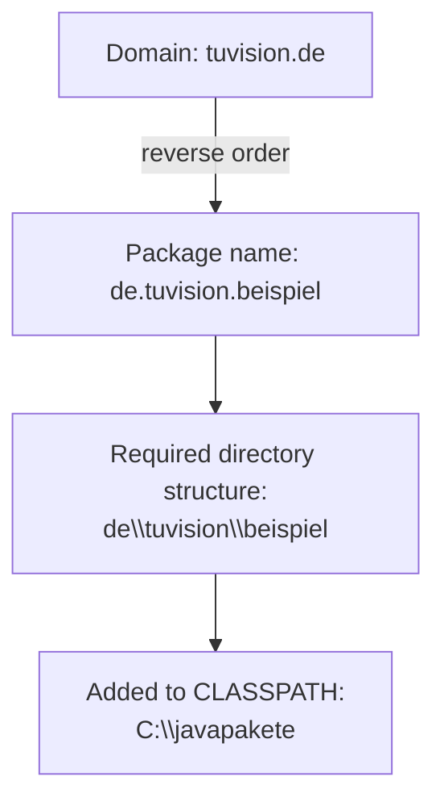

## Definition

`*.class` files are grouped into **packages** (*Pakete*, §0.8.3.4). Every class
belongs to exactly one package, declared in the first line of the `*.java` file
with the `package` statement, e.g. `package de.tuvision;` states that all
classes in that file belong to the package `de.tuvision`.

## Problem it solves

**Namespace collisions:** different packages could use the same class name
(§0.8.3.6). Java's common solution is to use **domain names in reversed order**
as fully qualified package names, e.g. domain `tuvision.de` → package
`de.tuvision.beispiel`. On the machine, the directory structure
`de\tuvision\beispiel` must exist (e.g. `C:\javapakete\de\tuvision\beispiel`),
and the path `C:\javapakete` is added to the `CLASSPATH` system variable.



## Package conventions

- The search path includes the package name as directory name; classes should
  preferably be placed in an identically-named directory.
- Every class is uniquely addressable via its qualified name, e.g.
  `java.lang.String` is the class `String` from package `java.lang`.
- Names of **packages** are written lower-case; names of **classes** begin with
  an upper-case letter.

## Importing packages (§0.8.3.5)

**Problem:** classes from foreign packages must be referenced/imported to be
used conveniently.

**Solution:** `import` tells the compiler the names of one or more classes of
other packages. A wildcard `*` is allowed:

```java
import java.util.*;   // makes all classes from package java.util known
```

The package `java.lang` (containing `String`, `Math`, etc.) is automatically
imported into every Java program.

```java
import de.tuvision.autobeispiel.*;
```

## Compared with C++

Java's `package` + `import` system is analogous in spirit to, but syntactically
distinct from, C++ [[concepts/namespaces]]:

| Aspect | C++ `namespace` | Java `package` |
|---|---|---|
| Nature | Purely logical/code construct | Tied to directory structure and compiled-file organization |
| Filesystem requirement | None | Package name must match a real directory path, searched via CLASSPATH |
| Naming convention | Project-chosen, no standard scheme | Reverse-domain-name convention (e.g. `de.tuvision`) to guarantee global uniqueness |
| Bringing names in scope | `using namespace std;` | `import java.util.*;` |
| Access-control interaction | `namespace` does not itself gate visibility | "No modifier" visibility is *package-private* — package membership itself is an access level (see [[concepts/java-classes-and-members]]) |

## Consequences / trade-offs

- Reverse-domain naming guarantees global uniqueness in a way that is only a
  convention in C++ namespaces, never enforced by the compiler.
- Tying packages to the filesystem (directories + CLASSPATH) is more rigid than
  C++ namespaces, which impose no directory requirement at all.

## Misuse & anti-patterns

- Forgetting that the directory structure must mirror the package name exactly
  — unlike namespaces, this is not optional in Java.
- Omitting `.` from CLASSPATH and then being unable to resolve classes in the
  working directory.

## Open questions

- The script does not discuss package visibility nuances beyond the
  package-private access level (covered on [[concepts/java-classes-and-members]]).

## Related

- [[concepts/java-vs-cpp]]
- [[concepts/java-bytecode-and-jvm]]
- [[concepts/namespaces]]
- [[concepts/java-classes-and-members]]

## Sources

[[sources/grigat-java]] §0.8.3.4, §0.8.3.5, §0.8.3.6
