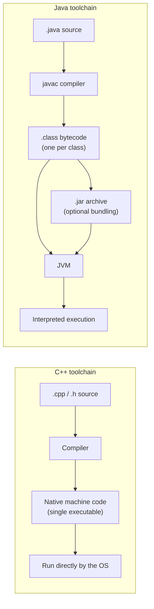

## Definition

This page is the master comparison between **Java** and **C++** as taught by the
source script: "In this lecture the concepts of procedural and object-oriented
programming are explained using C++ and *Java*" (*Gegenüberstellung*, direct
comparison). C++ is described as evolved from C (*Entstanden aus C*), compiling
to native machine code, enabling hardware-close programming, and fast. Java is
described as a new language design (*Neuentwicklung*), compiling to **bytecode**
run inside a **virtual machine (VM)**, with automatic memory management and
**no pointer types** — stated to make it less error-prone during development.

## Problem it solves

A reader who already knows C++ needs a single map of *where* Java diverges from
it, so that each divergence can be studied in depth on its own page without
re-deriving the comparison every time. This page is that map — every row links
to the page that treats the topic in depth.

## The comparison table

| Aspect | C++ | Java | Detail page |
|---|---|---|---|
| Origin / design | Evolved from C | New language design (*Neuentwicklung*) | — |
| Compilation model | Compiler → native machine code | Compiler (`javac`) → bytecode (`.class`) → interpreted by a VM | [[concepts/java-bytecode-and-jvm]], [[concepts/modularization-and-build-pipeline]] |
| Memory management | Manual (`new`/`delete`, RAII) | Automatic — garbage collector run by the JVM | [[concepts/garbage-collection]], [[concepts/memory-model]] |
| Pointers / references | Raw pointers (`*`), references (`&`, fixed alias, no own storage), smart pointers | No pointer types; "references" are reassignable, storage-occupying, type-safe pointers (*typsichere Zeiger*) | [[concepts/java-references-and-primitives]], [[concepts/pointers-and-references]], [[concepts/smart-pointers]] |
| Primitive vs. reference types | Value types (built-ins, objects) vs. pointers/references, chosen by the programmer | Explicit split: *Grundtyp-Variablen* (value semantics) vs. *Referenztyp-Variablen* (pointer semantics), fixed by the type system | [[concepts/java-references-and-primitives]] |
| `==` vs. content comparison | `operator==` can be overloaded for value comparison | `==` on reference types always compares pointer identity; content comparison needs an `equals()` method, there is no operator overloading at all | [[concepts/java-references-and-primitives]], [[concepts/operator-overloading]] |
| Universal base class | None — no common root for all types | `Object` is the implicit base of every class | [[concepts/java-references-and-primitives]], [[concepts/java-inheritance-and-interfaces]], [[concepts/inheritance]] |
| Operator overloading | Supported (`operator+`, `operator==`, ...) | Not supported at all | [[concepts/operator-overloading]] |
| Destructors / cleanup | Explicit `~ClassName()`, deterministic, backbone of RAII | No destructor exists; cleanup is the garbage collector's job | [[concepts/garbage-collection]], [[concepts/destructor]] |
| Exceptions | `try`/`catch`, no `finally`, no checked-exception enforcement, RAII handles guaranteed cleanup | `try`/`catch`/`finally`, **checked exceptions** enforced by the compiler via `throws` | [[concepts/java-exceptions]], [[concepts/exceptions]] |
| Packages / namespaces | `namespace`, purely logical, no filesystem requirement | `package` + `import`, tied to directory structure and reverse-domain naming | [[concepts/java-packages]], [[concepts/namespaces]] |
| Inheritance model | True multiple inheritance from several classes | Single inheritance of classes (`extends`, one base) plus multiple interfaces (`implements`, many) | [[concepts/java-inheritance-and-interfaces]], [[concepts/multiple-inheritance]], [[concepts/inheritance]] |
| Virtual dispatch | Methods non-virtual by default, `virtual` required | Methods virtual by default; `final` suppresses overriding | [[concepts/java-inheritance-and-interfaces]], [[concepts/overriding-vs-overloading]], [[concepts/polymorphism]] |
| Generics / templates | Templates instantiate separate code per concrete type at compile time, can use primitive types directly, allow non-type/default arguments | Generics compile to a single shared implementation (**type erasure**), cannot hold primitives directly (need boxing), no default type arguments, not covariant | [[concepts/java-generics]], [[concepts/templates]], [[concepts/stl-containers]] |
| Default arguments | Allowed, for functions/methods and template parameters | **Not allowed**, neither for constructors nor for methods | [[concepts/java-classes-and-members]], [[concepts/parameter-passing]] |
| Parameter passing | Call-by-value, call-by-reference (`&`), call-by-pointer | **Call-by-value only** — for reference types, a copy of the pointer is passed, never true call-by-reference | [[concepts/java-classes-and-members]], [[concepts/parameter-passing]] |
| Object copying | Implicit copy constructor gives value-semantics deep-ish copy by default | Plain `=` only copies the reference (both variables alias the same object); an independent copy needs explicit `clone()` + `Cloneable` | [[concepts/java-object-copying]], [[concepts/copy-constructor]], [[synthesis/special-member-functions]] |
| Nested/inner classes | Nested classes, no static/non-static access distinction emphasized | Static nested classes, inner classes, local inner classes, anonymous inner classes, each with distinct access rules | [[concepts/java-nested-classes]] |
| Arrays | No runtime bounds checking (undefined behavior out of range) | Runtime bounds checking, throws `ArrayIndexOutOfBoundsException` | [[concepts/java-references-and-primitives]], [[concepts/arrays-and-dynamic-memory]], [[concepts/exceptions]] |
| Access control | `public`/`protected`/`private`, `friend` grants explicit access | Adds **package-private** (no modifier) as a fourth level; package-private mirrors `friend`-granted access but at package granularity | [[concepts/java-classes-and-members]], [[concepts/access-modifiers]], [[concepts/friend]] |
| Static member initialization | Always defined outside the class body (e.g. in the `.cpp` file) | Initialized directly inside the class definition | [[concepts/java-classes-and-members]], [[concepts/static-members]] |
| `new` with no-arg constructor | `new CCabrio` — parentheses optional | `new Auto()` — parentheses mandatory | [[concepts/java-references-and-primitives]] |

## Toolchain comparison diagram

## Consequences / trade-offs

- Every "Java is simpler here" item (no pointers, no destructors, no multiple
  inheritance, no operator overloading, no default arguments) trades flexibility
  for reduced error-proneness, per the script's own framing (*weniger
  fehleranfällig*).
- Several items look syntactically similar (`new`, `==`, references) but are
  **semantically different** — the single biggest risk for a C++ programmer
  learning Java is assuming shared syntax implies shared semantics (see
  [[concepts/java-references-and-primitives]] for the canonical `b = a; b = c;`
  worked example).

## Misuse & anti-patterns

- Assuming a Java "reference" behaves like a C++ reference (fixed alias) rather
  than a reassignable pointer.
- Assuming `==` compares content in Java the way an overloaded `operator==`
  would in C++.
- Assuming Java generics generate per-type code the way C++ templates do.

## Compared with C++

This entire page *is* the C++ comparison; see the individual detail pages
linked in the table above, and in particular [[concepts/pointers-and-references]],
[[concepts/templates]], [[concepts/exceptions]], [[concepts/multiple-inheritance]],
and [[synthesis/special-member-functions]] for the C++-only depth behind each row.

## Open questions

- The script does not explicitly state Java's execution speed relative to C++;
  it only implies a VM layer exists (no numeric or qualitative claim is made
  here, so none is asserted).
- No C++11/14/17 modern-era features (move semantics, smart pointers as a
  default idiom, lambdas) are directly juxtaposed against Java generics/lambdas
  in the source notes for this wave; only structural/semantic contrasts stated
  in the script are recorded.

## Related

- [[concepts/java-bytecode-and-jvm]]
- [[concepts/java-packages]]
- [[concepts/java-nested-classes]]
- [[concepts/garbage-collection]]
- [[concepts/java-references-and-primitives]]
- [[concepts/java-classes-and-members]]
- [[concepts/java-inheritance-and-interfaces]]
- [[concepts/java-exceptions]]
- [[concepts/java-object-copying]]
- [[concepts/java-generics]]
- [[concepts/pointers-and-references]]
- [[concepts/memory-model]]

## Sources

[[sources/grigat-java]] §0.8.1, §0.8.1.1, §0.8.1.2, §0.8.1.3
