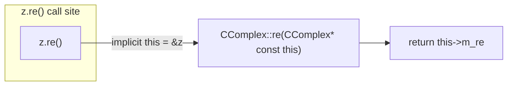
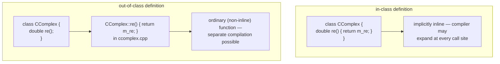

A member function (*Memberfunktion*), also called an element function (*Elementfunktion*), is a function defined as part of a class and operating on the (hidden) data of a specific object of that class.





Every non-static member function receives the calling object's address as an
implicit first argument, named `this` — see [[concepts/this-pointer]] for the
full mechanics. Defining a function's body directly inside the class (as in
`InClass` above) implicitly marks it `inline`, whereas the `ClassName::`
out-of-class form used throughout this page compiles like an ordinary
function and keeps the header free of implementation detail.

## Problem it solves

A [[concepts/class-and-object]] needs behavior tied to its data without exposing the data directly. Member functions provide the public interface through which code outside the class reads or changes an object's state, while the private data stays hidden (see [[concepts/encapsulation]]).

## Definition and the scope operator `::`

A member function is declared inside the class body and *defined* outside it using the scope operator (*Scope-Operator*) `::`, which ties the function back to its class:

```cpp
// ccomplex.hpp
class CComplex
{
public:
  double re();
private:
  double m_re;
  double m_im;
};

// ccomplex.cpp
double CComplex::re()
{
  return m_re;
}
```

`CComplex::re` means "the function `re` belonging to class `CComplex`". Inside its own body, a member function can access the object's member variables/functions directly (e.g. `m_re`), without qualification.

## Access via `.` and `->`

From outside the class, a member function is invoked with the dot operator (*Punktoperator*) on an object, or with the arrow operator on a pointer to an object:

```cpp
CComplex z(1.0, 2.0);
z.re();          // dot operator, z is an object

CComplex *zp = new CComplex(1.0, 2.0);
(*zp).print();   // dereference then dot — correct but hard to read
zp->print();     // arrow operator — idiomatic equivalent
delete zp;
```

`(*z).print()` and `z->print()` are equivalent; `->` is the form used in practice (§0.3.3.4).

## Constant member functions vs. constant parameters

Two independent `const` mechanisms exist and are easy to confuse (§0.3.2.7-0.3.2.8):

- **Constant member function** — `const` placed *after* the parameter list promises the function will not modify its own object's members:

```cpp
double CComplex::re() const; // re() darf eigenes Objekt nicht veraendern
```

  The `const` qualifier must appear identically in both the declaration and the definition.

- **Constant parameter** — `const` on a parameter only protects that argument, not the object's own members:

```cpp
void lackiere(const std::string farbe); // konstanter Parameter
```

  Inside `lackiere`, the parameter `farbe` cannot be changed, but the object's own member `m_farbe` still can be (since `lackiere` itself is not marked `const`).

A function can combine both: a constant member function with constant parameters — the two concepts are orthogonal.

## Consequences / trade-offs

- Marking read-only accessors `const` lets the compiler catch accidental state mutation and allows calling them on `const` objects/references.
- Forgetting `const` on an accessor silently permits mutation and blocks use on `const` objects — a common source of bugs when interfaces grow.

## Misuse & anti-patterns

- Confusing a `const` parameter with a `const` member function — a `const` parameter gives no guarantee about the object's own state.
- Omitting `::ClassName` when defining member functions outside the class (a compile error, but a frequent typo for beginners coming from free functions).

A member function can also be declared as an operator (e.g. `operator+`),
letting ordinary operator syntax call into the same mechanism — see
[[concepts/operator-overloading]].

## Related

- [[concepts/class-and-object]]
- [[concepts/this-pointer]]
- [[concepts/const-and-volatile]]
- [[concepts/encapsulation]]
- [[concepts/constructor]]
- [[concepts/operator-overloading]]

## Sources

[[sources/grigat-oop-teil1]] §0.3.2.5, §0.3.2.6, §0.3.2.7, §0.3.2.8, §0.3.3.4
