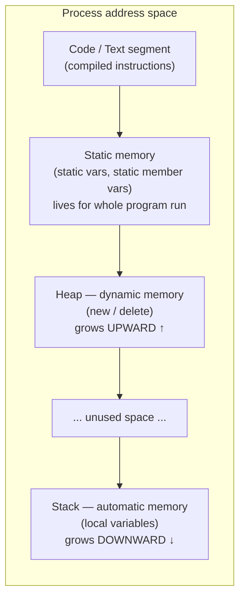
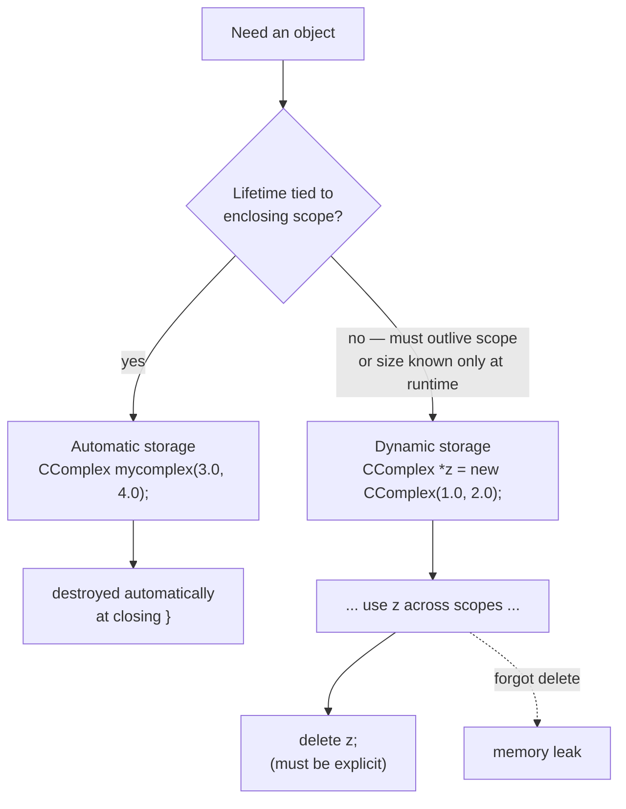

C++ distinguishes three memory locations (*Speicherplatz*) for objects: static memory, automatic memory ("Stack"), and dynamic memory ("Heap"), each with a different lifetime and allocation mechanism (§0.3.3-0.3.3.1).





**What `new CComplex(1.0, 2.0)` does, step by step:**

```
1. Request a block of memory from the heap large enough for a CComplex.
2. If allocation fails, throw std::bad_alloc (unless a nothrow form is used).
3. Call the CComplex constructor on that raw memory, passing (1.0, 2.0)
   — this runs the member initializer list, then the constructor body.
4. Return a pointer (CComplex*) to the now-constructed object.
```

**What `delete z` does, step by step:**

```
1. Call the destructor ~CComplex() on the object z points to.
2. Return the memory block that object occupied back to the heap
   (available for future `new` calls).
3. z itself still holds the old address afterward (a dangling pointer)
   unless the programmer sets it to nullptr.
```

## Problem it solves

Different objects need different lifetimes: some must exist for the whole program run, some only for a block of code, and some need a lifetime controlled explicitly by the programmer, independent of any enclosing scope. A single memory model cannot satisfy all three needs, so C++ offers three.

## The three memory kinds

- **Static memory** (*statischer Speicher*): allocated by the linker for the entire duration of program execution (§0.3.3.1). Static variables (*statische Variable*, defined outside all functions/objects, module-global) and [[concepts/static-members|static member variables]] live here.
- **Automatic memory** (*automatischer Speicher*, "Stack"): memory for a variable is provided "automatically" upon its definition and freed again as soon as its scope (*Gültigkeitsbereich*, the enclosing `{ }`) is left (§0.3.3.1, §0.3.3.2).
- **Dynamic memory** (*dynamischer Speicher*, "Heap"): memory is explicitly requested by the program with `new`; it remains allocated even after leaving the scope in which it was requested, and must be explicitly freed with `delete` (§0.3.3.1, §0.3.3.4).

## Objects in automatic memory

A local object is destroyed as soon as its scope ends; reaching the closing `}` calls the [[concepts/destructor|destructor]], after which the object no longer exists (§0.3.3.2):

```cpp
{ // lokales Objekt
  CComplex mycomplex(3.0, 4.0);
  /* ... */
} // mycomplex wird hier wieder zerstoert
```

A parameterless [[concepts/constructor|constructor]] is invoked with no parentheses at all:

```cpp
CAuto erstwagen; // Aufruf des parameterlosen Konstruktors zur Erzeugung des Objekts erstwagen
```

> [!warning] Most vexing parse
> `CAuto erstwagen();` is parsed as a **function declaration**, not object creation (§0.3.3.3).

## Objects in dynamic memory

`new` creates an object on the heap and returns a pointer to it; the object outlives its creating scope and must be released with `delete` (§0.3.3.4):

```cpp
CComplex *z = new CComplex(1.0, 2.0);
(*z).print();
delete z;
```

`(*z).print()` and `z->print()` are equivalent; `->` is the idiomatic form in practice.

## Memory leaks

Forgetting to `delete` a heap-allocated object is the cause of **memory leaks** (*Speicherlecks*): the object's destructor never runs and its memory is never reclaimed, so free working memory keeps shrinking as the program runs (§0.3.3.4). Manually paired `new`/`delete` is exactly the error-prone pattern that [[concepts/smart-pointers]] are designed to remove, by tying the `delete` call to an object's own destructor. For heap-allocated *arrays* specifically, see [[concepts/arrays-and-dynamic-memory]].

## Consequences / trade-offs

- Stack objects are cheap and safe (automatic cleanup) but cannot outlive their scope.
- Heap objects can outlive their scope and be sized/created dynamically at runtime, at the cost of manual, error-prone lifetime management.
- Static objects are always available (even before `main` runs, in some cases) but exist exactly once for the whole program, which couples them to [[concepts/static-members|static members]] semantics.

## Misuse & anti-patterns

- Missing `delete` after `new` → memory leak.
- Returning a pointer/reference to a stack (automatic) object after its scope has ended → dangling reference, since the object was already destroyed.
- Writing `ClassName obj();` intending default construction, which the compiler parses as a function declaration instead.

## Related

- [[concepts/destructor]]
- [[concepts/constructor]]
- [[concepts/static-members]]
- [[concepts/pointers-and-references]]
- [[concepts/arrays-and-dynamic-memory]]
- [[concepts/smart-pointers]]

## Sources

[[sources/grigat-oop-teil1]] §0.3.3, §0.3.3.1, §0.3.3.2, §0.3.3.3, §0.3.3.4
