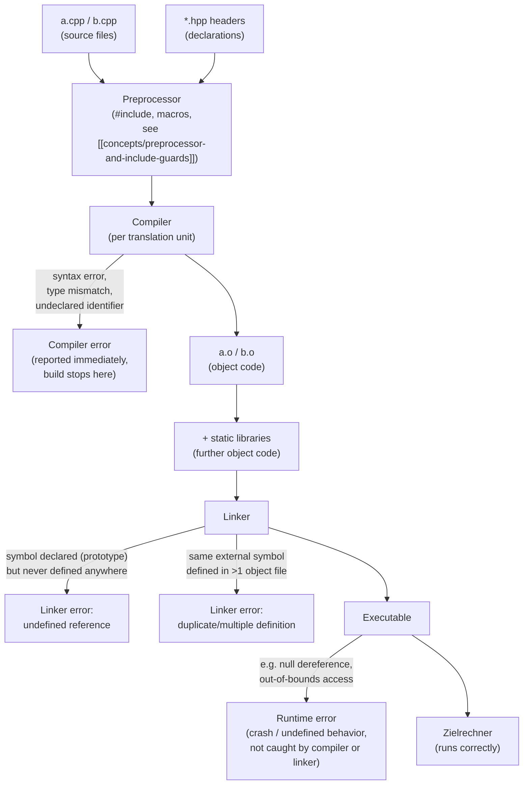

## Definition

Modularization (*Modularisierung*) splits a program's source code across
multiple files that are compiled separately and then combined by a linker,
instead of compiling one large, unwieldy source file.

## Problem it solves

Large programs take a long time to compile, and a single large source file
becomes unclear and hard to manage. The solution is to split a program into
multiple source files, compile each file separately, and recompile only the
files that changed (§0.2.5).

## The build pipeline (§0.2.5.1)

Grigat's diagram "C++: Schritte vom Quelltext zum Programm" (steps from source
code to program) shows the pipeline:

```
Texteditor → Compiler → Linker → Zielrechner (target machine)
```

Inputs: *Quelldatei* `*.cpp` and *Headerdatei* `*.h` feed into the editor and
compiler as **Quellcode** (source code). The compiler emits **Objektcode**
(object code) per translation unit. The linker combines this object code with
*weiterer Objektcode* (further object code from other files) and *Bibliotheken*
(libraries) into the final program run on the *Zielrechner*. Error feedback
loops back to the editor: **Compilerfehler** (compiler errors) from the
compiler, **Linkerfehler** (linker errors) from the linker, and
**Laufzeitfehler** (runtime errors) from the target machine.



- A **compiler error** surfaces while compiling a single translation unit —
  the compiler alone cannot see across files, so it only catches problems
  visible from the prototypes and definitions in that one unit (see
  [[concepts/function-declarations]]).
- A **linker error** ("undefined reference") surfaces only once the linker
  tries to match every *used* symbol to exactly one *definition* across all
  object files and libraries — a prototype with no matching definition
  compiles fine but fails to link.
- A **runtime error** surfaces only once the finished executable actually
  runs on the target machine; neither the compiler nor the linker can catch
  it, since both work on static code, not running behavior.

Three numbered steps summarize the pipeline:

1. Each source file is compiled separately into an **object file**.
2. Object files can be combined into **static libraries**.
3. The **linker** (*Linker*) combines object files and static libraries into an
   executable program.

## The build procedure, step by step

```
1. for each modified .cpp translation unit:
   1.1 preprocessor expands #include directives and macros
       (textually inlining headers, see
       [[concepts/preprocessor-and-include-guards]])
   1.2 compiler checks syntax and types against visible
       declarations/prototypes
       -> on failure: emit compiler error, stop for this unit
   1.3 compiler emits an object file (*.o) for this translation unit
2. (optional) archive a group of object files into a static library
3. linker collects every requested object file and library
   3.1 for each external symbol referenced but not defined locally,
       search the other object files and libraries for its definition
       -> if no definition is found anywhere: linker error
          ("undefined reference")
       -> if more than one definition is found: linker error
          ("duplicate symbol" / "multiple definition")
   3.2 combine all resolved object code into a single executable
4. the target machine (Zielrechner) loads and runs the executable
   -> errors occurring here are runtime errors, undetectable by
      steps 1-3
```

This is also why only the files that actually changed need to be recompiled
(step 1): unaffected translation units already have a valid, up-to-date
object file, so the linker can simply reuse it in step 3.

## Header files (§0.2.5.2)

Problem: variables and functions from foreign source files (`*.cpp`) and
libraries must be made known to the compiler *without recompiling them*.

Solution: factor out declarations into **header files** (`*.hpp`), which are
textually inserted (via the preprocessor — see
[[concepts/preprocessor-and-include-guards]]) wherever they are needed:

```cpp
//verdoppeln.hpp
int verdoppeln(int x);
float verdoppeln(float x);
```

```cpp
//main.cpp
#include "verdoppeln.hpp"
#include <iostream>

using namespace std;

int main()
{
        int a = 2;
        cout << verdoppeln (a);
        return 0;
}
```

This is **separate compilation**: `main.cpp` only needs the *declaration* of
`verdoppeln` from the header to compile; the *definition* can live in a
different translation unit and be supplied later, by the linker.

## Consequences / trade-offs

- Separate compilation drastically reduces rebuild times for large projects,
  since only changed translation units need recompiling.
- It requires discipline about what goes in a header (declarations) vs. a
  `.cpp` file (definitions) — see [[concepts/scope-and-storage-classes]] for
  the linkage rules that make this consistent across translation units.

## Misuse & anti-patterns

- Putting definitions with external linkage directly in headers that are
  included by multiple translation units causes linker errors (duplicate
  symbol) unless guarded appropriately (`inline`, `static`, or a header guard
  for `const`/`constexpr`, as discussed in
  [[concepts/preprocessor-and-include-guards]]).

## Related
- [[concepts/preprocessor-and-include-guards]]
- [[concepts/scope-and-storage-classes]]
- [[concepts/namespaces]]
- [[concepts/function-declarations]]
- [[concepts/templates]] — template definitions must be visible at every
  instantiation point, so (unlike ordinary functions) they are conventionally
  kept entirely in headers rather than split into declaration/definition
- [[concepts/standard-library]] — the quintessential example of a "library"
  the linker combines with your object code above

## Sources
- [[sources/grigat-oop-teil1]] §0.2.5.1-0.2.5.2, §0.2.5.4-0.2.5.6
