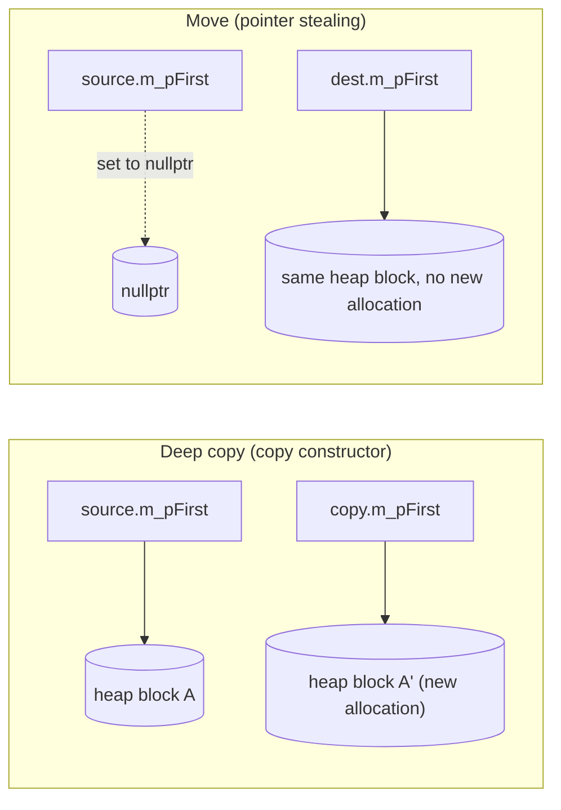

## Definition

Move semantics (*Move-Semantik*) let a class transfer ("steal") ownership of its dynamically allocated resources from a temporary or otherwise-expiring object instead of deep-copying them. It is implemented through **R-value references** (`T&&`) in function/constructor signatures, together with the `std::move()` and `std::forward()` utilities from `<utility>`.

> [!important] `std::move` moves nothing
> `std::move()` is purely a **cast** to an R-value reference — `static_cast<X&&>(lVar)` — performed entirely at compile time. The name is historical and, per the lecture notes, would have been better named `rvalue()`. No data is touched by calling `std::move()` itself; the actual resource transfer happens later, inside whichever move constructor or move-assignment operator ends up being selected because the argument is now an R-value.

## Problem it solves

Deep-copying a large dynamic data structure (e.g. a big vector, or a class holding owned pointers as in [[concepts/assignment-operator]]) is expensive, yet is exactly what a naive copy constructor/assignment does even when the source object is a temporary about to be destroyed anyway. Move semantics let the compiler pick a cheap, constant-time "steal the pointers" path instead, but only when it is provably safe to modify the source — i.e. only for R-values (see [[concepts/value-categories]]).

## `move()` and `forward()` in `<utility>` (§0.4.4.11–0.4.4.12)

```cpp
template<typename T>
Remove_reference<T>&& move(T&& t) noexcept {
return static_cast<Remove_reference<T>&&>(t); }
```

- `move()` converts its argument into an R-value, unconditionally — regardless of whether the input was itself an L-value or R-value.

`forward()` likewise converts to an R-value, but is conditional: it works correctly for **both** L-values and R-values passed through a template parameter, preserving (*perfect forwarding*, *Weiterleiten*) whichever category the caller originally used. The notes emphasize that `forward()` is *safe*, whereas `move()` effectively marks the object for destruction (its resources may be gone afterward).

```cpp
template<typename T>
T&& forward(Remove_reference<T>&  t) noexcept {
return static_cast<T&&>(t); }

template<typename T>
T&& forward(Remove_reference<T>&& t) noexcept {
static_assert(!Is_lvalue_reference<T>,"L-Wert weiterleiten");
return static_cast<T&&>(t); }

int i = 7;
forward<int>(i); // L-Wert gelangt zur ersten  Version
forward<int>(7); // R-Wert gelangt zur zweiten Version
```

## Moving vs. deep copy (§0.4.4.14)

- Primitive types and objects without pointers are **always copied** — move and copy are indistinguishable for them.
- For objects that own dynamic memory via pointers, the two operations differ:
  - **Copy** (*Kopie*) produces a **deep copy** (*tiefe Kopie*): separately allocated, independent memory.
  - **Move** (*Verschieben*) produces a **shallow copy** (*flache Kopie*) of the pointer values, then sets the pointers in the source object to `nullptr` so its destructor does not free memory that now belongs to the destination.
- Because moving mutates the source, it is only permissible when the source is an R-value (nobody else still depends on its old content).
- `nullptr` is only assignable to pointers — not to be confused with the integer `NULL`/`0`.



## R-value references in signatures (§0.4.4.15)

An R-value reference (`&&`) in a signature refers to a temporary, modifiable object under the assumption that it will not be reused by its original owner:

- For primitive types and pointer-free objects, `T&&` behaves exactly like `T&`.
- For objects that own pointers, the pointers reachable through the `T&&` parameter may be modified as needed — this is precisely what lets a **move constructor** (*Move-Konstruktor*) or **move assignment** (*Move-Zuweisung*) move dynamic content instead of performing a costly deep copy.

## Copy constructor vs. move constructor (§0.4.4.16)

| | Copy constructor | Move constructor |
|---|---|---|
| Parameter | `const T&` (L-value reference) | `T&&` (R-value reference) |
| Parameter mutability | must be `const` | must **not** be `const` — it is modified |
| Source untouched? | yes | no — source's pointers are nulled out |

```cpp
class CAuto
{
CAuto(const CAuto&);  // Kopierkonstruktor, L-Wert-Referenz als Parameter
CAuto(      CAuto&&); // Move-Konstruktor, nur R-Wert-Referenz zulässig als
                       // Parameter, diesen nicht const setzen (kann
                       // verändert werden)!
...
}
```

(Example reference in the source material: `KP22_1_moveSemantik_floatVek`.)

## The move constructor (§0.4.4.17)

```cpp
CComplexPair::CComplexPair(const CComplexPair & lVar) // lVar ist L-Wert
{ m_pFirst  = new CComplex(*(lVar.m_pFirst ));
  m_pSecond = new CComplex(*(lVar.m_pSecond));
}
```

```cpp
CComplexPair::CComplexPair(      CComplexPair && rVar) // rVar ist R-Wert
{ m_pFirst  = rVar.m_pFirst;    // Dynamischen Speicher übernehmen (Move)
  m_pSecond = rVar.m_pSecond;
  rVar.m_pFirst  = nullptr;     // Dyn. Speicher vor Freigabe schützen,
  rVar.m_pSecond = nullptr;     //     daher rVar nicht const übergeben!
}  // nun erfolgt automatischer Aufruf des Destruktors von rVar,
   // dynamischer Speicher ist aber vor Freigabe geschützt
```

```cpp
//main.cpp
CComplexPair a, b;
CComplexPair c(std::move(a+b)); // Move-Konstruktor
```

```
Move constructor pseudocode:
1. Receive the source object `rVar` by R-value reference (T&&), not const.
2. For each owned pointer member: copy the pointer VALUE from rVar into *this
   (shallow copy — no new allocation, no deep copy of pointee content).
3. Set each corresponding pointer member in rVar to nullptr.
4. On return, rVar's destructor will run automatically; because its pointers
   are now nullptr, it frees nothing and the moved-to resources survive.
```

## Move assignment (§0.4.4.18)

Advantages: no re-reservation of dynamic memory, only a flat (shallow) copy instead of a deep copy, constant runtime; selected automatically when the right-hand-side argument is an R-value. Implemented here as a swap-based "swapper":

```cpp
CComplexPair& CComplexPair::operator=(CComplexPair && rVal)
{ if(this != &rVal)   // keine Selbstzuweisung erlauben
  { CComplex* temp = m_pFirst;    // swap m_pFirst
         m_pFirst  = rVal.m_pFirst;
    rVal.m_pFirst  = temp;
         temp      = m_pSecond;     // swap m_pSecond
         m_pSecond = rVal.m_pSecond;
    rVal.m_pSecond = temp;
  }
  return *this;
}
```

```
Move-assignment pseudocode (swap-based):
1. If `this == &rVal` (self-assignment), do nothing further.
2. For each owned pointer member: swap this object's pointer with rVal's
   pointer (no allocation, no deep copy).
3. (rVal now holds this object's old pointers and will free them when it is
   destroyed — exactly like an ordinary swap.)
4. Return *this by reference.
```

## Consequences / trade-offs

- Move semantics are, for large dynamic data structures, much more efficient than copying — the gain is proportional to the cost of the deep copy avoided.
- Move constructor/assignment parameters must be non-`const`, because the whole point is to mutate the source; this is the one place where a "copy-like" operation is explicitly allowed to have side effects on its argument.
- `std::forward()` is needed (rather than `std::move()`) whenever a template function must relay an argument onward while preserving whatever value category the caller used — this is the basis of *perfect forwarding*.

## Misuse & anti-patterns

- Calling `std::move()` on an object and then continuing to use it as if unchanged — after a move, the source is left in a valid-but-unspecified state and should only be destroyed or reassigned.
- Forgetting to null out stolen pointers in a hand-written move constructor: the moved-from object's destructor would then free memory that the new owner still uses (double free).
- Writing a `const T&&` move-constructor parameter — this prevents the mutation move semantics depend on and defeats the purpose.

## Related

- [[concepts/value-categories]]
- [[concepts/assignment-operator]]
- [[concepts/copy-constructor]]
- [[concepts/destructor]]
- [[concepts/memory-model]]
- [[synthesis/special-member-functions]]

## Sources

- [[sources/grigat-cpp-concepts-generic]] §0.4.4.11, §0.4.4.12, §0.4.4.13, §0.4.4.14, §0.4.4.15, §0.4.4.16, §0.4.4.17, §0.4.4.18
