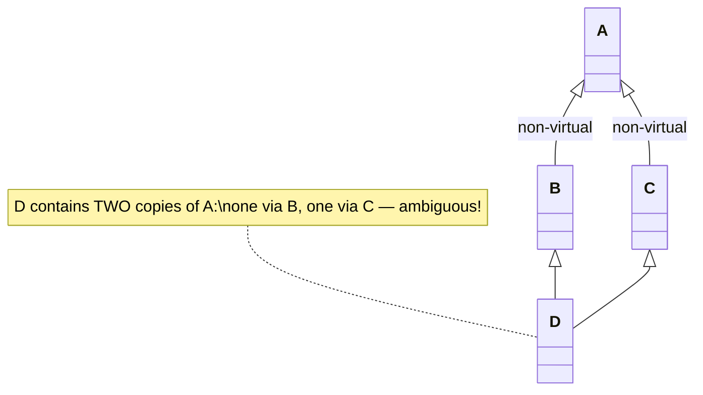
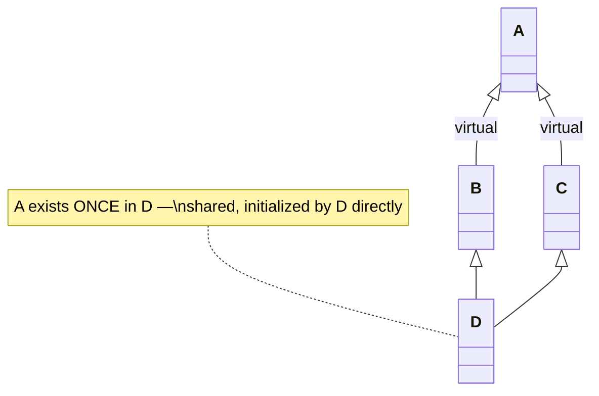

Multiple inheritance (*Mehrfachvererbung*) lets a class derive from more than one base class simultaneously — something C++ allows but Java does not (§0.3.5.2).

## Problem it solves

A class sometimes genuinely "is" more than one kind of thing at once — e.g. a convertible that is both a car and a toy. Single [[concepts/inheritance]] cannot express two independent "is-a" relationships from one class; multiple inheritance can.

## Multiple inheritance syntax and example

> Figure 9 ("UML-Diagramm: Mehrfachvererbung: 'Cabrio ist ein Auto und ein Spielzeug'") shows two base class boxes `CAuto` and `CSpielzeug` (toy), each connected via a hollow-triangle inheritance arrow down to a single box `CCabrio`, illustrating inheritance from two unrelated base classes (§0.3.5.2).

```cpp
// ccabrio.hpp
class CCabrio : public CAuto,
                public CSpielzeug
{                             // Mehrfachvererbung
public:
  CCabrio();
  ~CCabrio();
};
```

## Base class initialization order

A derived class cannot directly initialize members belonging to its base classes; instead its constructor must call the constructors of its base classes, via the member initializer list (§0.3.5.3):

```cpp
// ccabrio.cpp
CCabrio::CCabrio()
  : CAuto(),     // Initialisierung
    CSpielzeug() // der Basisklassen
{
  /* ... */
}
```

## Multiple indirect base classes and the diamond problem

An indirect base class of a class `D` can end up existing **multiple times in memory**, creating a risk of ambiguity (§0.3.5.4):

```cpp
class B : public A, public A {}; // Fehler
class B : public A {};  // nicht-virtuelle Basisklasse A
class C : public A {};
class D : public B, public C {}; // A ist in D doppelt vorhanden
```

Here `D` inherits from both `B` and `C`, and both `B` and `C` inherit (non-virtually) from `A`. `D` therefore contains **two separate copies** of `A` — the classic "diamond problem" (§0.3.5.4).



## Virtual base classes

Declaring the shared indirect base class `virtual` fixes this: `A` then exists only once in `D`'s memory, and the ambiguity is prevented (§0.3.5.5):

```cpp
class B : public virtual A {}; // virtuelle Basisklasse A
class C : public virtual A {};
class D : public B, public C {}; // A nur einmal vorhanden
```



### Procedure: resolving the diamond with virtual inheritance

1. Compiler sees `D : public B, public C`, where both `B` and `C` declare `A` as a `virtual` base.
2. Because `A` is virtual in both paths, the compiler allocates only **one** shared `A` subobject inside `D`, instead of one per path.
3. At construction time, `D` (the most-derived class) is made directly responsible for initializing the shared `A` subobject — not `B` or `C`.
4. Any constructor-call to `A` written inside `B` or `C` is ignored at runtime; only `D`'s own initializer list (or, absent that, `A`'s default constructor) actually runs.
5. All virtual base classes are constructed first (step 3), before any non-virtual base classes of `D`.
6. A member access like `d.someAmember()` inherited from `A` now resolves unambiguously, since there is only one `A` to find.

### Rules for virtual base classes

- Initialization of the virtual base class `A` happens via the constructor call made at the **deepest derivation level** — here, `D`. Constructor calls to `A` written inside `B` or `C` are ignored/ineffective (§0.3.5.5).
- If `D` calls no constructor of `A` itself, then `A` must have a default constructor, which is executed instead; constructor calls of `A` inside `B` and `C` remain ineffective regardless (§0.3.5.5).
- A virtual base class remains virtual for any further (deeper) derivations built on top of `D` (§0.3.5.5).
- An indirect base class **cannot** be declared virtual retroactively — it must be marked `virtual` at the point of inheritance, i.e. only in `B` and `C` themselves, not later in `D` (§0.3.5.5).
- Initialization order: all **virtual** base classes are initialized first, before the **non-virtual** base classes (§0.3.5.5).

## Consequences / trade-offs

- Multiple inheritance lets a class legitimately model two or more independent "is-a" relationships, something Java deliberately forbids (Java allows multiple interface implementation but only single class inheritance).
- The diamond problem is an inherent risk whenever two base classes share an indirect common ancestor; `virtual` inheritance resolves the duplication, but moves responsibility for initializing the shared base all the way to the deepest derived class, which must now know about a base class it does not directly inherit from.

## Misuse & anti-patterns

- Inheriting from the same base class twice directly (`class B : public A, public A {};`) — this is simply an error (§0.3.5.4).
- Forgetting to mark a shared indirect base class `virtual` in *both* intermediate classes (`B` and `C`) — marking it in only one still leaves a duplicate copy via the other path.
- Expecting to add `virtual` to an already-existing non-virtual indirect base relationship after the fact — it must be declared at the inheritance point itself, not patched in later from a further-derived class.

## Related

- [[concepts/inheritance]]
- [[concepts/composition]]
- [[concepts/constructor]]
- [[concepts/class-and-object]]

## Sources

[[sources/grigat-oop-teil1]] §0.3.5.2, §0.3.5.3, §0.3.5.4, §0.3.5.5
