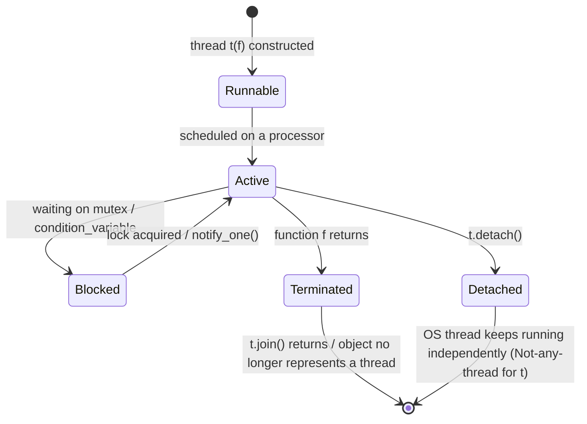
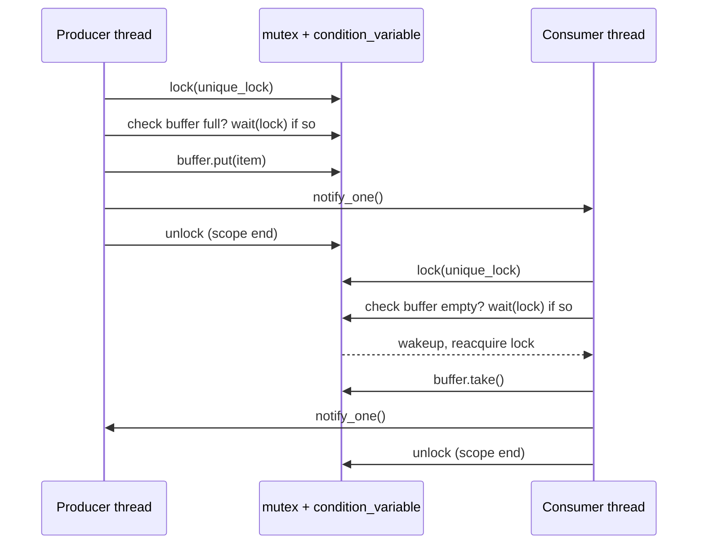

A **thread** (*Faden*, "thread of execution") is a sequentially executed program section; **multithreading** lets several such threads execute concurrently, sharing an address space but each keeping its own stack.

## Problem it solves

A single thread executes one instruction stream at a time. Multithreading lets independent parts of a program make progress concurrently — e.g. so that a slow input does not block an ongoing computation — and lets compute-intensive programs be accelerated via parallelization (e.g. four parallel threads on a quad-core processor). Because threads share an address space (global data), concurrent access to that shared memory must be synchronized.

## 0.5.12 Threads

- Every thread has its own stack (local data).
- Threads can share an address space (global data); synchronization of concurrent memory accesses (*konkurrierende Speicherzugriffe*) is necessary.
- Only one thread per processor can execute at a time; multiple processors/cores allow true parallel execution and time savings.

### Creating threads (*Threads erzeugen*)

- Threads are objects of class `thread`.
- States of such objects: *runnable* (*lauffähig*), *active* (*aktiv*), *blocked* (*blockiert*), or *terminated* (*beendet*). A terminated object no longer represents a thread.

```cpp
#include <thread>
void main(){
  thread t1(f1);        // Globale Funktion f1() ohne Parameter
  thread t2(f2, 5, 17); // Globale Funktion f2(5, 17)
  thread t3;             // t3 stellt noch keinen Thread dar
  t1.join();             // Warten, bis t1 beendet
  t2.join();             // Warten, bis t2 beendet
  // t1, t2 stellen nun keinen Thread mehr dar
}
```

`join()` blocks the calling thread until the joined thread finishes; after `join()` the `thread` object no longer represents a running thread.

### Copying, assignment, and moving of threads

Two objects of class `thread` cannot represent the same underlying thread of execution, so copy construction and copy assignment are suppressed:

```cpp
thread(const thread&) = delete;
thread& operator=(const thread&) = delete;
```

Move construction and move assignment (see [[concepts/value-categories]], [[concepts/move-semantics]]) are allowed instead:

```cpp
t1 = thread t(f);   // Funktion f() global, t(f) temporär
```

A thread can be initialized with a [[concepts/function-objects|function object]]; internally it always works with a *copy* of that function object.

### Concurrent memory accesses and `mutex`

- Simultaneous memory accesses by different threads (race conditions, *racing conditions*) can lead to inconsistency.
- A `mutex` ("mutual exclusion lock") exclusively assigns a resource to one thread until that thread releases it again.
- If other threads attempt to acquire the mutex, they are blocked until it is released.
- Locking with `lock()`, release with `unlock()`.

```cpp
#include <thread>
#include <mutex>
#include <string>
#include <iostream>

std::string s;      // Speicher für konkurrierende Zugriffe
std::mutex mtx;     // Mutex global vereinbaren

void writeHallo(){
  mtx.lock();
  s = "Hallo"; std::cout << s ;
  mtx.unlock();
}
int main(){
  std::thread t1(writeHallo);
  std::thread t2(writeHallo); // Ohne Mutex HaHllalolo möglich
  t1.join(); t2.join();       // Mit Mutex HalloHallo
  return 0;
}
```

Without the mutex, interleaved/garbled output like `"HaHllalolo"` is possible; with the mutex, clean sequential output `"HalloHallo"` results.

### Thread-ID

- Every `thread` object is assigned a unique value, the Thread-ID, of class `id` (a class local to `thread`, i.e. `thread::id`).
- The Thread-ID is a positive integer if the thread object is associated with a thread, or the special value *Not-any-thread* if it is associated with no thread.
- `t.get_id()` gives the Thread-ID of thread object `t`; for *Not-any-thread* this yields the value `0`.
- From *within* the function `f` running in a thread `t(f)`, the current Thread-ID is obtained via the global function `get_id()` in namespace `this_thread`:

```cpp
thread::id x = this_thread::get_id(); // in Funktion f im thread t
```

### Detach

- `t.detach();` prematurely releases the connection between the `thread` object `t` and its underlying OS thread.
- After `detach()`, `t.get_id()` returns the pseudo-value *Not-any-thread*.
- The underlying thread itself continues executing until completion — it is not stopped.
- The thread retains the ID previously assigned to `t`; that ID can still be queried from within the running thread via `this_thread::get_id()`.

### Deadlocks and `lock_guard`

- If `unlock()` is never called, the program hangs as soon as another `lock()` on the same mutex occurs — a **deadlock**.
- Remedy: **locks**, objects of the template class `lock_guard<mutex>`.
  - Constructor calls `lock()`.
  - Destructor calls `unlock()`.
- A lock is created as a local variable inside the function run by the thread; it is destroyed at the end of its scope, automatically calling `unlock()` — this is [[concepts/destructor|RAII]] applied to synchronization.

```cpp
lock_guard<mutex> lock(mtx);
```

### Recursive mutex (*rekursiver Mutex*)

- A recursive routine that calls itself will call `lock()` again inside the recursive call — with an ordinary `mutex` this deadlocks (the same thread blocks on a lock it already holds).
- `recursive_mutex` allows the **same thread** to re-lock recursively, while other threads remain blocked as usual.
- The recursive lock is only destroyed (and `unlock()` only truly released) when the scope of the *first*, outermost call of the executed routine is left:

```cpp
lock_guard<recursive_mutex> reclock(m);
```

### Condition variables (*Bedingungsvariablen*) — producer/consumer pattern

- Consumer is **blocked** when the buffer is empty; producer wakes the consumer once data has been written.
- Producer is **blocked** when the buffer is full.
- Synchronization is done via **condition variables**, objects of class `condition_variable`, which can block threads or lift such blocking.
- `condition_variable` works together with a lock of template class `unique_lock<mutex>`.

```cpp
#include <mutex>
#include <condition_variable>
condition_variable cond;
mutex mtx;
unique_lock<mutex> lock(mtx);
cond.wait(lock);   //
cond.notify_one(); // hebt Blockierung des nächsten wartenden Threads auf
```

`cond.wait(lock)` blocks the current thread (releasing `lock` while waiting); `cond.notify_one()` lifts the blocking of the next waiting thread.

## Numbered pseudocode: producer/consumer protocol

```
1. shared: buffer, mtx (mutex), cond (condition_variable)
2.
3. function producer():
4.     lock = unique_lock(mtx)
5.     while buffer is full:
6.         cond.wait(lock)          // releases mtx while blocked, reacquires on wakeup
7.     buffer.put(item)
8.     cond.notify_one()            // wake a possibly-waiting consumer
9.     // lock released when 'lock' goes out of scope
10.
11. function consumer():
12.    lock = unique_lock(mtx)
13.    while buffer is empty:
14.        cond.wait(lock)          // releases mtx while blocked, reacquires on wakeup
15.    item = buffer.take()
16.    cond.notify_one()            // wake a possibly-waiting producer
17.    // lock released when 'lock' goes out of scope
18.    return item
```

## Mermaid: thread lifecycle



## Mermaid: producer/consumer handshake



## Consequences / trade-offs

- Multithreading can meaningfully speed up compute-bound work on multi-core hardware, but adds the burden of correct synchronization.
- `lock_guard`/`unique_lock` turn locking into an RAII pattern, making it far harder to forget `unlock()` — but a misused `recursive_mutex` or nested locks across multiple mutexes can still deadlock.
- `thread` objects being movable-only (not copyable) mirrors the move semantics of other exclusive-ownership types such as [[concepts/smart-pointers|std::unique_ptr]].

## Misuse & anti-patterns

- Manual `lock()`/`unlock()` without RAII is fragile: any early return or exception skips `unlock()` and causes a deadlock.
- Using a plain `mutex` in recursive code causes a self-deadlock; `recursive_mutex` is required there.
- Calling `detach()` and then letting the owning scope end without any further synchronization can lead to the detached thread outliving data it references (dangling references into the caller's stack).

## Related

- [[concepts/memory-model]]
- [[concepts/move-semantics]]
- [[concepts/value-categories]]
- [[concepts/smart-pointers]]
- [[concepts/destructor]]
- [[concepts/function-objects]]

## Sources

- [[sources/grigat-cpp-concepts-generic]] §0.5.12
