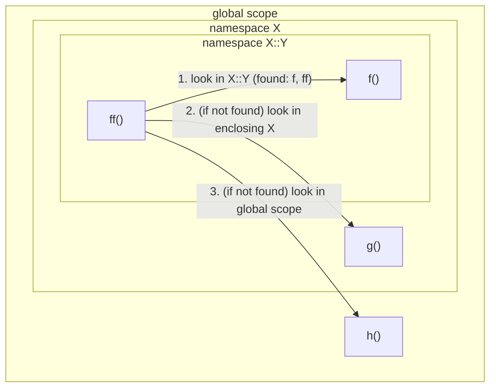
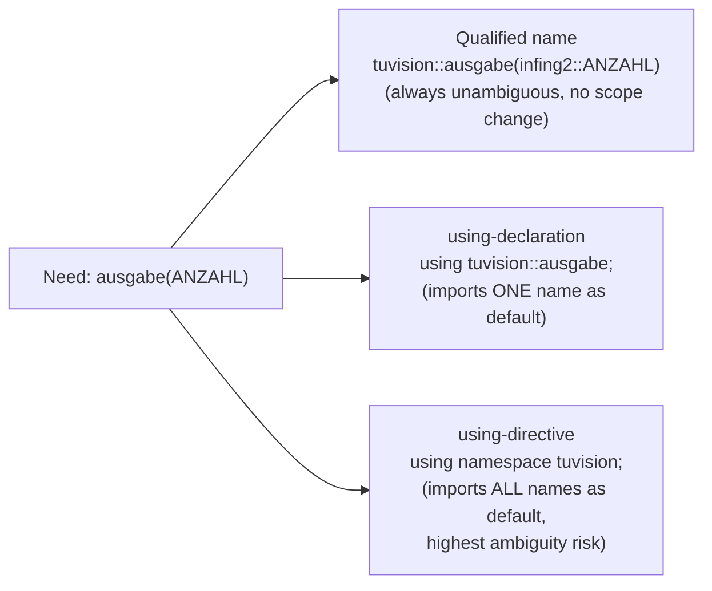

## Definition

A namespace (*Namensraum*) is a named scope that groups declarations so that
identical names from different libraries do not collide (§0.2.5.12).

## Problem it solves

Different libraries can use the same name for functions or variables, causing
an ambiguity error when both are included:

```cpp
//tuvision.hpp
const int ANZAHL = 5;
void ausgabe(int x);

//infing2.hpp
const int ANZAHL = 7;
void ausgabe(int x);

//main.cpp
#include "tuvision.hpp"
#include "infing2.hpp"
//Fehlermeldung wegen
//Mehrdeutigkeit von ANZAHL
```

```cpp
int main()
{
  ausgabe(ANZAHL);
  return 0;
}
```

## Separate namespaces as the solution (§0.2.5.12)

Each header wraps its declarations in its own namespace:

```cpp
//tuvision.hpp
namespace tuvision
{
  const int ANZAHL = 5;
          //tuvision::ANZAHL
  void ausgabe(int x);
          //tuvision::ausgabe
}

//infing2.hpp
namespace infing2
{
  const int ANZAHL = 7;
          //infing2::ANZAHL
  void ausgabe(int x);
          //infing2::ausgabe
}
```

Resolving a name from a namespace (*Auflösung des Namensraums*) can be done
three ways:

1. **Scope resolution operator `::`**, fully qualifying the name:

```cpp
tuvision::ausgabe(infing2::ANZAHL);
```

2. **`using` declaration** — brings a single name into the current scope as
   the default:

```cpp
using tuvision::ausgabe;
// Deklaration: Funktion ausgabe
// aus tuvision ist Default
ausgabe(infing2::ANZAHL);
```

3. **`using namespace` directive** — brings *all* definitions from a namespace
   into the current scope as the default:

```cpp
using namespace tuvision;
// Direktive: alle Definitionen aus
// tuvision sind Default
ausgabe(ANZAHL);
```

The `using`-declaration is more targeted (imports one name), while the
`using namespace`-directive imports everything from the namespace and is more
prone to reintroducing ambiguity if multiple namespaces are opened this way.

## Unnamed (anonymous) namespace (§0.2.5.13)

An unnamed namespace encapsulates a translation unit's global variables so
they do not leak external linkage:

```cpp
namespace {              // anonymer Namensraum
int a;
void f() { /* ... */ }
int g() { /* ... */ }
}
```

It behaves as if it had a unique name known only within that translation unit
(shown here as `$$$`), with an implicit `using namespace` applied:

```cpp
namespace $$$ {
    int a;              // $$$ nur lokal bekannt
    void f() { /* ... */ }
    int g() { /* ... */ }
}
using namespace $$$;
```

This gives the contained names **internal linkage** — see
[[concepts/scope-and-storage-classes]].

## Nested namespaces (§0.2.5.14)

```cpp
void h();                      // h()
namespace X {
    void g();                   // X::g()
    namespace Y {
        void f();               // X::Y::f()
        void ff();              // X::Y::ff()
    } // X::Y
} // X
```

Name-resolution rules, illustrated by legal/illegal calls:

```cpp
void X::Y::ff() {
f(); g(); h();      // OK, Zugriff auf Umgebung
}
void X::g() {
f();                // Fehler: kein f() in X
Y::f();             // OK
}
void h() {
f();                // Fehler: keine globale f()
Y::f();             // Fehler: kein globaler Y
X::f();             // Fehler: kein f() in X
X::Y::f();          // OK
}
```

Key teaching point: code *inside* a nested namespace can access names from its
enclosing scopes directly (`ff()` can call `f()`, `g()`, `h()` unqualified),
but code *outside* a namespace must fully qualify nested names
(`X::Y::f()`); unqualified or partially qualified lookups fail if the name
is not visible in that exact scope.

## Nested namespaces and name lookup



Lookup from inside `X::Y::ff()` walks **outward**: first the innermost
enclosing namespace (`X::Y` itself), then each enclosing namespace in turn
(`X`, then global), stopping at the first scope that declares the name. Code
written *outside* `X`/`X::Y` does not get this automatic walk — it must supply
the qualification itself (`X::Y::f()`), which is exactly why the `h()` and
`X::g()` examples above fail without it.

## Qualified name, `using`-declaration, and `using`-directive



## Consequences / trade-offs

- Namespaces resolve cross-library name collisions without renaming the
  colliding identifiers themselves.
- `using namespace` at broad scope (e.g., in a header) reintroduces the
  collision risk namespaces were meant to prevent.
- Unnamed namespaces are a namespace-based alternative to the `static`
  module-global storage class for giving names internal linkage.

## Misuse & anti-patterns

- Placing `using namespace X;` inside a header file, which forces that choice
  onto every translation unit that includes the header.
- Expecting an unqualified name used outside a namespace to resolve into it
  without `::` qualification or a `using` declaration/directive — the nested
  namespace example above shows this fails to compile.

## Related
- [[concepts/scope-and-storage-classes]]
- [[concepts/modularization-and-build-pipeline]]
- [[concepts/class-and-object]]
- [[concepts/standard-library]] — `std` is the namespace this page's
  `using namespace std;` examples open

## Sources
- [[sources/grigat-oop-teil1]] §0.2.5.12-0.2.5.14
