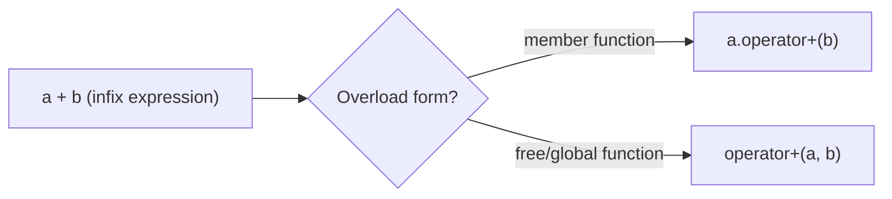

## One-sentence definition

Operator overloading (*Überladen von Operatoren*) is the definition of an
operator (such as `+`, `+=`, `[]`) for a custom data type, so that objects of
that type can use natural infix/index syntax instead of explicit function
calls (§0.4.1.9).

## Problem it solves

Without overloading, combining custom objects requires ugly, unfamiliar
function-call syntax. The notes motivate this with an addition
(*Additionsoperation*) example for a `CComplex` class.

### Option 1 — Additionsfunktion (addition function, no overload) (§0.4.1.7)

```cpp
//ccomplex.hpp
class CComplex
{
  public:
    CComplex plus(CComplex &other);
    /* ... */
}
```

```cpp
//ccomplex.cpp
CComplex CComplex::plus(CComplex &other)
{
    return CComplex(re()+other.re(),
                    im()+other.im());
}
```

```cpp
// main.cpp
/* ... */
  CComplex a(0.0,1.0);
  CComplex b(1.0,0.0);
  CComplex c = a.plus(b);  // unschön, + wäre besser
```

The notes comment on the last line: *"unschön, + wäre besser"* — "ugly, `+`
would be better". This motivates overloading `operator+` directly.

### Option 2 — Überladen des Operators + (overloading operator+) (§0.4.1.8)

```cpp
//ccomplex.hpp
class CComplex
{
  public:
    CComplex operator+(CComplex &other);//Überladen der Methode operator+
    /* ... */                           //die bei Operation + aufgerufen wird
}                                        //a + b bewirkt a.operator+(b)
```

```cpp
//ccomplex.cpp
CComplex CComplex::operator+(CComplex &other)
{
    return CComplex(re()+other.re(),
                    im()+other.im());
}
```

```cpp
// main.cpp
/* ... */
  CComplex a(0.0,1.0);
  CComplex b(1.0,0.0);
  CComplex c = a + b;  // gewohnte Schreibweise, nun auch für CComplex
```

"a + b bewirkt a.operator+(b)" — "a + b causes a.operator+(b)": the compiler
rewrites the infix expression into a call of the member function
`operator+`.

## Overloading operators in C++ (§0.4.1.9)

- Operator overloading **defines** an operator for a custom data type.
- Code becomes clearer and easier to understand **if** operators are
  overloaded **sinnvoll** (sensibly) — e.g. never implement subtraction
  behavior under `+`.
- As a **member function**: the first operand is always the object from
  which the operator is called; `a + b` causes `a.operator+(b)`.
- Alternative: define the operator as a **global/free function**
  (*globale Funktion*) with two call parameters, e.g. `A& operator+(A&, A&)`.
- Ordinary C++ function attributes (`static`, `virtual`, …) also apply to
  operator functions, since they are functions/[[concepts/member-functions]]
  like any other.



## Overloading operator+= (§0.4.1.10)

```cpp
//ccomplex.hpp
class CComplex
{
/* ... */
  CComplex& operator+=
    (CComplex& z);
};
```

```cpp
//ccomplex.cpp
CComplex& CComplex::operator
  +=(CComplex& z)
{
  m_re += z.re();
  m_im += z.im();
  return *this;
}
```

```cpp
//main.cpp
  CComplex a(1.0,2.0);
  CComplex b(3.0,4.0);
  a += b;
```

**Anmerkungen (Remarks):**
- The operator is the member function `CComplex::operator+=`.
- A space is allowed in the declaration, i.e. `CComplex::operator +=` is
  equivalent.
- The first operand is the current object (*aktuelles Objekt*) — `a` in
  `main.cpp`.
- `a += b` causes `a.operator+=(b)`.
- The function returns `*this` by reference so that compound assignment can
  itself be chained, mirroring [[concepts/this-pointer]] usage.

## Overloading operator[] (§0.4.1.11)

- The index operator `[]` causes the call of the member function
  `operator[]`.
- Realization of multi-dimensional arrays by **composition of classes**
  ([[concepts/composition]]): e.g. matrices as column objects that contain
  row objects (*Matrizen als Spaltenobjekte, die Zeilenobjekte enthalten*).

> [!warning] Uncertain / not in notes
> The transcribed notes describe *which* operators the lecture demonstrates
> overloading for (`+`, `+=`, `[]`) but do not enumerate a general list of
> which C++ operators can or cannot be overloaded beyond this; the only
> explicit non-overloadable case recorded anywhere in this source chunk is
> the **initialization** form of `=` (see [[concepts/copy-constructor]]
> §0.4.4.7), not operators in general. Do not infer a complete
> overloadable/non-overloadable list from these notes alone.

## Consequences / trade-offs

- Member-function overloads make the first operand implicit and require
  mutation access to the class; free-function overloads allow the left
  operand to be of a different (or built-in) type and can access private
  members only via [[concepts/friend]].
- Overloading increases notational convenience but can obscure cost: `a + b`
  looks like a cheap built-in operation even when it allocates.

## Misuse & anti-patterns

- Overloading an operator with semantics unrelated to its conventional
  meaning (the notes' explicit example: implementing `-` behavior under `+`)
  makes code harder, not easier, to understand — the opposite of the
  motivation for overloading in the first place.

## Related
- [[concepts/operators-and-precedence]]
- [[concepts/function-overloading]]
- [[concepts/member-functions]]
- [[concepts/composition]]
- [[concepts/copy-constructor]]

## Sources
- [[sources/grigat-cpp-concepts-generic]] §0.4.1.7, §0.4.1.8, §0.4.1.9, §0.4.1.10, §0.4.1.11
