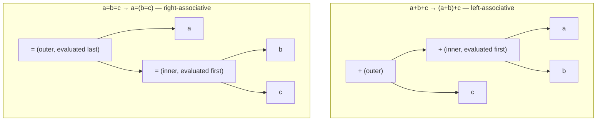

## One-sentence definition

An operator (*Operator*) applies a fixed operation to one, two, or three
operands, written in infix, prefix, or postfix notation; C++ ranks every
operator into one of 13 precedence levels that determine the implicit
parenthesization (*Klammerung*) of an expression (§0.4.1.1, §0.4.1.4).

## Problem it solves

Mathematical expressions need an unambiguous way to decide which sub-expression
is evaluated first when no (or only partial) parentheses are given, and a way
to classify how many operands a given operator symbol consumes.

## Notations for operator application (§0.4.1.1)

Given operator `+` with operands `a, b`:

| Notation | Form | Property |
|---|---|---|
| Infix-Notation (infix) | `a + b` | conventional math notation; evaluation order depends on precedence and parenthesization (*Klammerung*) |
| Präfix-Notation (prefix, "Polish notation" / *polnische Notation*, after Łukasiewicz) | `+ a b` | operator precedes both operands; **no** dependency on priorities or parentheses; used e.g. in Lisp |
| Postfix-Notation (postfix, "reverse Polish notation" / *umgekehrte polnische Notation*) | `a b +` | operator follows both operands; easily evaluated automatically with the [[structures/stack]] ADT (cf. [[algorithms/postfix-evaluation]]) |

Because prefix and postfix notation encode structure directly in token order,
they need no precedence rules or parentheses to be unambiguous — a property
infix notation lacks.

## Unary, binary, and ternary operators (§0.4.1.3)

- **Unärer (einstelliger, monadischer) Operator** (unary / one-place / monadic
  operator): exactly **one** operand. Example: negation, `a = -b;`.
- **Binärer (zweistelliger, dyadischer) Operator** (binary / two-place /
  dyadic operator): exactly **two** operands. Example: addition, `c = a + b;`.
- **Ternärer (dreistelliger) Operator** (ternary / three-place operator):
  exactly **three** operands. In C++ only `?:` has three operands:
  `a?b:c;` means *if a, then b, else c*.

## Operator precedence table (§0.4.1.4, §0.4.1.5)

Associativity rule: unary operators and assignment operators are
**rechtsassoziativ** (right-associative); all other operators are
**linksassoziativ** (left-associative, evaluated left to right).

| Level | Operators | Notes |
|---|---|---|
| 1 | `(ausdr)` parenthesization, lambda expressions | highest precedence |
| 2 | `klassenname::member`, `namespace::member`, `::name` | scope resolution |
| 3 | `objekt.member`, `zeiger->member` | object / pointer member access |
| 4 | Suffixoperatoren ("von rechts"/from the right): `zeiger[ausdr]` indexing, `ausdr(ausdrliste)` function call, `L-Wert++`, `L-Wert--` post-inc/dec, `static_cast`/`dynamic_cast`/`reinterpret_cast`/`const_cast`, functional-style conversion `typ(ausdrliste)` | postfix operators |
| 5 | Präfixoperatoren ("von links"/from the left): `++L-Wert`, `--L-Wert` pre-inc/dec, `~`, `!`, unary `+`, unary `-`, `&` address-of, `*` dereference, `new`, `delete`, `noexcept`, `(typ)ausdr` cast | prefix operators; right-associative |
| 6 | `*`, `/` | arithmetic |
| 7 | `+`, `-` | arithmetic |
| 8 | `<<`, `>>` | shift |
| 9 | `<`, `<=`, `>=`, `>` | relational comparisons |
| 10 | `==`, `!=` | equality comparisons |
| 11 | diverse Stufen logischer Operatoren (various levels of logical operators) | `&&`, `\|\|`, etc. |
| 12 | `ausdr ? ausdr : ausdr` | ternary operator |
| 13 | `=`, `*=`, `/=`, `+=`, `-=` | assignments; right-associative |

### Precedence examples (§0.4.1.5)

- `a=b=c` means `a=(b=c)` (assignment is right-associative)
- `a+b+c` means `(a+b)+c` (addition is left-associative)
- `a<<b<<c` means `(a<<b)<<c`
- `*p++` means `*(p++)` (postfix `++` binds tighter than prefix `*`)
- `int*p[]` means array of pointers to `int`
- `int(*p)[]` means pointer `p` to array of `int`
- `int*p()` means function `p` that returns pointer to `int`

These examples illustrate [[concepts/complex-declarations]]: C++'s
declaration syntax reads using the same precedence table as expressions.

### Parse trees: left- vs. right-associativity in practice

The two grouping examples above come from the **same** operator applied
twice in a chain, yet they group in opposite directions because `+` (level
7) is left-associative while `=` (level 13) is right-associative:

Reading the trees: for `a+b+c`, the **left** `+` is the inner node (grouped
and evaluated first), reflecting left-to-right association. For `a=b=c`,
the **right** `=` is the inner node (grouped and evaluated first), reflecting
right-to-left association — `c` is assigned to `b` first, and that result is
then assigned to `a`.

## Operator vs. function (§0.4.1.6)

An n-ary operator is interpretable as a function call:

- Infix: `a + b`
- As a **global function**: `plus(a,b)` — an n-ary operator ≈ a free function
  with **n** parameters
- As a **member function**: `a.plus(b)` — an n-ary operator ≈ a member
  function with **n−1** parameters (the first operand becomes the implicit
  object)

This equivalence is the basis for [[concepts/operator-overloading]]: `a + b`
literally causes `a.operator+(b)` once `operator+` is defined as a member of
`a`'s class.

## Consequences / trade-offs

- Postfix notation trades human readability for machine-friendly,
  parenthesis-free evaluation (see [[algorithms/postfix-evaluation]]).
- The 13-level precedence table lets C++ omit most parentheses, but ambiguous
  declarations like `int*p[]` vs `int(*p)[]` show that the same precedence
  rules governing expressions also govern type declarations, which is a
  frequent source of confusion (see [[concepts/complex-declarations]]).

## Misuse & anti-patterns

- Relying on precedence instead of parentheses in non-obvious mixed
  expressions (e.g. combining shifts and comparisons) harms readability even
  when the result is technically correct.
- Confusing prefix `*`/`&` (dereference/address-of, level 5) with their binary
  counterparts (multiplication, level 6; bitwise AND, which is not shown
  separately in this table) is a classic parsing trap, visible in `*p++`.

## Related
- [[algorithms/postfix-evaluation]]
- [[concepts/operator-overloading]]
- [[concepts/complex-declarations]]
- [[concepts/function-overloading]]

## Sources
- [[sources/grigat-cpp-concepts-generic]] §0.4.1.1, §0.4.1.3, §0.4.1.4, §0.4.1.5, §0.4.1.6
