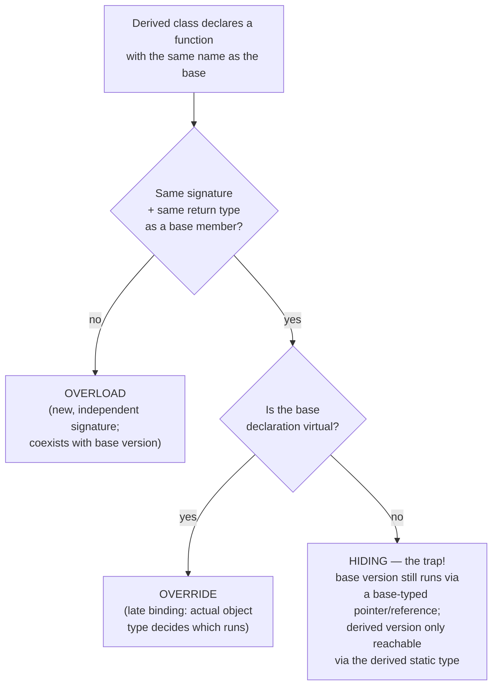

*Überschreiben* (overriding) replaces the functionality of an inherited
method in a derived class; *Überladen* (overloading) defines several methods
that share a name but differ in signature. They look similar but solve
different problems and are controlled by different C++ mechanisms.

## Overriding (Überschreiben)

Overriding requires the **same name, same signature, and same return type**
as the base-class method, but different functionality in the derived class.

```cpp
//cauto.hpp
class CAuto
{
public:
    virtual void lackiere(std::string farbe); // Tip: niemals nicht-virtuelle
/* ... */ };                                   // Funktion überschreiben, siehe bei Polymorphie

//ccabrio.hpp
class CCabrio : public CAuto
{
public:
    void lackiere(std::string farbe);
}; //ueberschreiben von lackiere
```

`virtual` on the base-class declaration is what makes this a true override
with late binding — see [[concepts/polymorphism]]. `virtual` is inherited
automatically; it does not need to be repeated in the derived class
declaration, though the function must still be re-declared (not just defined
externally) in the derived class to actually override it.

### Calling the base-class version despite overriding

The scope operator `::` lets an overriding function explicitly invoke the
base-class version it replaced (also usable with multiple inheritance to pick
a specific base):

```cpp
//cabrio.cpp
void CCabrio::lackiere(string farbe)
{
  cout << "Dach mit Folie schuetzen";
  CAuto::lackiere(farbe);
}
```

## Overloading (Überladen)

Overloading means **the same function name with a different signature**
(different parameter list). Unlike overriding, overloading can happen within
the same class, and a derived class can additionally overload a name it
inherited — see also [[concepts/function-overloading]] for the general
mechanism outside inheritance, and [[concepts/operator-overloading]] and
[[concepts/templates]] for two further places C++ reuses the "same name,
resolved differently" idea — operator overloading at the lexical/syntax
level, and template overload resolution against multiple instantiable
signatures at compile time.

## Three cases, side by side



### Procedure: how a call `obj.f(args)` is actually resolved

1. **Name lookup**: starting from `obj`'s *static* (declared) type, search outward through enclosing scopes/base classes for any declaration named `f`; stop at the first scope where at least one `f` is found (this is why a derived `f` with a different signature can *hide* all base overloads of `f`, rather than merely adding to them).
2. **Overload resolution**: among the declarations of `f` found in that one scope, pick the one whose parameter list best matches `args`; if none matches or it's ambiguous, compile error.
3. **Virtual dispatch check**: if the selected declaration is `virtual` and the call is made through a pointer/reference (not a plain object or `Base::f(...)` qualified call), defer the actual function address to runtime.
4. **Runtime dispatch** (only if step 3 deferred): look up `obj`'s actual *dynamic* type's [[concepts/vtable|vtable]] entry for that virtual function and call it instead of the statically selected one.
5. Otherwise (non-virtual, or qualified with `::`), call the statically selected function directly — no runtime lookup.

## `final`

The `final` keyword, placed after a class name, creates a **final class**
that cannot be further derived:

```cpp
class CCabrio final : public CAuto
{ /* ... */ };
```

Placed at the end of a virtual member function's declaration (within the
class body, after `override` if both are used), `final` prevents that
specific member function from being overridden in any further-derived class:

```cpp
class CBus : CAuto{
void waschen() const noexcept override final;
};
```

`final` is a *contextual keyword* — its meaning depends on where it appears
(class vs. member function); preventing further overriding is only achievable
at the very end of the member-function declaration inside the class
definition.

## `override`

Placed at the end of an overriding member function's signature, `override`
makes the compiler verify that a corresponding `virtual` method with a
matching signature and return type actually exists in the base class —
otherwise it's a compile error. This turns an accidental overload (silent
"name hiding" of the base method) into a hard compile-time failure.

```cpp
void waschen() override;
void lackiere(string) override final;
std::string getFarbe() const noexcept override final;
```

`override` is written at the very end of the member-function declaration,
before `final` if both are used.

## Pitfalls

> [!warning] Never override a non-virtual function
> If the base-class function is not declared `virtual`, "overriding" it in a
> derived class does not give late binding: calling it through a base-class
> pointer or reference always runs the base-class version, regardless of the
> actual object type. The derived "override" silently becomes an unrelated,
> hidden function (name hiding) reachable only via the derived static type.
> This is called out repeatedly as a classic C++ pitfall — see
> [[concepts/polymorphism]] for the mechanics and [[concepts/access-modifiers]]
> for how this interacts dangerously with `protected` data.

## Related

- [[concepts/polymorphism]]
- [[concepts/vtable]]
- [[concepts/function-overloading]]
- [[concepts/access-modifiers]]
- [[concepts/abstract-class]]
- [[concepts/operator-overloading]]
- [[concepts/templates]]

## Sources

- [[sources/grigat-oop-teil1]] §0.3.5.11
- [[sources/grigat-oop-teil1]] §0.3.5.12
- [[sources/grigat-oop-teil1]] §0.3.5.13
- [[sources/grigat-oop-teil1]] §0.3.5.14
- [[sources/grigat-oop-teil1]] §0.3.5.15
