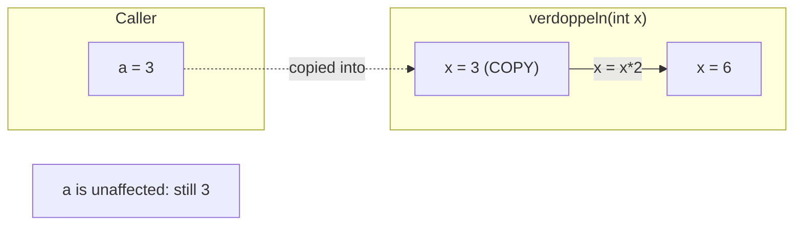
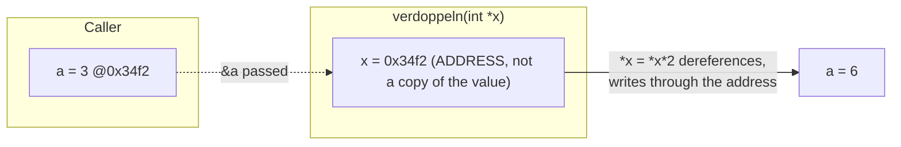
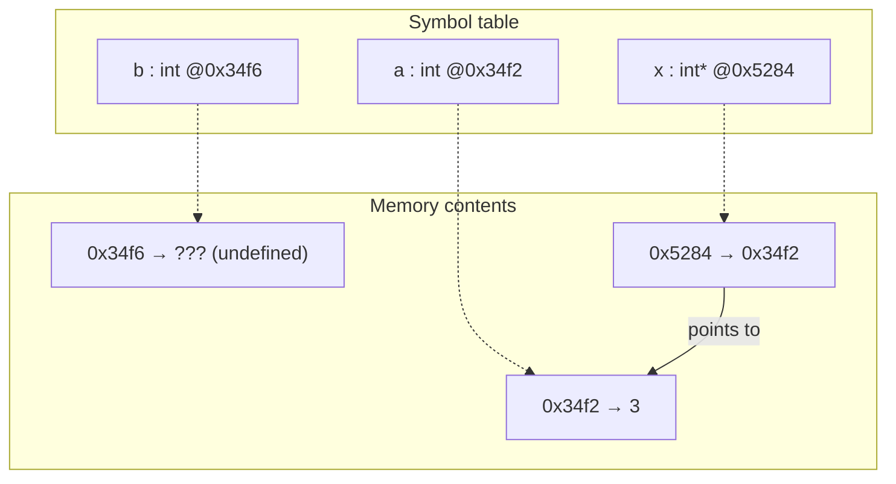

# Parameter Passing

How an argument reaches a function decides whether the caller's variable can
change.

- **Call by Value** — a *copy* of the parameter variable is passed. The original
  cannot be changed by the function.
- **Call by Reference** — the function operates on the *original* variable. No
  copy is made, so it is faster, and the original can be changed.

> [!note] Two meanings of "reference"
> The general concept in "Call by Reference" is not the same as the specific C++
> language feature *Referenz(C++)* (`int&`). C++ can realise call by reference
> either with a reference **or** with a pointer.

## Call by Value



```cpp
int verdoppeln(int x)
{
    x = x * 2;
    return x;
}

int a = 3;
int b = verdoppeln (a);
cout << a << ", " << b;
```

A copy of `a` is passed; `a` is **not** changed. Output: `3, 6`.

## Call by Reference via C++ references

```mermaid
graph LR
    subgraph Caller
        a["a = 3"]
    end
    subgraph "verdoppeln(int&#38; x)"
        x["x (ALIAS, same storage as a)"]
    end
    a ===|"x IS a, no copy"| x
    x -->|"x = x*2 writes through to a"| a2["a = 6"]
```



```cpp
int verdoppeln(int& x) // x ist anderer Name fuer
{                       // Speicherstelle einer
    x = x * 2;          // int Parametervariable
    return x;
}

b = verdoppeln (a);
cout << a << ", " << b;
```

`int&` means a reference is passed — "another name" for a variable that exists
outside. Inside `verdoppeln`, `x` *is* `a`. Output: `6, 6`.

## Call by Reference via pointers



```cpp
int verdoppeln(int *x)//Zeiger auf int
{//Inhalt von x mit 2 multiplizieren
    *x = *x * 2;
    return *x; //Rueckgabe: Inhalt von x
}            //(Typ int)
```

Called as `int b = verdoppeln(&a);` — read `int *x` right-to-left as "x is
pointer to int". Output is again `6, 6`.

### What the machine sees

Compiler symbol table (*Symboltabelle*) for the pointer variant:

| Name | Adresse | Typ |
|---|---|---|
| a | 0x34f2 | int |
| b | 0x34f6 | int |
| x | 0x5284 | int * |

Data inside `verdoppeln`:

| Adresse | Inhalt |
|---|---|
| 0x34f2 | 3 |
| 0x34f6 | ??? (undefined) |
| 0x5284 | 0x34f2 |

`x` holds the *address* of `a`, which is why writing through `*x` reaches `a`.



## Choosing

| Goal | Use |
|---|---|
| Caller's value must not change, object is small | Call by Value |
| Avoid copying a large object, no modification intended | `const T&` — see [[concepts/const-and-volatile]] |
| Function must modify the caller's variable | `T&` |
| Interop with C, or the argument may legitimately be absent | `T*` |

```text
PROCEDURE choose_parameter_passing_mode(parameter_type, must_modify_caller, argument_may_be_absent):
1. IF argument_may_be_absent OR interop_with_C:
2.     use T* (pointer)
3. ELSE IF must_modify_caller:
4.     use T& (reference)
5. ELSE IF parameter_type is small and cheap to copy:
6.     use T (call by value)
7. ELSE:
8.     use const T& (reference, no copy, no modification allowed)
```

The script's recommendation is to prefer C++ references over pointers — see
[[concepts/pointers-and-references]].

> [!warning] Return local variables only as a copy.
> A local variable's storage dies at the end of its scope; returning a reference
> or pointer to it dangles. See [[concepts/scope-and-storage-classes]].

## Related

- [[concepts/pointers-and-references]]
- [[concepts/const-and-volatile]]
- [[concepts/function-declarations]]
- [[concepts/scope-and-storage-classes]]
- [[concepts/memory-model]]
- [[concepts/value-categories]]
- [[concepts/move-semantics]] (rvalue references add a third reference-passing mode)

## Sources

- [[sources/grigat-oop-teil1]] §0.2.4.1 (Parameterübergabe),
  §0.2.4.2 (Call by Value), §0.2.4.3 (Inhaltsoperator, Adressoperator),
  §0.2.4.4–0.2.4.5 (Call by Reference), §0.2.4.6 (Probleme von Zeigern),
  §0.2.1.3 (Globale vs. lokale Variable)
