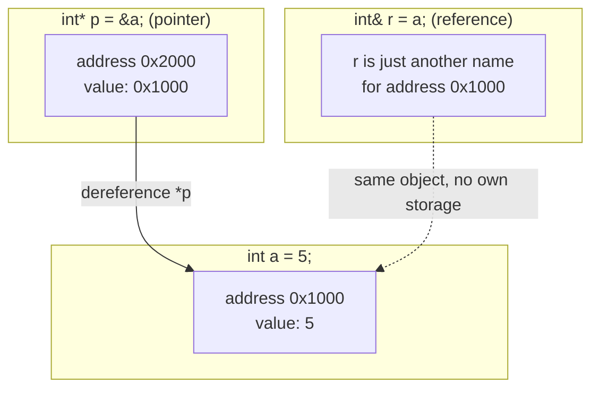
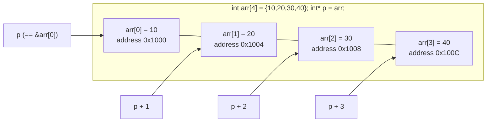

# Pointers and References

A **pointer** (*Zeiger*) holds an address. A **C++ reference** (*Referenz(C++)*)
is another *name* for an existing object. They solve overlapping problems with
very different ergonomics.

## Value, pointer, and reference in memory



A reference has no separate address of its own to reason about — it *is* `a`
under another name. A pointer is itself an object (it lives at its own
address, here `0x2000`) whose value happens to be another address; this extra
indirection is what the problems below are paying for.

## Pointer arithmetic over an array



`p + i` advances by `i * sizeof(int)` bytes, landing on `arr[i]`; this is the
same arithmetic used for `*(ptr+i)` ≡ `ptr[i]` in the pointer-to-pointer
example below.

## Null and dangling pointer states

```mermaid
stateDiagram-v2
    [*] --> Null: int* p = nullptr;
    Null --> Valid: p = &x;
    Valid --> Valid: reassign to another live object
    Valid --> Dangling: object pointed to is destroyed (delete p; or out-of-scope)
    Dangling --> Null: p = nullptr;
    Dangling --> [*]: dereferencing is undefined behavior
    Null --> [*]: dereferencing is undefined behavior
```

Dereferencing a pointer in the `Null` or `Dangling` state is undefined
behavior — one concrete instance of the "error-prone" problem noted below.
[[concepts/smart-pointers]] exist largely to make the `Dangling` state
unreachable by tying pointer lifetime to object lifetime.

## The four symbols

| Symbol | Name | Meaning |
|---|---|---|
| `&` | address operator (*Adressoperator*) | `y=&x;` — y is the address of x |
| `int&` | C++ reference (*Referenz(C++)*) | `int& x = a;` — x is another *name* for `a`; it is the memory *content*, not its address; it is **initialized**, and the binding is **not** changeable |
| `*` | dereference operator (*Inhaltsoperator*) | `*y` is the content of address y |
| `int*` | pointer type (*Zeigertyp*) | `int* y` — y is a changeable pointer to an int; it can be re-assigned other addresses |

The decisive asymmetry: a reference is bound once at initialization and can never
be re-bound; a pointer can be re-pointed at will.

## Binding of `*`

Whitespace is irrelevant; the `*` binds to the **declarator**, not the base type:

```cpp
int* a; int * b; int *c; //a,b,c Zeiger auf int
int* a, b; //b ist kein Zeiger sondern int
```

> [!warning] `int* a, b;` declares one pointer and one plain `int`.
> Declare one pointer per line.

## Problems with pointers

The script makes a deliberate case against pointers:

- **Poor readability** — e.g. `*x = *x * 2;`
- Callers must distinguish value passing from address passing: `f(a); f(*a); f(&a);`
- **Error-prone**, since pointer validity is often not checked.

> Daher wird die Verwendung von Referenzen (C++) empfohlen.
> *(Therefore the use of C++ references is recommended.)*

See [[concepts/parameter-passing]] for the worked `verdoppeln` comparison, and
[[concepts/const-and-volatile]] for `const` pointers and references.

## Pointer to pointer

```cpp
CAuto** ptr = new CAuto*[400] // Array aus Zeigern auf Autos
```

- `ptr` addresses the first pointer in the array.
- Array element *i*: `*(ptr+i)` ≡ `ptr[i]` — the pointer at index i.
- The object managed by the i-th pointer: `*ptr[i]`; `**ptr` ≡ `*ptr[0]` is the
  object addressed by the 0th pointer.

## Function pointers

- The name of a function is a **constant pointer** to that function; it addresses
  the machine code.
- You can retrieve and call the function's address through it, but not change the
  function.
- A typical application is a jump table — which is exactly how [[concepts/vtable]]
  implements [[concepts/polymorphism]].

Type notation:

| Notation | Meaning |
|---|---|
| `double(int)` | the *type* of a function taking `int`, returning `double` |
| `double(*)(int)` | the type of a *pointer* to such a function |
| `double(*pf)(int)` | a named pointer variable of that type |
| `double *pf(int)` | **not** a pointer — a function `pf` returning `double*` |

```cpp
#include <iostream>
#include <string>
void drucke(std::string s){std::cout << s << std::endl;} // void(string)
void drucke(int  i){std::cout << i << std::endl;}          // void(int)

int main(){
    void (*f1)(std::string) = &drucke; // f1 zeigt auf drucke
    void (*f2)(std::string) = drucke;  // auch ok, implizites &
    void (*f3)(std::string);           // Zeiger auf void(string)
    f3 = &drucke;                      // f3 zeigt nun auf drucke void(string)
    f3 = drucke;                       // auch ok
    void (*f4)(int) = drucke;          // f4 zeigt nun auf drucke void(int)

    (*f1)("Erster Test mit f1"); // Aufruf von drucken
    f1("Zweiter Test mit f1");   // Auch ok, Dereferenzierung automatisch
    f2("Test mit f2");
    f3("Test mit f3");
    // f1(42);        // Fehler, falscher Argumenttyp
    f4(42);           // ok
    return 0;
}
```

The `&` on assignment is implicit, and dereferencing on call is automatic — so
`f1(...)` and `(*f1)(...)` are equivalent. Overload resolution picks the
`drucke` whose signature matches the pointer's type; see
[[concepts/function-overloading]].

## Matrices as function arguments

- A matrix is a column vector (array) made of row vectors (arrays).
- The name of an array is a pointer to the first array element; the name of a
  matrix is a pointer to the first **row vector**.
- The compiler must know the number of rows and columns for a matrix type.
- `size_t` is the integer type for array sizes.

```cpp
const size_t COLS{3};
const size_t ROWS{2};
using Row_t = int[COLS];      // äquivalent: typedef int Row_t[COLS];
using Matrix_t = int[ROWS][COLS]; // typedef int Matrix_t[ROWS][COLS];
Row_t *pMat;     // äquivalent: Row_t pMat[];
Row_t mat[5];    // Matrix aus 5 Zeilen und 3 Spalten
Matrix_t m;      // Matrix vom Typ Matrix_t, 2 Zeilen, 3 Spalten
m[1][2] = 7;     // Zweite Zeile, dritte Spalte
```

## Related

- [[concepts/parameter-passing]]
- [[concepts/const-and-volatile]]
- [[concepts/complex-declarations]]
- [[concepts/memory-model]]
- [[concepts/vtable]]
- [[concepts/smart-pointers]] — RAII wrappers that remove the dangling-pointer
  state above
- [[concepts/arrays-and-dynamic-memory]] — the array/pointer arithmetic
  interplay shown above, extended to dynamic allocation
- [[concepts/value-categories]] — the lvalue/rvalue distinction underlying
  what a reference can bind to

## Sources

- [[sources/grigat-oop-teil1]] §0.2.2.1 (Zeiger auf Zeiger),
  §0.2.2.3–0.2.2.4 (Zeiger auf Funktionen), §0.2.2.8 (Matrizen als Argumente),
  §0.2.4.3 (Inhaltsoperator, Adressoperator, Referenz, Zeiger),
  §0.2.4.6 (Probleme von Zeigern), §0.2.4.7 (Bindung des `*`)
