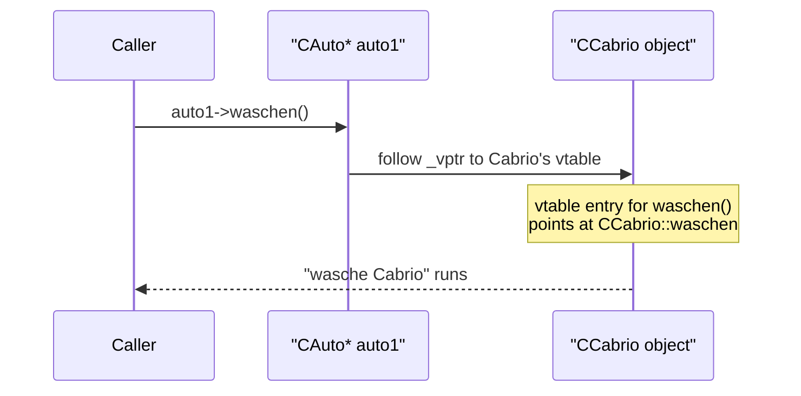
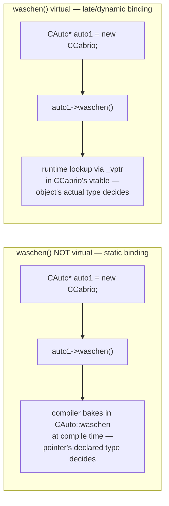

Polymorphism (*Polymorphie*) lets code written against a base-class type
automatically run the correct derived-class behavior at runtime, chosen by
the object's **actual** type rather than the **static** type of the pointer
or reference used to reach it.

## Basic example

```cpp
CAuto *auto1 = new CCabrio;//Upcast
CAuto *auto2 = new CBus;   //Upcast

auto1->waschen(); // Cabrio waschen
auto2->waschen(); // Bus waschen
```

(Don't forget `delete`!) A base class `CAuto` declares an interface method
`waschen()`; derived classes `CCabrio` and `CBus` each supply their own
implementation. A UML diagram shows this as an abstract base `CAuto`
containing `waschen()`, with hollow (open) triangle inheritance arrows from
`CCabrio` and `CBus` pointing up to it.

- At runtime — **late binding** (*späte Bindung*) — the matching override is
  automatically selected based on the object's actual type.
- Late binding must be explicitly requested in C++ with `virtual` on the
  base-class declaration. (In Java, late binding is the default for all
  methods.)
- The object is reached through a pointer (`CAuto*`) or reference (`CAuto&`)
  typed as the base class — see [[concepts/pointers-and-references]].
- Polymorphism further separates interface (`CAuto`) from implementation
  (`CCabrio`, `CTaxi`, `CBus`), building on [[concepts/encapsulation]] and
  [[concepts/abstract-class]].



## Static vs. dynamic binding, side by side



## `virtual` and the vtable

A class is called **polymorphic** if it has at least one virtual function:

```cpp
class Auto
{
public:
    virtual ~Auto();
};
```

Only for polymorphic classes does the compiler create a **vtable** (virtual
method table) holding the overridden method variants; each instance of such a
class stores a hidden pointer to its class's vtable so the correct entry
point for each virtual function can be found at runtime. See
[[concepts/vtable]] for the mechanics.

- `virtual` is inherited; it need not be repeated when overriding in a
  derived class.
- To actually override a virtual function, the new version must still be
  *declared* (not just defined elsewhere) inside the derived class
  definition — otherwise the base-class version is used.
- If the base class's access rights should still govern calls to the
  overridden version, the overriding version in the derived class can be
  made `private`; then it is only reachable via late binding (a base-type
  pointer/reference), not directly.

## Constructors, destructors, and polymorphism

- Constructors are **never** virtual.
- A destructor of a class meant to be used polymorphically **must** be
  `virtual`; otherwise deleting a derived object through a base-class
  pointer only frees the base class's portion of memory, leaking the rest.
  See [[synthesis/special-member-functions]] for the destructor alongside
  C++'s other special member functions.
- Constructors and destructors should **not** call virtual functions: during
  construction, derived parts don't exist yet; during destruction, they no
  longer exist. A virtual call made from a constructor/destructor always
  resolves to the version belonging to the currently-executing
  class (because construction runs top-down through the hierarchy and
  destruction runs bottom-up) — never to a not-yet-existing or
  already-destroyed derived override.

### Procedure: how the compiler decides static vs. dynamic binding for `obj->f(args)`

1. Resolve name lookup and overload resolution exactly as for any function call, using `obj`'s *static* (declared) type — this picks one specific declaration of `f` (see [[concepts/overriding-vs-overloading]] for the full pipeline).
2. Check whether that declaration is `virtual`.
3. If **not** `virtual`: bind at compile time to that exact function; emit a direct call. The object's actual runtime type is irrelevant.
4. If `virtual` **and** the call is made through a pointer or reference: bind at compile time only to "the vtable slot of this virtual function"; emit code that follows `obj`'s `_vptr` and calls whatever function occupies that slot in `obj`'s *actual* class's vtable — resolved at runtime (late binding). See [[concepts/vtable]].
5. If `virtual` but the call is made on a plain (non-pointer, non-reference) object, or explicitly qualified with `Base::f(...)`, bind statically regardless of step 2 — qualification and value semantics suppress dynamic dispatch.

## Upcast and downcast

**Upcast**: converting a pointer/reference from a derived type to its base
type.
- General: a type change from derived-class type to base-class type.
- Application: enables runtime decision of which member function to execute
  — Run Time Type Information (RTTI).
- In C++, upcasts of class objects are only possible through pointers or
  references.
- Example: a pointer to a `CCabrio` object is stored in a variable of type
  `CAuto*`.

Which code is **allowed** to perform the upcast is restricted by the
base-class modifier used in the derived class's declaration — see
[[concepts/access-modifiers]] for the full `public`/`protected`/`private`
table.

**Downcast**: recovering the actual (more derived) type from a base-type
pointer, via `dynamic_cast<>()`:

```cpp
dynamic_cast<CCabrio*>(auto1)
```

If the downcast fails (the object isn't actually of that type), the result is
`nullptr`.

## Static vs. late binding

```cpp
CAuto *auto1 = new CCabrio;//Upcast
CAuto *auto2 = new CBus;   //Upcast

auto1->waschen(); // Auto waschen
auto2->waschen(); // Auto waschen
```

If `waschen` is **not** `virtual`, the pointer's *declared* type decides
which version runs — here, both calls run `CAuto`'s version, regardless of
the actual object type (static binding). If `waschen` **is** `virtual`, the
*object's actual* type decides which version runs (late binding) — not the
type of the pointer used to call it.

## Pitfalls

> [!warning] Never override a non-virtual function
> If a base class function is not `virtual`, "overriding" it in a derived
> class only creates an unrelated hidden function. Calling it through a
> base-type pointer always activates the base-class version — with the base
> class's own access rights, not the derived class's. Since that base-class
> code can access all `private`/`protected` elements of base-class objects
> (and the base-class portion of any derived object), this is a classic
> source of surprising, hard-to-find bugs. See
> [[concepts/overriding-vs-overloading]] and the worked exercise in
> [[concepts/access-modifiers]].

> [!warning] Always make a polymorphic base class's destructor virtual
> Deleting a derived object through a non-virtual base-class destructor only
> frees the base class's own memory, leaking the derived portion.

> [!warning] Constructors are never virtual, and must not call virtual functions
> Because of the top-down/bottom-up construction and destruction order, a
> virtual call inside a constructor or destructor cannot reach a not-yet-built
> or already-torn-down derived override; it always resolves to the
> currently-executing class's own version.

## Worked exercise: CKfz / CPkw / CMotorrad

The script's extended exercise on vehicle classes (`CKfz` = vehicle,
`CPkw` = car, `CMotorrad` = motorcycle) deliberately uses `protected`
member variables and a mix of virtual/non-virtual member functions "that a
good programmer would never use", to force a close reading of exactly whose
access rights apply at each call site. It is given in full, with its
question/answer solution, in [[concepts/access-modifiers]]; the central
lesson is that **the access rights available during a member-function call
come from the class whose code is actually executing** (the base-class
version or the overridden version — which depends on `virtual` and the
vtable), not from the static type of the pointer used to make the call. The
exercise also notes two further omissions typical of sloppy code: the base
class `CKfz` lacks a `virtual` destructor despite being polymorphic, and the
`new`-allocated objects in the example are never `delete`d.

## Two kinds of polymorphism

Everything above is **runtime (subtype) polymorphism**: one base type, many
derived implementations, selected by the object's actual type at call time
via the vtable. C++ has a second, unrelated kind — **compile-time
(parametric) polymorphism** via [[concepts/templates]]: a template function or
class works with *any* type `T` that supports the needed operations, with no
common base class and no vtable at all; the compiler generates a separate,
statically-bound version of the code per instantiation instead of dispatching
at runtime. See [[synthesis/oop-core-concepts]] for the side-by-side
comparison.

## Related

- [[concepts/vtable]]
- [[concepts/access-modifiers]]
- [[concepts/overriding-vs-overloading]]
- [[concepts/abstract-class]]
- [[concepts/inheritance]]
- [[concepts/templates]]
- [[synthesis/special-member-functions]]

## Sources

- [[sources/grigat-oop-teil1]] §0.3.7
- [[sources/grigat-oop-teil1]] §0.3.7.1
- [[sources/grigat-oop-teil1]] §0.3.7.2
- [[sources/grigat-oop-teil1]] §0.3.7.3
- [[sources/grigat-oop-teil1]] §0.3.7.4
- [[sources/grigat-oop-teil1]] §0.3.7.5
- [[sources/grigat-oop-teil1]] §0.3.7.6
- [[sources/grigat-oop-teil1]] §0.3.7.7
- [[sources/grigat-oop-teil1]] §0.3.7.8
- [[sources/grigat-oop-teil1]] §0.3.7.9
- [[sources/grigat-oop-teil1]] §0.3.7.10
- [[sources/grigat-oop-teil1]] §0.3.7.11
- [[sources/grigat-oop-teil1]] §0.3.7.12
