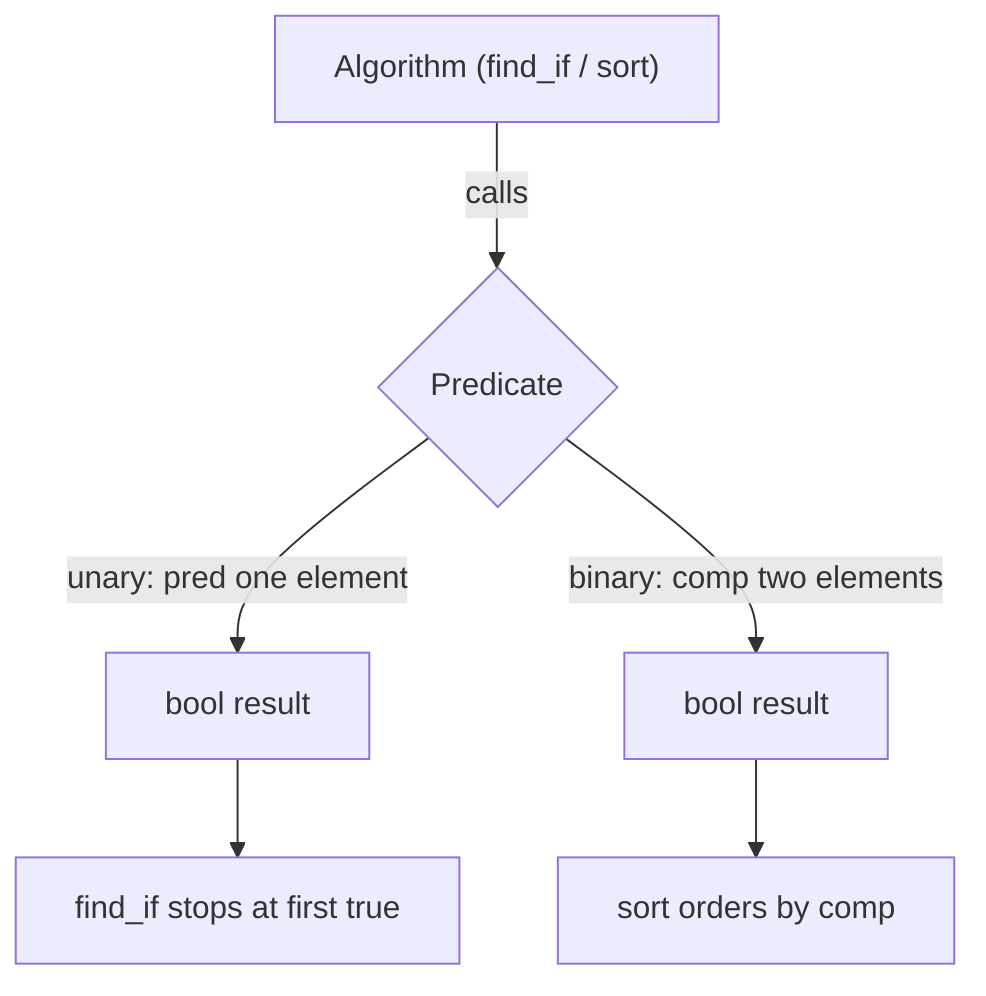

A **predicate** (*Prädikat*) is a function (or [[concepts/function-objects|function object]]) that returns a value of type `bool`, used to express a search or sort criterion for [[algorithms/stl-algorithms|STL algorithms]].

## Problem it solves

Algorithms like `sort` or `find` need a customizable criterion — "is this element what I'm looking for?" or "should this element come before that one?" — without the algorithm itself needing to know the concrete rule. Predicates let that rule be plugged in as an ordinary parameter, while the algorithm stays generic.

## 0.5.9.6 Predicates in the standard library

- Predicates are functions that return a value of type `bool`.
- They are frequently used to specify a search or sort criterion.
- Predicates can be **unary** (*unär*) or **binary** (*binär*).

## 0.5.9.7 Unary predicates

A unary predicate tests a property of **one** argument.

```cpp
bool gt_10(int value)
{
  return (value > 10);
}

list<int> lst;
list<int>::iterator pos;
/* ... */
pos = find_if(lst.begin(), lst.end(),  //Sequenz
              gt_10);                 //Praedikat
```

`find_if()` applies `gt_10(int)` to each element as long as it returns `false`; as soon as `gt_10(int)` yields `true`, `find_if()` stops and returns the position of the current element.

## Numbered pseudocode: `find_if`

```
1. function find_if(first, last, pred):
2.     while first != last:
3.         if pred(*first) == true:
4.             return first
5.         first = first + 1
6.     return last
```

## 0.5.9.8 Binary predicates

A binary predicate compares **two** arguments. It is necessary when `operator<` is not defined for the data type used, but sorting is still required by some other criterion (see [[concepts/operator-overloading]]).

```cpp
class Person {
public:
  string firstname();
  string lastname();
  /*...*/
};

bool compareTwoPersons(const Person& p1, const Person& p2) {
  return (p1.lastname() < p2.lastname()) ||
         ((p1.lastname() == p2.lastname()) &&
           p1.firstname() < p2.firstname());
}
```

```cpp
int main() {
  deque<Person> deq;
  /*...*/
  sort(deq.begin(), deq.end(), compareTwoPersons);
}
```

This predicate sorts persons by lastname, then by firstname when lastnames are equal.

## Numbered pseudocode: `sort` with a binary predicate

```
1. function sort(first, last, comp):
2.     // comp(a, b) returns true if a should precede b
3.     repeatedly reorder elements in [first, last)
4.         such that for every adjacent pair (a, b) after sorting,
5.         comp(a, b) == true or comp(b, a) == false
6.     // concrete algorithm (e.g. introsort) left to the implementation
```

## Mermaid: predicate use in `find_if` / `sort`



## Minimal code example

See the `gt_10` / `find_if` and `compareTwoPersons` / `sort` listings above — both are plain free functions passed where a [[concepts/function-objects|function object]] is expected, since any callable with the right signature qualifies as a predicate.

## Consequences / trade-offs

- Predicates decouple the search/sort *criterion* from the algorithm's *traversal/ordering logic*.
- Binary predicates are the standard escape hatch when a type has no natural `operator<` or when multiple sort keys (lastname, then firstname) are needed.
- Any callable obeying the signature works: a plain function, a function pointer, a [[concepts/function-objects|functor]], or a [[concepts/lambda-expressions|lambda]].

## Misuse & anti-patterns

- A binary predicate used for sorting must define a strict weak ordering; an inconsistent predicate (e.g. one that is not antisymmetric) causes undefined behavior in `sort`.
- Mutating state from inside a predicate invoked by `sort`/`find_if` is fragile, since the number and order of calls is implementation-defined.

## Related

- [[algorithms/stl-algorithms]]
- [[concepts/function-objects]]
- [[concepts/lambda-expressions]]
- [[concepts/operator-overloading]]
- [[concepts/iterators]]

## Sources

- [[sources/grigat-cpp-concepts-generic]] §0.5.9.6, §0.5.9.7, §0.5.9.8
