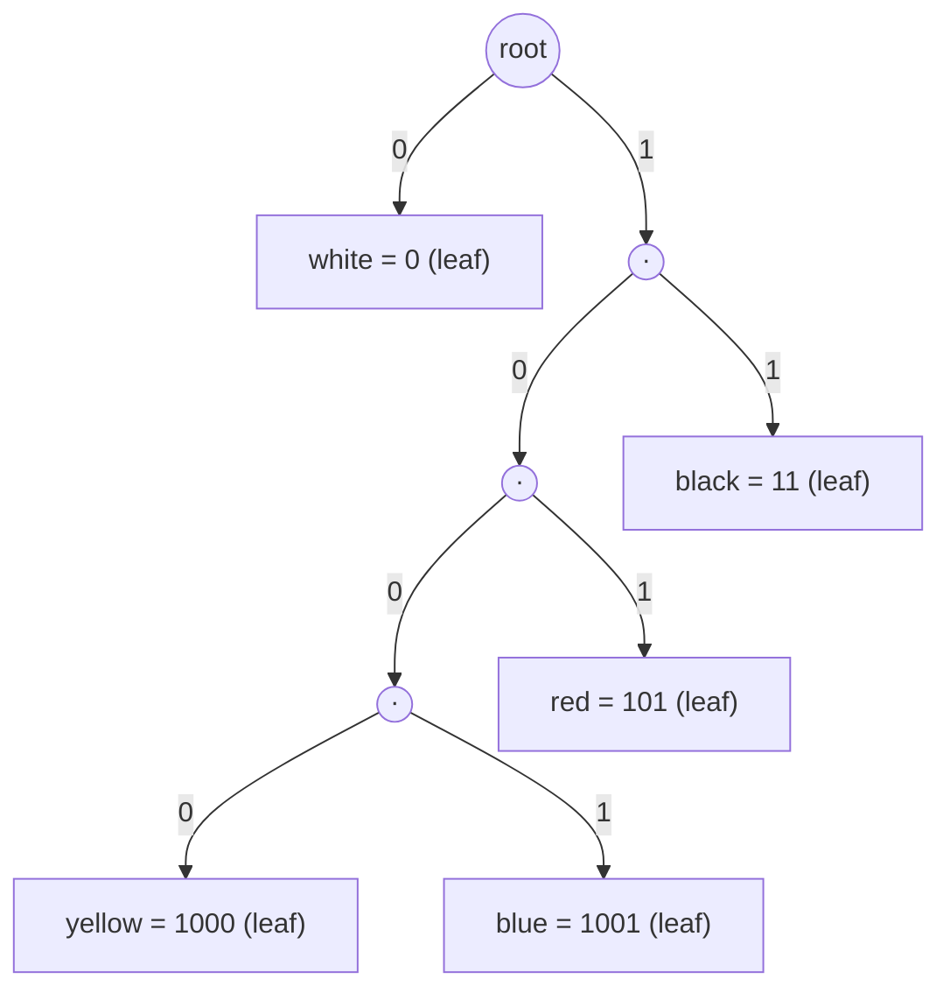
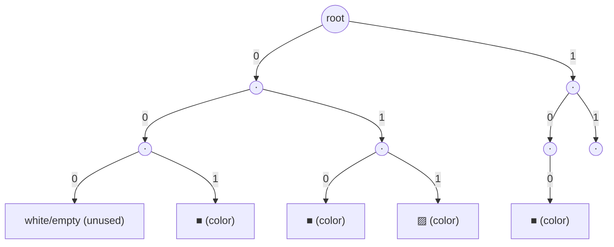
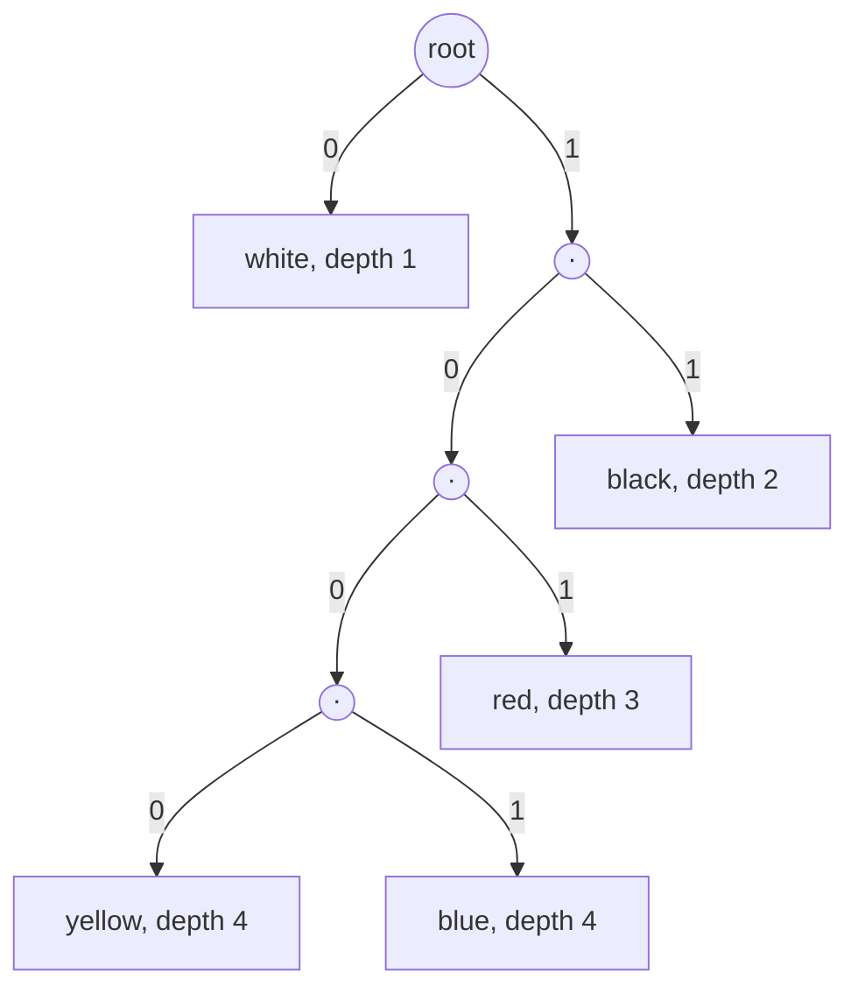

## One-sentence definition

A prefix code (*Präfix-Code*) is a code in which no codeword is a prefix of
another codeword, which makes every codeword in a variable-length stream
decodable unambiguously immediately after receiving its last bit (§0.12.4.4).

## Problem it solves

Given an alphabet (event set) *C*, we need an efficient binary representation
of sequences of events (*Ereignisfolgen*) — e.g. letters of a text, or pixel
values of an image (§0.12.4.1). There are two fundamentally different
strategies:

### Fixed length coding (FLC) — §0.12.4.2

Every event *c* ∈ *C* is assigned a unique binary codeword of the same
length `l(c) = l`. For an alphabet of cardinality `|C|`, the codeword length
must satisfy:

```
l ≥ ⌈log₂ |C|⌉
```

*Example*: the ASCII code gives every letter, digit, and special character a
unique 8-bit codeword, e.g. `01001000 01000001 01001100 01001100 01001111` =
"HALLO".

### Variable length coding (VLC) — §0.12.4.3

The codeword length `l(c)` for event *c* instead depends on its probability
or relative frequency `P(c)`. The **mean codeword length** (*mittlere
Codewortlänge*) `l̄` for alphabet *C* is:

```
l̄ = Σ_{c∈C} P(c) · l(c)      ...(22)
```

(Verbundcodierung — joint/combined coding of multiple events in one codeword
— is noted as a further alternative but explicitly **not** part of this
lecture, §0.12.4.1.)

## Worked example: an image with five colors (§0.12.4.4, Tabelle 25)

| Color | rel. frequency | VLC codeword | FLC codeword |
|---|---|---|---|
| weiß (white) | 0.4 | 0 | 000 |
| schwarz (black) | 0.35 | 11 | 001 |
| rot (red) | 0.15 | 101 | 010 |
| gelb (yellow) | 0.05 | 1000 | 011 |
| blau (blue) | 0.05 | 1001 | 100 |

Mean codeword length for the variable-length code:
```
l̄_v = 0.4·1 + 0.35·2 + 0.15·3 + 0.05·4 + 0.05·4 = 1.95 bit
```

Mean codeword length for the fixed-length code is worse:
```
l̄_f = ⌈log₂ 5⌉ = 3 bit > l̄_v
```

## The prefix property (§0.12.4.4)

**Definition:** no codeword is a prefix of another codeword.

Consequences:
- Even with variable codeword length (VLC), **no termination symbol per
  codeword is required**.
- Decoding of each codeword is possible unambiguously immediately after
  receiving its last bit.
- On a one-bit transmission error, further decoding with VLC is only
  possible again after resynchronization.

*Example decoding* with the VLC column of Tabelle 25:
`1001011` decodes as *blau weiß schwarz* (blue, white, black) — read
left-to-right, each codeword is recognized the instant it stops being a
prefix of any other codeword.

## Why the prefix property makes decoding unambiguous

Representing the VLC code from Tabelle 25 as a binary tree (0 = left edge,
1 = right edge) makes the property visually obvious: every codeword sits at
a **leaf**, and since no codeword is an ancestor of another codeword's leaf,
a decoder walking bit-by-bit from the root always hits exactly one leaf
before it could possibly be confused with a different, longer codeword.



Contrast this with a non-prefix code where, say, `1` and `11` were both
codewords: `1` would sit on the path to `11`'s leaf, so after reading a
single `1` bit a decoder could not tell whether the codeword is already
complete or whether it must keep reading — exactly the ambiguity the prefix
property rules out.

## Binary tree representation (§0.12.4.5–0.12.4.6)

- Elements *c* of the alphabet *C* are stored in the tree's **leaves**
  (*Blätter*).
- The "key" at each leaf is really its probability `P(c)`.
- The path from root to the leaf of *c* gives its codeword, one bit per
  edge: digit `0` ⇒ left child, digit `1` ⇒ right child.
- The path length to leaf *c* equals the codeword length `l(c)`.
- Every path length is weighted by `P(c)`, giving the term `P(c) · l(c)`
  summed in equation (22).
- **Optimization task** (*Optimierungsaufgabe*): find the tree with
  **minimal mean weighted path length**:
  ```
  l̄ = Σ_{c∈C} P(c) · l(c)   →   min
  ```
  This optimization problem is solved by [[algorithms/huffman-coding]].

Both sub-trees of Tabelle 25's codes, drawn per §0.12.4.5 (Abbildung 102):


*(a) Fixed-length code: a complete balanced binary tree of depth 3, with 5 of
the 8 possible leaves used — all codewords equal length 3.*


*(b) Variable-length code: an unbalanced tree, shallow for frequent symbols
(white, black) and deep for rare ones (yellow, blue).*

## Consequences / trade-offs

- VLC can beat FLC's mean codeword length whenever the alphabet's symbol
  probabilities are skewed (as in the 5-color example: 1.95 bit vs. 3 bit).
- VLC's efficiency depends on knowing (or estimating) accurate symbol
  probabilities `P(c)`; a mismatched probability model wastes the potential
  gain.
- VLC loses robustness to transmission errors: a single flipped bit can
  desynchronize the whole subsequent stream until a recognizable
  resynchronization point is found, whereas FLC errors stay localized to one
  codeword.

## Misuse & anti-patterns

- Using VLC without ensuring the prefix property breaks unambiguous decoding
  entirely — a termination symbol per codeword (as in a plain
  [[structures/trie]]) becomes necessary again, defeating the point of VLC.
- Applying FLC to a highly skewed distribution wastes bits relative to the
  theoretical minimum achievable by an optimal prefix code (see
  [[algorithms/huffman-coding]] for how to construct that optimum).

## Related
- [[algorithms/huffman-coding]]
- [[algorithms/lzw-compression]]
- [[structures/trie]]
- [[concepts/big-o-notation]]
- [[concepts/complexity-classes]]
- [[concepts/strings-cpp-vs-c]]

## Sources
- [[sources/grigat-trees-sorting]] §0.12.4.1, §0.12.4.2, §0.12.4.3, §0.12.4.4, §0.12.4.5, §0.12.4.6
