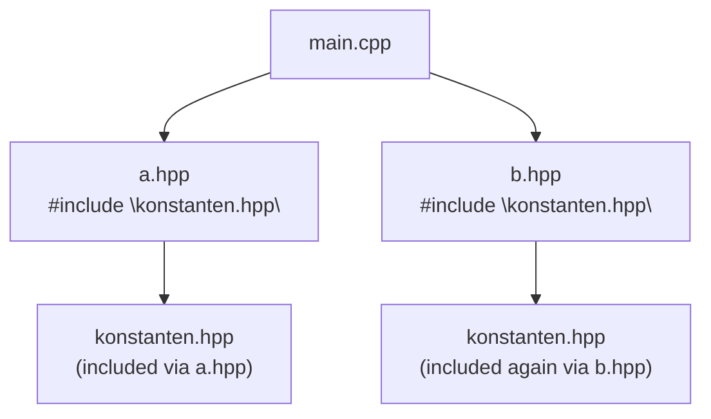

## Definition

The preprocessor (*Präprozessor*) is part of the C++ compiler that performs
simple text substitutions on the source before actual compilation.
Preprocessor directives are introduced with `#` (§0.2.5.3).

## `#include` and header files

`#include "verdoppeln.hpp"` textually inserts the named file into the source
at that point (§0.2.5.4):

```cpp
//verdoppeln.hpp
int verdoppeln(int x);
float verdoppeln(float x);
```

```cpp
//main.cpp
#include "verdoppeln.hpp"
#include <iostream>

using namespace std;

int main()
{
        int a = 2;
        cout << verdoppeln (a);
        return 0;
}
```

`#include ""` vs. `#include <>` differ in search order: `""` searches the
*current directory first*, while `<>` searches all known (configurable)
search-path directories.

## Conditional compilation and the problem it solves (§0.2.5.5)

Definitions/declarations in one header are often needed by multiple `*.cpp`
source files, but a given definition may only be compiled **once** per
translation unit (otherwise: redefinition error). `#pragma once` is noted as a
non-standard-conforming solution and is *not recommended*.

The standard-conforming solution is **conditional compilation** via
preprocessor macros — commonly called **include guards** (*Include-Wächter*).
Macro names are not protected against name collisions, so the recommendation is
to use long, specific names.

## The include-guard pattern (§0.2.5.6)

```cpp
//konstanten.hpp
#ifndef KONSTANTEN_H
#define KONSTANTEN_H
const double PI = 3.14;
//Definition von PI
//global wirksam
#endif // KONSTANTEN_H
```

```cpp
//konstanten.cpp
#include "konstanten.hpp"
/* ... */
```

```cpp
//main.cpp
#include "konstanten.hpp"
/* ... */
```

## Double inclusion via a diamond of headers

A single translation unit can pull in the same header twice *transitively*,
without ever naming it twice itself — the classic "diamond" shape:



Without a guard, the preprocessor would paste `const double PI = 3.14;` into
`main.cpp`'s translation unit twice, causing a redefinition error. With the
guard, the second paste is suppressed — see the step-by-step mechanism below.

Step-by-step mechanism, as numbered pseudocode:

**First inclusion of `konstanten.hpp` in a translation unit:**

```
1. preprocessor reaches #ifndef KONSTANTEN_H
2. KONSTANTEN_H is not yet defined -> condition is true
3. preprocessor executes #define KONSTANTEN_H
   (the macro is now defined, for the rest of this translation unit)
4. preprocessor pastes everything up to #endif into the source
   (including "const double PI = 3.14;")
5. preprocessor reaches #endif, resumes normal processing after it
```

**Second inclusion of `konstanten.hpp` in the same translation unit**
**(e.g. transitively via another header):**

```
1. preprocessor reaches #ifndef KONSTANTEN_H
2. KONSTANTEN_H is already defined (from step 3 above)
   -> condition is false
3. preprocessor skips everything up to #endif
   (PI is NOT redefined; no redefinition error)
4. preprocessor reaches #endif, resumes normal processing after it
```

## Consequences / trade-offs

- Include guards make a header safe to `#include` multiple times (directly or
  transitively) within one translation unit, which is essential once headers
  start including other headers.
- Because macro names live in a single flat, uncapsulated namespace, guard
  names should be long and specific to avoid accidental collisions with guards
  from other headers.

## Misuse & anti-patterns

- Using `#pragma once` where strict standards conformance is required — the
  notes explicitly flag it as non-standard.
- Choosing short/generic guard macro names (e.g. `H_H`) that collide across
  headers from different libraries.
- Putting a definition with external linkage (not `const`, not guarded by
  `static`/`inline`) in a header included by multiple `.cpp` files — see
  [[concepts/scope-and-storage-classes]] for the linkage rules that avoid
  duplicate-definition linker errors here.

## Related
- [[concepts/modularization-and-build-pipeline]]
- [[concepts/scope-and-storage-classes]]
- [[concepts/namespaces]]
- [[concepts/templates]] — another reason template definitions commonly live
  entirely in headers guarded this way

## Sources
- [[sources/grigat-oop-teil1]] §0.2.5.3-0.2.5.6
