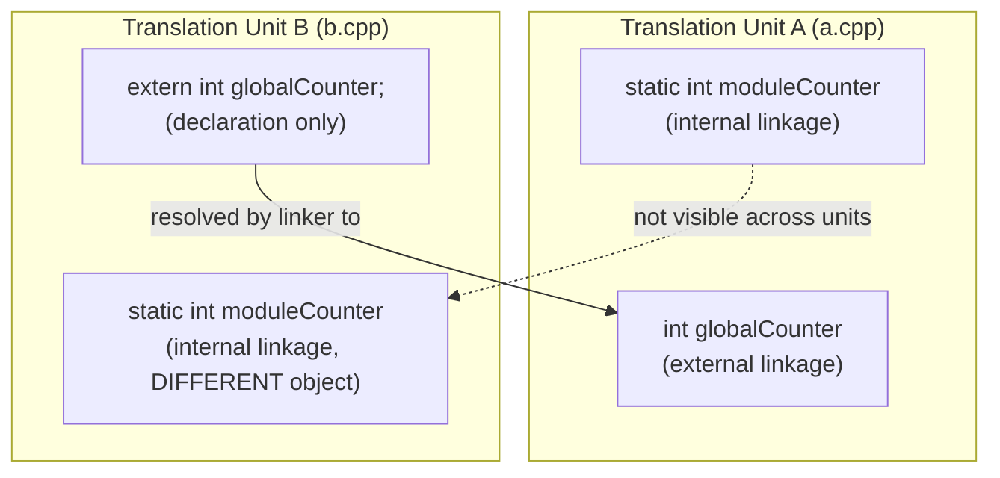
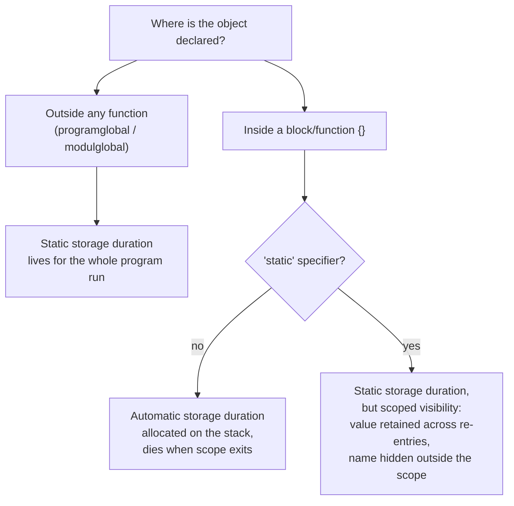

## Definition

A storage class (*Speicherklasse*) of an object in C++ determines two properties:
its lifetime/storage duration (*Lebensdauer*) and its scope (*Geltungsbereich*).
Both are fixed by where a declaration sits in the source file and which
storage-class specifiers (`extern`, `static`) are attached to it.

## Problem it solves

In a modularized program, source files (*Übersetzungseinheiten*, translation
units — see [[concepts/modularization-and-build-pipeline]]) need rules for
which names are visible where, and how long an object's memory persists. Without
such rules, two files could silently collide on names, or local variables would
not retain state across calls where that is needed.

## Translation units and linkage

A translation unit (*Übersetzungseinheit*) is a source file together with
everything it `#include`s. Names declared in it can have:

- **Internal linkage** (*interne Bindung*): visible only within the local
  translation unit.
- **External linkage** (*externe Bindung*): visible across all translation
  units, resolved by the linker.



Defaults for basic types (§0.2.5.7):

- `const`, `constexpr`, `inline` have **internal** linkage by default.
- Plain basic types have **external** linkage by default.
- `extern` switches a `const`/`constexpr`/`inline` declaration to external
  linkage.
- `static` switches a basic type's definition to internal linkage.
- An unnamed (anonymous) namespace — see [[concepts/namespaces]] — behaves like
  internal linkage.

```cpp
int a;              // Definition, bedeutet "int a=0;", externe Bindung
int a = 1;          // Fehler, Redefinition
extern int b;       // nur Deklaration, keine Definition
extern float b;     // Fehler, falscher Typ
extern int b;       // ok, Redeklaration
b = 5;              // Fehler, b noch nicht definiert
const int c = 1;     // Konstanten nicht extern sichtbar, interne Bindung
extern const int d=1; // externe Bindung der Konstante
extern int e = 1;    // Definition, "extern" ist unwirksam
```

## Programglobal vs. modulglobal vs. local (§0.2.5.8-0.2.5.10)

All objects declared outside of any function have **static storage duration**:
their lifetime spans the entire program run. They differ in scope:

| Kind | Scope | Known to linker | Specifier |
|---|---|---|---|
| **Programmglobal** (global) | entire program | yes | `extern` before every *declaration* (not the definition) |
| **Modulglobal** (module-global) | only this translation unit | no | `static` before the *definition* (not the declaration) |

Global scope cannot be subdivided further except by namespaces (see
[[concepts/namespaces]]).

**Local storage** (§0.2.5.10) is declared inside a scope `{}` (block or
function body) and comes in two flavors:

- **Automatic (non-static) local storage**: lifetime ends when the enclosing
  scope is exited; allocated on the stack (*Stapel*).
- **Static (permanent) local storage**: declared with `static` inside the
  scope; has static (permanent) lifetime for the whole program, but its
  *visibility* still ends when the scope is left — it becomes visible again
  (with its retained value) the next time the scope is re-entered.



## External and static functions (§0.2.5.11)

The same `extern`/`static` distinction applies to functions:

- **Externe Funktionen** (external functions): programglobal; no `static`
  specifier before the definition; `extern` may precede declarations.
- **Statische Funktionen** (static functions): module-global; `static` before
  the definition (and before the declaration, if the function is called
  before it is defined within the module). Local functions are not allowed in
  C++ — a function definition cannot be nested inside another function.

## Consequences / trade-offs

- `static` locals give you persistent state without exposing a
  programglobal, reducing coupling between translation units.
- Declaring `const`/`constexpr`/type aliases (see [[concepts/type-aliases]])
  consistently in header files avoids mismatches between translation units,
  since these have internal linkage by default.

## Misuse & anti-patterns

- Overusing programglobal variables defeats encapsulation
  (see [[concepts/encapsulation]]) and makes the linker-visible namespace
  crowded; prefer `static` (module-global) or a namespace when global state is
  truly needed only within one file.
- Forgetting that `extern int b;` is only a *declaration* and expecting it to
  allocate storage.

## Related
- [[concepts/modularization-and-build-pipeline]]
- [[concepts/namespaces]]
- [[concepts/preprocessor-and-include-guards]]
- [[concepts/memory-model]]

## Sources
- [[sources/grigat-oop-teil1]] §0.2.5.7-0.2.5.11
