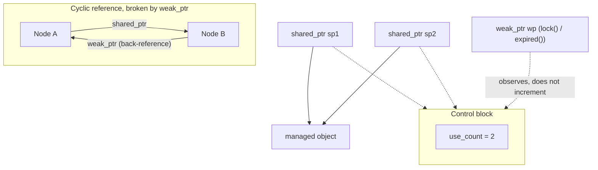

## Definition

Smart pointers (*intelligente Zeiger*) are objects that behave like pointers to
(mostly dynamic) objects but automatically manage the lifetime of what they
point to, destroying the pointed-to object when the last owning pointer to it
is destroyed. They live in header `<memory>` and support **no pointer
arithmetic**. The standard library provides three smart-pointer class
templates:

- `unique_ptr<typename T, typename D=default_delete<T>>` — not copyable, the
  **sole** owner.
- `shared_ptr<typename T>` — copyable, **one of possibly several** owners.
- `weak_ptr<typename T>` — copyable, **not an owner**.

## Problem it solves

Manual `new`/`delete` pairing is error-prone: forgetting `delete` causes a
memory leak (*Speicherleck*); calling `delete` twice, or using a pointer after
its object was freed, is undefined behaviour. Smart pointers tie object
lifetime to scope and ownership (an application of [[concepts/destructor]]-driven
RAII), eliminating most manual bookkeeping — closely related to
[[concepts/move-semantics]] for transferring ownership without copying.

## `unique_ptr` (§0.5.4.2)

`unique_ptr<T, D>` manages a resource (memory, file, device) exclusively.
Template parameter `D` names a function/functor used to release the resource,
defaulting to `default_delete<T>`, which frees memory with `delete`.

Key members:

| Member | Meaning |
|---|---|
| `T* get();` | returns the stored (raw) pointer |
| `D& get_deleter();` | reference to the deleter function/functor |
| `void swap(unique_ptr& up);` | swaps ownership with another `unique_ptr` |
| `T* release();` | releases ownership: returns the old pointer value, sets this pointer to null |
| `void reset(T* p=nullptr);` | destroys the currently-owned object, takes ownership of `p` |

`up1.reset(up2.release());` is a move assignment, equivalent to
`up1 = std::move(up2);`. `unique_ptr` may only be passed by value or returned
via its **move constructor** — never copied.

## `unique_ptr` move semantics (§0.5.4.3)

`std::move()` produces an rvalue (here specifically an xvalue) from an lvalue
(see [[concepts/move-semantics]] for the full lvalue/rvalue/xvalue vocabulary).
The move constructor transfers ownership: after `unique_ptr<int> up2(std::move(up1))`,
`up2` owns the object and `up1 == nullptr`. The copy constructor and copy
assignment operator are both forbidden (deleted) for `unique_ptr`.

```cpp
#include <memory>
unique_ptr<int> up1(new int(20)), up2; // *up1==20, up2==nullptr
// unique_ptr<int> up2(up1);           // Fehler, kein Kopierkonstruktor
unique_ptr<int> up2(std::move(up1))    // ok, Move-Konstruktor, up1==nullptr
// up2++;                              // Fehler, keine Zeigerarithmetik
*up2 += 10;                            // Dereferenzierung ok, Objekt geändert
// up1 = up2;                          // Fehler, keine Zuweisung
up1 = std::move(up2);                  // ok, Move-Zuweisung, up2==nullptr
// Beispiel: KP34_1_uniquePtr1, KP34_2_uniquePtr2, KP34_3_uniquePtr3
```

## `shared_ptr` characteristics (§0.5.4.4)

Multiple `shared_ptr<T>` instances can **share ownership** of the same object.
`shared_ptr<T>` maintains a **reference counter** (*Referenzzähler*) of the
number of current owners:

- `long use_count() const;` — current value of the reference counter.
- `bool unique() const;` — `true` if this pointer is the sole owner.

Unlike `unique_ptr`, `shared_ptr` has a working copy constructor and assignment
operator. The managed object is destroyed only when the **last** `shared_ptr`
sharing ownership gives it up.

## Constructors of `shared_ptr` (§0.5.4.5)

`shared_ptr<T> sp(new U);` is possible whenever `U*` is convertible to `T*`.
The **control block** (*Kontrollblock*) created alongside the managed object
stores the object's true (dynamic) type, so the **correct destructor is always
called** — even though `T`'s destructor need not be `virtual` (contrast with
ordinary base-class pointers, see [[concepts/polymorphism]] and
[[concepts/vtable]]).

```cpp
shared_ptr<Base> pBase(new Derived);
pBase.reset();  // Derived-Destruktor!
```

## Operators of `shared_ptr` (§0.5.4.6)

- Access operators `*` and `->` exist, as with `unique_ptr`.
- Assignment and move assignment are both permitted (unlike `unique_ptr`'s
  assignment, which is move-only).
- Comparing two smart pointers compares the underlying raw pointers.
- Implicit conversion from `shared_ptr<U>` to `shared_ptr<T>` is allowed, e.g.
  when `T` is a base class of `U` ([[concepts/inheritance]]).

```cpp
shared_ptr<int> sp1, sp2(new int(100));
sp1=sp2;      // Zuweisung ist ok
cout << sp1;  // Ausgabe von sp1.get()
```

## Methods of `shared_ptr` (§0.5.4.7)

`shared_ptr` has no `release()` (release would break the shared-ownership
invariant), but has: `use_count()`, `unique()`, `get()`, `reset()`, `swap()`,
and `get_deleter<D>()` (returns the deleter pointer only if one is present).
`make_shared<>()` is the efficient factory function that allocates the managed
object **and** its control block in a single allocation.

```cpp
shared_ptr<int> sp1, sp2(new int(10));
sp1.swap(sp2);           // *sp1==10 und sp2 leer
sp1.reset(new int(20));  // Gibt int(10) frei
sp1 = sp2;               //sp1.reset(); da sp2 leer
// Beispiel: KP34_4_sharedPtr1, KP34_5_sharedPtr2, KP34_6_sharedPtr3
```

## `weak_ptr` (§0.5.4.8)

`weak_ptr<T>` is a **non-owning** observer of an object owned by a
`shared_ptr<T>`. Its chief application is **breaking cyclic references**
(*zyklische Verweise*): if two objects hold `shared_ptr`s to each other, each
reference counter never reaches 0, the objects leak, and are never accessible
again. Replacing one direction of the cycle with a `weak_ptr` avoids this.

- `weak_ptr<int> wp(sp);` creates a weak pointer; the reference counter is
  **not** changed, and the object's lifetime is **not** influenced.
- `expired()` reports whether the observed object has already been destroyed.
- Access to the object happens only through a `shared_ptr<T>`:
  - `lock()` returns a `shared_ptr<T>` to the object (or an empty one if
    expired); its constructor can throw `bad_weak_ptr`.
  - The `shared_ptr<T>` constructor also accepts a `weak_ptr<U>` argument
    whenever `U*` is convertible to `T*`.

## Comparison table

| Property | `unique_ptr<T>` | `shared_ptr<T>` | `weak_ptr<T>` |
|---|---|---|---|
| Ownership | sole owner | one of several owners | not an owner |
| Copyable | no (move-only) | yes | yes |
| Reference counting | no | yes (`use_count()`) | no (observes the count) |
| Access to object | `*`, `->`, `get()` | `*`, `->`, `get()` | only via `lock()` → `shared_ptr` |
| Typical use | exclusive resource management | shared resource management | breaking reference cycles |
| Destroys object when | it goes out of scope / is reset | last owning `shared_ptr` is gone | never (doesn't own it) |

## Diagram: `shared_ptr` reference counting and `weak_ptr` cycle-breaking



## Consequences / trade-offs

- `unique_ptr` has (close to) zero overhead over a raw pointer; prefer it as
  the default smart pointer whenever sole ownership suffices.
- `shared_ptr` pays for an atomic reference counter and (without
  `make_shared`) an extra allocation for the control block.
- `weak_ptr` adds a small bookkeeping cost but is the only safe way to hold a
  "maybe still alive" reference without extending an object's lifetime.

## Misuse & anti-patterns

- Mixing raw `new`/`delete` with smart pointers on the same object (double
  free, or the smart pointer destructor running on an already-freed pointer).
- Building owner cycles entirely out of `shared_ptr`s — classic memory leak;
  break the cycle with `weak_ptr`.
- Calling `lock()` and using the result without checking whether it is empty
  (equivalent to not checking `expired()`).
- Attempting pointer arithmetic (`up2++`) on a smart pointer — not supported,
  by design (§0.5.4.1).

## Related

- [[concepts/destructor]]
- [[concepts/move-semantics]]
- [[concepts/memory-model]]
- [[concepts/pointers-and-references]]
- [[concepts/polymorphism]]
- [[concepts/vtable]]

## Sources

[[sources/grigat-cpp-concepts-generic]] §0.5.4.1, §0.5.4.2, §0.5.4.3, §0.5.4.4,
§0.5.4.5, §0.5.4.6, §0.5.4.7, §0.5.4.8
