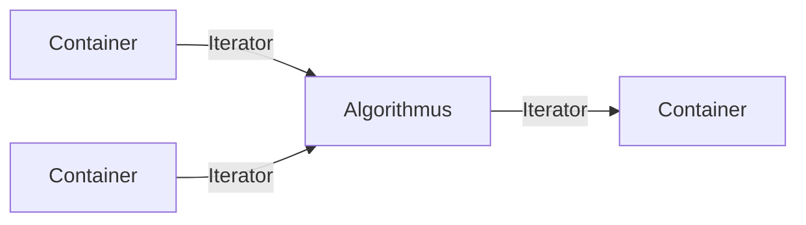
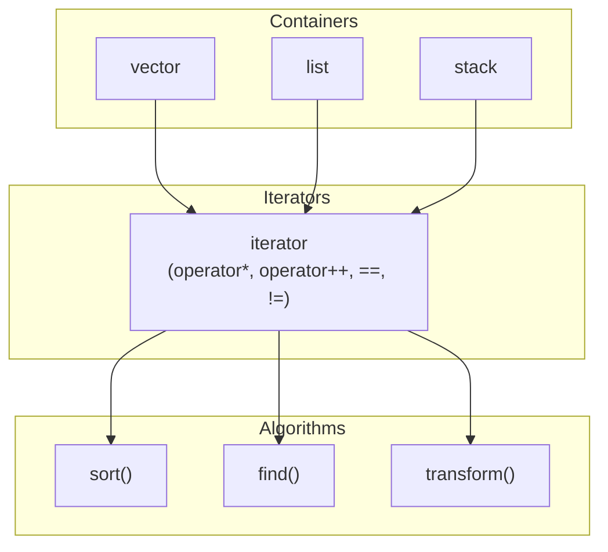

## Definition

The C++ standard library (*C++-Standardbibliothek*) is the namespace `std` plus
a fixed set of headers: the fundamental program library of C++ and part of the
ISO C++ standard. Historically, in 1998 HP's **Standard Template Library (STL)**
was adopted into the C++ standard's library, bringing efficient, generic
algorithms and data structures built on [[concepts/templates]].

> Literature pointers from the source: de.wikipedia.org/wiki/C++-Standardbibliothek;
> en.cppreference.com/w/; Nicolai M. Josuttis, *The C++ Standard Library — A
> Tutorial and Reference*.

## Problem it solves

Without a shared standard library, every program would reimplement its own
containers (lists, dynamic arrays), searching/sorting routines, and the glue
between them — duplicating effort and risking subtle bugs. The standard library
provides reusable, generically-templated, well-tested building blocks instead.

## Components of the standard library (§0.5.3.1)

Three main components:

- **Container** (*Container*): containers for data, e.g. stack, list, etc. —
  implemented as template classes. See [[structures/stack]] for a worked
  example of one such container.
- **Iteratoren** (*Iterators*):
  - resemble pointers (operators `*`, `++`, `==`, `!=`, `=`, partly `--`, `[]`)
  - move step by step through the elements of a container
  - allow access to the element currently pointed to
  - implemented as a (sub-)class **within** each container class
  - form a common interface across arbitrary container types
- **Algorithmen** (*Algorithms*):
  - search, sort, and otherwise manipulate data
  - access data exclusively via iterators
  - are globally defined functions taking iterators as parameters
  - and thereby **deliberately violate the object-oriented model** — algorithms
    are not methods of the containers they operate on.

## Separation of data structures and operations (§0.5.3.2)

- **Data** is managed by containers.
- **Operations** are defined by algorithms.
- **Iterators** are the connecting link between containers and algorithms.

This is an explicitly **non-OOP** design choice: rather than each container
implementing its own `sort`, `find`, etc. as member functions (as
[[concepts/encapsulation]] might suggest), a single generic algorithm works on
*any* container type that can supply suitable iterators — trading
encapsulation for combinatorial reuse (M containers × N algorithms need only
M+N pieces of code, not M×N).

### Diagram: Abbildung 12 — Komponenten der Standardbibliothek

## Reference illustration

## Consequences / trade-offs

- A container author needs to implement only one iterator type to make all
  standard algorithms usable, instead of one member function per algorithm.
- An algorithm author needs to write one generic function (templated over
  iterator type) to work on every conforming container.
- The price is reduced encapsulation: algorithms live outside the container's
  class, and misuse of raw iterators (e.g. after invalidation) is a common
  source of undefined behaviour — see [[concepts/pointers-and-references]] for
  the pointer-like semantics iterators share.

## Misuse & anti-patterns

- Treating standard containers as suitable polymorphic base classes — the
  source elsewhere notes they are not designed to be derived from (no virtual
  destructors).
- Passing an overloaded function (rather than a uniquely-resolved one) as an
  algorithm's function parameter — see [[concepts/templates]] §0.5.2.13 for why
  this fails and how to fix it.

## Related

- [[concepts/templates]]
- [[concepts/smart-pointers]]
- [[concepts/pointers-and-references]]
- [[structures/stack]]
- [[concepts/encapsulation]]

## Sources

[[sources/grigat-cpp-concepts-generic]] §0.5.3.1, §0.5.3.2
