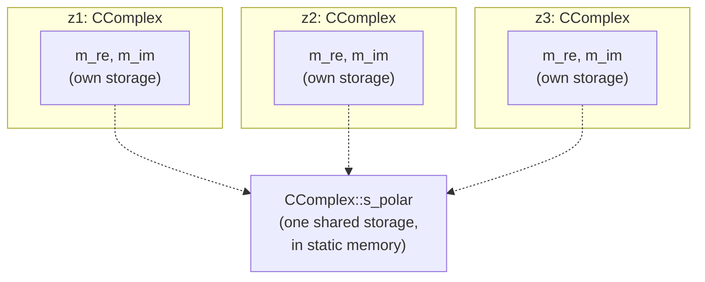
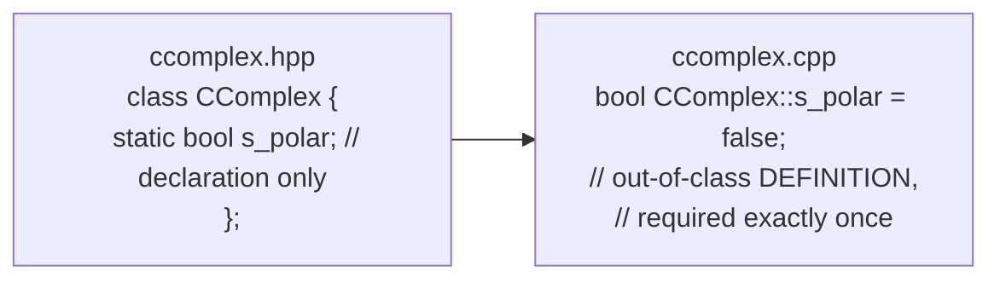

Static member variables (*statische Membervariable*) and static member functions (*statische Memberfunktion*) belong to the **class** itself rather than to any one instance: their storage or callability does not depend on an object existing (§0.3.3.5-0.3.3.9).





A static member variable is *declared* inside the class but must be
*defined* (and given storage) exactly once outside it, mirroring the
declaration/definition split used for [[concepts/member-functions|member
functions]] (§0.3.3.7) — otherwise the linker has nowhere to place its
storage.

## Problem it solves

Normally, every instance of a class gets its own storage for each member variable. Sometimes data must instead be *shared* across all instances — a synchronization flag for a shared resource, or a setting (e.g. output format) that should apply uniformly to every object of the class. A per-instance member variable cannot express this; a static member variable can (§0.3.3.6).

## Static member variables

- Every instance of a class normally gets its own storage region for each member; **static member variables are the exception** — they occupy storage only once, and all instances access the same variable (§0.3.3.6).
- Static member variables are stored in [[concepts/memory-model|static memory]] (§0.3.3.1, §0.3.3.6).
- They can be accessed even before any object of the class exists, via a static member function of that class (§0.3.3.5).

```cpp
// ccomplex.hpp
class CComplex
{
public:
  CComplex(double r, double i);
  ~CComplex();
  double re();
  double im();
  void print();
private:
  double m_re;
  double m_im;
  static bool s_polar; // statische Membervariable
};
```

A static member variable must be initialized exactly once, outside the class, in the corresponding `.cpp` file:

```cpp
// ccomplex.cpp
bool CComplex::s_polar = false; // Initialisierung
```

`CComplex::s_polar` exists exactly once, independent of how many instances of `CComplex` are created (§0.3.3.7).

## Static member functions

A static member function belongs to the class, not to an object; it can be called even when no instance of the class exists yet, and is particularly used to access static member variables of that class (§0.3.3.5, §0.3.3.8).

```cpp
// ccomplex.hpp
class CComplex
{
public:
  /* ... */
  void print();
  static void setPolar(bool format); // statische Memberfunktion, Deklaration
private:
  /* ... */
  static bool s_polar;
};

// ccomplex.cpp
void CComplex::setPolar(bool format) // stat. Memberfunktion, Definition
{
  s_polar = format;
}

// main.cpp
int main()
{ // Aufruf statischer Memberfunktion
  CComplex::setPolar(true);
  CComplex *z = new CComplex(1.0, 2.0);
  z->print();
  delete z;
  return EXIT_SUCCESS;
}
```

A static member function can meaningfully access only static member variables and variables within its own parameter signature — it has no `this` pointer, so it cannot address a particular object's non-static members without naming an object explicitly (§0.3.3.8).

## Application areas

- Synchronizing objects of a class around a shared resource.
- Shared settings for all objects of a class (e.g. a display/output format such as `s_polar`).
- A public interface (the static member function) for otherwise-private static member variables (§0.3.3.9).

## Static member objects

[[concepts/composition|Member objects]] are themselves member variables, so they too can be declared static; the same rules that apply to static member variables apply to static member objects, and static member functions can access static member objects as well (§0.3.4.5).

## Consequences / trade-offs

- A static member variable gives class-wide shared state without resorting to a global variable, while still respecting access modifiers (it can be `private`).
- Because all instances share the same storage, mutating a static member variable through one object silently affects the state seen by every other object — an easy source of surprising coupling if not documented.

## Misuse & anti-patterns

- Forgetting to provide the out-of-class initialization (`bool CComplex::s_polar = false;`) — the static member variable is declared in the class but must still be defined exactly once elsewhere.
- Treating a static member function as if it had access to a particular object's non-static data without passing that object explicitly — it has no implicit object and hence no [[concepts/this-pointer|`this` pointer]].

## Related

- [[concepts/memory-model]]
- [[concepts/composition]]
- [[concepts/class-and-object]]
- [[concepts/this-pointer]]

## Sources

[[sources/grigat-oop-teil1]] §0.3.3.5, §0.3.3.6, §0.3.3.7, §0.3.3.8, §0.3.3.9, §0.3.4.5
