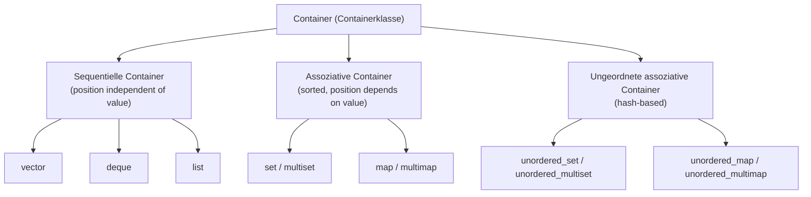

## One-sentence definition

A container (*Containerklasse*) is a standard-library class template that
stores a collection of elements, and the C++ standard library splits
containers into sequential, associative, and unordered-associative families
distinguished by whether an element's position depends on its value
(§0.5.6.1).

## Problem it solves

Every non-trivial program needs to hold a collection of objects and must
choose among trade-offs: random access vs. insertion cost, sortedness vs.
raw speed, searching by content vs. by position. Rather than hand-roll a
dynamic array or linked list each time, the STL offers a small family of
container classes with well-known complexity guarantees so the choice can be
made deliberately (§0.5.6.2).

## Container classes overview (§0.5.6.1)

Two main families:

1. **Sequentielle Container** (sequential containers): an ordered (not
   necessarily sorted) set of elements — the position of an element is
   independent of its value. Members: [[structures/vector]],
   [[structures/deque]], [[structures/list]].
2. **Assoziative Container** (associative containers): a sorted set of
   elements — the position of an element depends on its value. Subtypes:
   Set/Multiset and Map/Multimap, covered together in
   [[structures/set-and-map]].

A third family, not sorted but hash-based, is the **ungeordnete assoziative
Container** (unordered associative containers, §0.5.6.9): Unordered
Set/Multiset/Map/Multimap, covered in
[[structures/unordered-containers]].



## Which container should one use? (§0.5.6.2)

- *Vector*: wahlfreier Zugriff (random access), Einfügen am Ende (insertion at
  the end).
- *Deque*: wahlfreier Zugriff, Einfügen an Anfang oder Ende (insertion at
  front or end).
- *List*: Einfügen auch in der Mitte (insertion also in the middle).
- *Set/Multiset* or *Map/Multimap*: Suche nach Inhalten (search by content).

> [!note] Not meant as base classes
> Containers are not optimized as base classes for derivation (Ableitungen) —
> they are not designed to be inherited from as polymorphic base classes (no
> virtual destructors).

## Memory model (§0.5.6.6)

The memory model of a container is represented by its **Allokator-Klasse**
(allocator class) — a type responsible for dynamic memory management
(*Speicherverwaltung*) for objects of type `T`: it reserves memory with `new`
and frees it with `delete`. The default is the standard allocator class
`allocator<T>`:

```cpp
vector<typename T, typename Allocator = allocator<T> >
list<typename T, typename Allocator = allocator<T> >
deque<typename T, typename Allocator = allocator<T> >
```

See [[concepts/memory-model]] for the broader notion of memory models this
specializes.

## Note on direct element access (§0.5.6.10)

- **Zugriff mit `[]`** (access with `operator[]`): existence of the element is
  *not* checked.
- **Zugriff mit `at()`**: a member function of `vector` and `deque`; throws
  `out_of_range` if the element does not exist. Slower than `[]`, but safer.

```cpp
std::vector<int> vec;
vec.push_back(0);
std::cout << vec[1];    // undefiniert, evtl. zufaelliger Wert
std::cout << vec.at(1); // wirft out_of_range - Ausnahme
```

## Master comparison table

| Container | Family | Sorted? | Random access | Insert front | Insert end | Insert middle | Search |
|---|---|---|---|---|---|---|---|
| [[structures/vector]] | Sequential | No | O(1) | O(n) | O(1) | O(n) | O(n) |
| [[structures/deque]] | Sequential | No | O(1) | O(1) | O(1) | O(n) | O(n) |
| [[structures/list]] | Sequential | No | not possible | O(1) | O(1) | O(1) at current position, O(n) to reach other position | O(n) |
| set/multiset ([[structures/set-and-map]]) | Associative | Yes (by value) | not possible | — | — | O(log n) insert | O(log n) |
| map/multimap ([[structures/set-and-map]]) | Associative | Yes (by key) | not possible | — | — | O(log n) insert | O(log n) |
| unordered_set/map ([[structures/unordered-containers]]) | Unordered associative | No (hash order) | not possible | — | — | O(1) average* | O(1) average* |

\* Assuming a low load factor (*Speicherfüllungsgrad*) and a well-distributing
hash function; see [[structures/unordered-containers]] for the worst-case
bound.

## Trade-offs

- Sequential containers trade sortedness for control over position
  (`push_front`/`push_back`/positional insert); associative containers trade
  that control for automatic O(log n) search by content.
- Choosing the wrong container (e.g. `vector` when frequent front-insertion is
  needed) silently degrades an O(1) operation to O(n) — the complexity table
  above is the primary tool for avoiding that.

## Misuse & anti-patterns

- Deriving a custom class from an STL container to "add" behavior — containers
  are not designed as polymorphic base classes (§0.5.6.2).
- Using `operator[]` on a container when the index/key may not exist and then
  not checking for a default-inserted/garbage result — use `at()` instead
  when safety matters more than speed (§0.5.6.10).

## Related
- [[structures/vector]]
- [[structures/deque]]
- [[structures/list]]
- [[structures/set-and-map]]
- [[structures/unordered-containers]]
- [[concepts/iterators]]
- [[concepts/memory-model]]
- [[concepts/standard-library]]

## Sources
- [[sources/grigat-cpp-concepts-generic]] §0.5.6.1, §0.5.6.2, §0.5.6.6, §0.5.6.10
