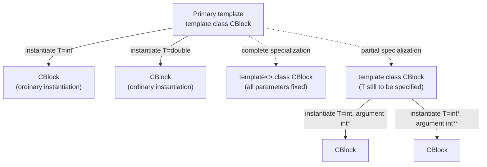

## Definition

**Template instantiation** (*Template-Instantiierung*) generates a class (or
function) definition from a [[concepts/templates|template]] by substituting
concrete template arguments for its template parameters. **Template
specialization** (*Template-Spezialisierung*) is a different, deviating
definition of the template provided for specific individual template arguments
— and that deviating definition may itself still contain template parameters.

## Problem it solves

A generic template body is not always appropriate for every possible argument:
`bool` or pointer types often need a fundamentally different internal
representation or behaviour than the generic case (e.g. a bit-packed `vector<bool>`
in the real standard library). Specialization lets the author override the
generic template for exactly those arguments while every other instantiation
still uses the generic definition.

## Instantiation vs. specialization (§0.5.2.4)

```cpp
//Instantiierung
CBlock<int   > intBlk;
CBlock<double> doubleBlk;
template<> class CBlock<bool>{     // Komplette Spezialisierung
// template<> bedeutet, dass alle Template-Parameter vorab bekannt sind,
// d.h. nicht mehr spezifiziert werden müssen,
// <bool> spezifiziert den Template-Parameter in dieser Spezialisierung
...
};
```

`CBlock<int>` and `CBlock<double>` are ordinary **instantiations** of the
primary template `CBlock<T>` (see [[concepts/templates]] §0.5.2.3 for its
definition). `template<> class CBlock<bool>{...};` is a **complete
specialization** (*komplette Spezialisierung*): the empty `template<>` means
all template parameters are already fixed in advance and need not be specified
again; `<bool>` fixes the one template parameter `T` for this particular
specialization.

## Complete vs. partial specialization (§0.5.2.5)

In a **complete specialization** every template parameter is replaced by a
concrete argument — nothing remains to be specified at instantiation. In a
**partial specialization** (*partielle Spezialisierung*), the template
parameter `T` remains, but constrained to a shape, e.g. restricted to pointer
types:

```cpp
template<>              class CBlock<int>{ ... };  // komplette Spezialisierung
template<typename T> class CBlock<T*> { ... };      // partielle Spezialisierung
```

```cpp
template<typename T> class CBlock<T*>{ .... };  // partielle Spezialisierung
// Template-Argument ist T*, Template-Parameter ist T
// Zur Instantiierung muss T noch spezifiziert werden.

// Instantiierungen des Klassen-Templates
// Template-Parameter T ist nicht identisch zu Template-Argument
CBlock<int* > intBlk;   // <T*> ist <int*>,  damit ist T ein int
CBlock<int**> pintBlk;  // <T*> ist <int**>, damit ist T ein int*
```

The key distinction raised by the notes: the **template argument** (what you
write in angle brackets, e.g. `T*`) is not necessarily identical to the
**template parameter** that still needs fixing (`T`). For `CBlock<int*>`, the
partial specialization's argument pattern `T*` matches `int*`, so `T` is
deduced as `int`; for `CBlock<int**>`, `T` is deduced as `int*`.

## Mermaid diagram of the relationships



## Reference implementation

```cpp
//block.hpp
template <typename T> class CBlock
{
public:
  CBlock(int num);
  /* ... */
private:
        T* elem;
        int n;
};

//Template-Konstruktor
template<typename T>
    CBlock<T>::CBlock(int num=100):
    n(num)
{
  elem = new T[num];
}
```

## Consequences / trade-offs

- Specialization lets a generic abstraction keep one clean interface while
  internally optimizing or correcting behaviour for particular types (e.g. the
  `vector<bool>` bit-packing case in the real STL).
- Partial specialization only applies to **class** templates in standard C++;
  function templates cannot be partially specialized (only overloaded, see
  [[concepts/templates]] §0.5.2.8–9).
- Every specialization must be visible wherever the template is instantiated
  with the matching arguments, or the compiler silently uses the wrong
  definition (ODR risk) — specializations belong in the same header as the
  primary template.

## Misuse & anti-patterns

- Confusing "template argument" with "template parameter" when reading a
  partial specialization — e.g. assuming `T` in `CBlock<T*>` is the same thing
  as the argument written inside the angle brackets at the call site.
- Declaring a specialization *after* a point where the primary template was
  already implicitly instantiated for the same arguments (undefined behaviour /
  compiler error in a conforming implementation).

## Related

- [[concepts/templates]]
- [[concepts/variadic-templates]]
- [[concepts/type-aliases]]
- [[concepts/inheritance]]
- [[concepts/function-overloading]]

## Sources

[[sources/grigat-cpp-concepts-generic]] §0.5.2.4, §0.5.2.5
