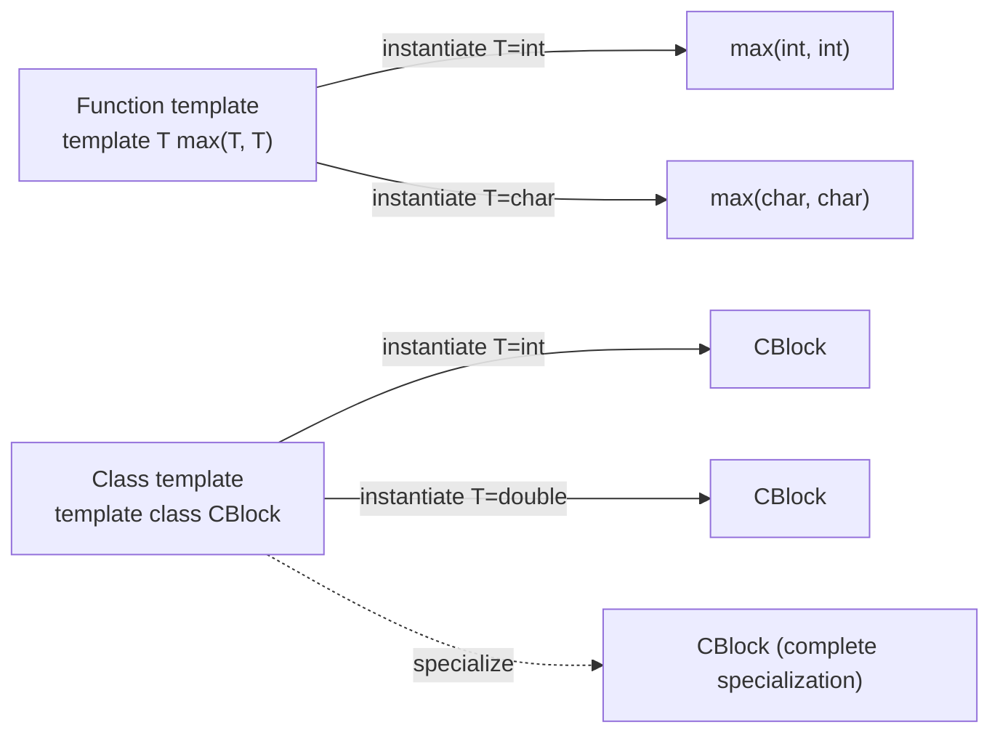

## Definition

Generic programming (*generische Programmierung*) means writing algorithms whose
data types are **not yet known** (*noch unbekannte Datentypen*) — the data type
is specified as a parameter, so the same algorithm works across many types. C++
templates (*Vorlagen, Schablonen*) are the language's direct support for this:
`template <typename T>` introduces **T** as a template parameter representing a
still-unknown type.

## Problem it solves

Without templates, code that differs only by type (e.g. "the larger of two
values") would have to be duplicated per type, or dispatched dynamically through
[[concepts/polymorphism]]. Templates let the compiler generate the type-specific
code once per actually-used type, at **compile time**, with no runtime
indirection — a form of static [[concepts/polymorphism]].

```cpp
// Template-Parameter T stellt einen noch unbekannten Datentyp dar
template <typename T>
const T& derGroessere(const T& a, const T& b) {
  return a > b ? a : b;
}
// Beispiel: Funktions-Template derGroessere
```

**Template instantiation** (*Template-Instantiierung*) is the compiler generating
a concrete function (or class) definition from a template by fixing its template
parameters. `<typename T>` is preferred over the equivalent `<class T>`: T need
not be a class, e.g. a plain `int` may be substituted, and "typename" reads more
honestly since T is a type name.

## Template classes and template parameters (§0.5.2.1)

Template parameters may stand for **types** (`typename T`) or for **constants**
(e.g. `int n`; floating-point constants are not allowed). Types and constants may
be combined, and default arguments are permitted, following the same rules as
default function arguments. At instantiation, any constant parameter must have a
value known to the compiler.

```cpp
//noch unbekannt:
//T (Datentyp), n (Konstante)
template <typename T=double, int n=10>
class CPicture
{
  /* ... */
};
```

```cpp
int i=5;
CPicture<int, 256> Pic1;
    // Okay, 256 ist Konstante
    // und Typ int
CPicture<int, i > Pic2;
    // Fehler, i ist nicht const
```

### Non-type template arguments (§0.5.2.2)

A non-type template argument that is a **reference** may only bind to a global
or `static` object. As a **pointer**, only the address of a global object or
global function is allowed. Otherwise only a **constant expression**
(*konstanter Ausdruck*) is allowed. A string literal such as `"Oktoberfest"` is
*not* allowed as a `char*` argument because it has static, not global, linkage —
but a named global string is fine.

```cpp
char str[] = "Laterne"; // global
Demo<double, str> abc;  // ok
```

## Member function templates (§0.5.2.3)

Member functions of a class template are themselves function templates. Because
the compiler must substitute template parameters at the point of use, their
**definitions must live in the header file** — otherwise multiple translation
units cannot see the definition needed to instantiate them, causing
multiple-definition or linker errors. The compiler only instantiates the member
functions that are actually used for a given set of template arguments.

```cpp
//block.hpp
template <typename T> class CBlock
{
public:
  CBlock(int num);
  /* ... */
private:
        T* elem;
        int n;
};

//Template-Konstruktor
template<typename T>
    CBlock<T>::CBlock(int num=100):
    n(num)
{
  elem = new T[num];
}
```

See [[concepts/template-specialization]] for how `CBlock` can later be
instantiated for `int`/`double` or specialized for `bool`/pointer types.

## Template functions vs. template classes (§0.5.2.6)

At instantiation of a **class** template, all template parameters must be given
explicitly: `CPicture<int, 256> intPic; CPicture<char, 26> charPic;`.
A **function** template, by contrast, should be able to deduce its template
parameters implicitly from the function's arguments:

```cpp
template<typename T, int n> void sort(CPicture<T, n>& Pic)
{ /* ... */ }
//Funktions-Template: Template-Parameter sind wegen der
//Funktions-Argumente hier implizit eindeutig
sort(intPic); // Template-Funktion aus Funktions-Template
sort(charPic); // Andere Template-Funktion, selbes Template
```

## Explicit specification of template functions (§0.5.2.7)

If template parameters are not implicitly deducible from the function
arguments, they must be specified explicitly after the function name — but
**only for parameters actually used** in the function. In the explicit list,
arguments may be omitted only from the back (*von hinten*). A frequent use is
fixing the return type of a template function.

```cpp
// Funktions-Template implicit_cast
template<typename T, typename U> T implicit_cast(U u){return u;}
void g(int i) {
  // Explizit spezifizierte Template-Funktionen implicit_cast
  implicit_cast(i);                 // Fehler: kann T nicht ermitteln
  implicit_cast<double>(i);         // T ist double, U ist int
  implicit_cast<char,double>(i);    // T ist char, U ist double
  implicit_cast<char*,int>(i);      // T ist char*; U ist int
                                     // Fehler: kann nicht int nach char* wandeln
}
```

## Overloading function templates (§0.5.2.8–0.5.2.9)

Function templates may be overloaded among themselves (same name, different
signature) and against ordinary (non-template) functions of the same name.

```cpp
template<typename T> T max(T, T); // Funktions-Template
double max(double, double);        // "normale" Funktion

max(3, 5);        // max<int>(int, int)
max('c', 'z');    // max<char>(char, char)
max(6.2, 3.7);    // max(double, double), "normale" Funktion vor Template
max(1, 'b')       // Fehler, mehrdeutig, aber:
max<int>(1, 'b'); // max<int>(1, int('b'))
```

**Rules for resolving ambiguities (§0.5.2.9):**

```
1. Determine the set of all function-template specializations suitable for resolution.
2. Reduce that set to the resolutions with the highest degree of template
   specialization (the match with the strongest restriction wins).
3. Resolve between the remaining template candidates and the ordinary-function
   candidates using the normal overload-resolution rules; matches that need no
   type conversion (cast) are preferred.
4. If a normal function and a template specialization are equally good matches,
   the normal function is preferred.
5. If no candidate, or several equally-ranked best candidates, remain: error (ambiguous).
```

## Class templates as base classes (§0.5.2.12)

When a base class is itself a template class, e.g. `vector<T>`, member access of
inherited names often requires full qualification, and dependent type names
require the `typename` keyword:

```cpp
template <typename T, typename Compare = less<T>>
class SortVec : public vector<T> {   // Basisklasse ist Templateklasse
  public:
    SortVec(int n, const T& x = T()) : vector<T>(n,x) {}
    void insert(const T& obj);        // Sortiert Einfügen
};
template <typename T, typename Compare >
void SortVec<T, Compare>::insert(const T& obj) {
  typename SortVec::iterator  pos, temp;  // typename erforderlich
  SortVec::push_back(obj);                 // SortVec:: erforderlich
  pos = SortVec::end()-1;                  // SortVec:: erforderlich
...
// Beispiel: KP33_1_binarySortMergeVector
```

`typename` is required before `SortVec::iterator` because, inside a dependent
template-base context, the compiler cannot otherwise know whether `iterator` is
a type or a value; `SortVec::` qualification is needed because names from a
template base class are not looked up unqualified. This relates directly to
[[concepts/inheritance]] and [[concepts/type-aliases]].

## Overloaded function as call parameter (§0.5.2.13)

Passing an overloaded function (such as `sqrt` from `<cmath>`, which has several
overloads) directly as a template algorithm's function-pointer parameter fails
because the compiler cannot resolve *which* overload to take the address of
("unresolved overloaded function type"). Fixes: wrap it in a non-overloaded
function, cast its type explicitly, or use `std::ptr_fun<T,T>()`.

```cpp
static inline double computeSqrt (double x) { return sqrt(x); }
transform(dblVec1.begin(), dblVec1.end(), dblVec2.begin(),
          computeSqrt); // ok, double(double)

transform(dblVec1.begin(), dblVec1.end(), dblVec2.begin(),
          sqrt); // Fehler, unresolved overloaded function type
transform(dblVec1.begin(), dblVec1.end(), dblVec2.begin(),
          (double(*)(double)) sqrt); // ok, cast auf double(*)(double)
transform(dblVec1.begin(), dblVec1.end(), dblVec2.begin(),
          ptr_fun<double, double>(sqrt));
                              // ok, cast mittels std::ptr_fun<T,T>()
```

## Diagram: template → instantiation



## Consequences / trade-offs

- Zero runtime overhead compared to hand-written per-type code; errors surface
  at compile time (sometimes with hard-to-read diagnostics).
- Member-function-in-header requirement increases compile times and couples
  interface/implementation, unlike ordinary non-template classes.
- Overload-resolution rules between templates and ordinary functions are subtle
  and a frequent source of ambiguity errors.

## Misuse & anti-patterns

- Relying on implicit deduction where it's impossible (e.g. `implicit_cast(i)`
  without explicit `T`) — leads to confusing compiler errors.
- Passing an overloaded function name directly where a single function pointer
  type is expected (§0.5.2.13).
- Treating a class template as if it could derive member name lookup the way
  ordinary inheritance does, forgetting `typename`/qualification.

## Related

- [[concepts/template-specialization]]
- [[concepts/variadic-templates]]
- [[concepts/standard-library]]
- [[concepts/inheritance]]
- [[concepts/type-aliases]]
- [[concepts/function-overloading]]
- [[concepts/polymorphism]]

## Sources

[[sources/grigat-cpp-concepts-generic]] §0.5.1, §0.5.2.1, §0.5.2.2, §0.5.2.3,
§0.5.2.6, §0.5.2.7, §0.5.2.8, §0.5.2.9, §0.5.2.12, §0.5.2.13
