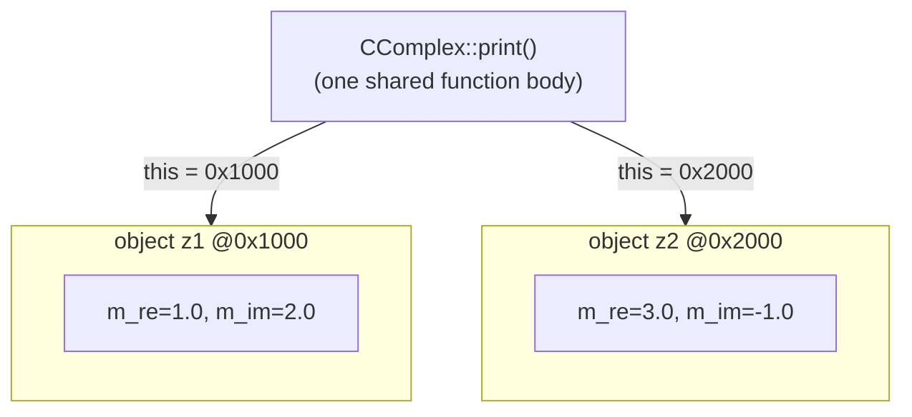
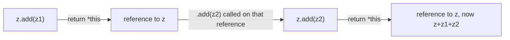

Every object implicitly holds a pointer (*Zeiger*) to itself, called `this`; `*this` dereferences it to yield the object itself, which lets a [[concepts/member-functions|member function]] return a reference to its own object.



Both `z1.print()` and `z2.print()` execute the exact same compiled function;
only the implicit `this` argument differs, pointing each call at its own
object's data.



## Problem it solves

A member function such as `z.add(z1)` should be chainable: `z.add(z1).add(z2)` should first add `z1` to `z`, then add `z2` to the *result*. For that, `add` must return something that refers back to `z` itself — it needs a way to name "the object this function was called on" (§0.3.2.9).

## The `this` pointer

The compiler supplies every (non-static) member function with an implicit pointer named `this` that points to the calling object. Its dereferenced form `*this` is the content of that object (§0.3.2.9).

> Figure 5 ("Das Objekt z mit this-Zeiger") depicts an object's private/data section containing a `this` pointer that points back to the object's own public method interface, illustrating this self-reference.

## Example: method chaining

```cpp
CComplex& CComplex::add(const CComplex& zn)
{
  m_re += zn.re();
  m_im += zn.im();
  return *this;
}
```

`add` returns `CComplex&` — a reference to the object itself. Because `*this` *is* the calling object, `z.add(z1)` returns (a reference to) `z`; calling `.add(z2)` on that result is the same as calling it on `z` directly:

```cpp
z.add(z1).add(z2); // z += z1, then z += z2
```

First `add(z1)` runs on `z`; the returned reference is just another name for `z`, so `add(z2)` runs on `z` as well (§0.3.2.10).

## Consequences / trade-offs

- Returning `*this` by reference (`ClassName&`) avoids copying the object and enables fluent, chainable APIs.
- Returning by value (`ClassName`) instead of by reference would still compile but would copy the object on every chained call, defeating the purpose and changing semantics (a new temporary would be mutated, not the original).

## Misuse & anti-patterns

- Returning `this` (the pointer) instead of `*this` (the object) from a function declared to return `ClassName&` is a type mismatch; the two are easily confused by beginners.
- Chaining methods that return `*this` on a `const` object requires the method itself to be a [[concepts/member-functions|constant member function]] returning `const ClassName&` — otherwise it cannot be called at all.

## Related

- [[concepts/member-functions]]
- [[concepts/class-and-object]]
- [[concepts/pointers-and-references]]
- [[concepts/constructor]]

## Sources

[[sources/grigat-oop-teil1]] §0.3.2.9, §0.3.2.10
