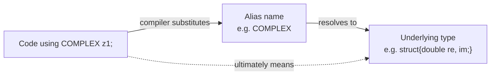
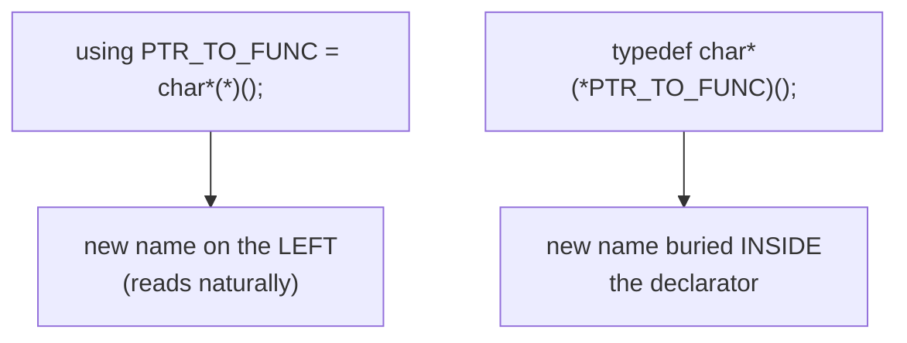

# Type Aliases (`typedef` vs. `using`)

A **type alias** (*Typalias*) creates a new name for an existing data type.
`using` is the modern form; `typedef` the traditional one.



Placement of the new name differs between the two forms:



## Why

- **Readability** — complex declarations become legible; see
  [[concepts/complex-declarations]].
- **Portability**, by encapsulating machine-dependent types behind a stable name.

Naming convention: `complex_t` or `COMPLEX`.

## Both forms

```cpp
using COMPLEX = struct{double re, im;}; // komplexe Zahl
typedef struct{double re, im;} COMPLEX; // dasselbe
COMPLEX z1, z2, *pz; // zwei komplexe Zahlen, Zeiger auf komplexe Zahl

using WERKTAG = enum{Mo, Di, Mi, Do, Fr}; WERKTAG tag;

using PTR_TO_FUNC = char*(*)(); // Zeiger auf Funktion, die char* liefert
typedef char*(*PTR_TO_FUNC)();  // dasselbe
PTR_TO_FUNC search; // gleichbedeutend mit char*(*search)()
```

Note how the `typedef` form buries the new name *inside* the declarator, while
`using` puts it on the left where you expect it. That difference is the whole
argument for `using`.

## Alias templates

`using` can do something `typedef` cannot — be templated:

```cpp
template<typename T> using Vector = std::vector<T, My_allocator<T>>;
Vector<int> entfernungen; // template-Alias
```

See [[concepts/templates]] for template syntax in general, and
[[concepts/standard-library]] for `std::vector` itself ([[structures/vector]]).

## Aliases for array and matrix types

```cpp
const size_t COLS{3};
const size_t ROWS{2};
using Row_t = int[COLS];      // äquivalent: typedef int Row_t[COLS];
using Matrix_t = int[ROWS][COLS]; // typedef int Matrix_t[ROWS][COLS];
```

See [[concepts/pointers-and-references]] for how matrices decay to pointers when
passed to functions.

## Related

- [[concepts/complex-declarations]]
- [[concepts/type-declaration-definition]]
- [[concepts/pointers-and-references]]
- [[concepts/templates]]
- [[structures/vector]]

## Sources

- [[sources/grigat-oop-teil1]] §0.2.2.7 (Typalias: typedef versus using),
  §0.2.2.8 (Matrizen als Argumente von Funktionen)
