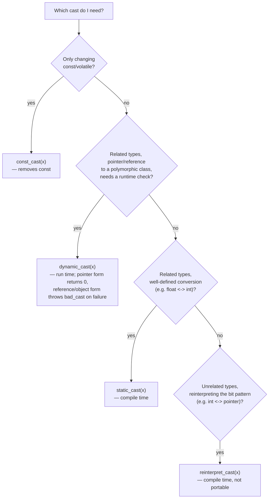

## Definition

A **type conversion** (*Typumwandlung*, cast) changes an expression's type, either **automatically/implicitly** (*automatische/implizite Konvertierung*) following fixed language rules, or **explicitly** (*explizite Konvertierung*) via a named cast or constructor call that the programmer writes deliberately.

## Problem it solves

Mixed-type arithmetic (`int` with `float`, `signed` with `unsigned`, etc.) needs a well-defined conversion ranking so results are predictable; and user-defined classes need a principled way to interoperate with other types (built-in or other classes) without either silently losing information or forcing verbose manual conversions everywhere.

## Automatic/implicit conversions (§0.4.7.1–0.4.7.2)

The compiler automatically converts between integer and floating-point types in binary operators with mismatched operand types, following these rules, applied in order:

1. For two floating-point types, the one with lower precision is converted into the other.
2. If only one operand is floating-point, the integer operand is converted into that floating-point type.
3. If both operands are integer types, the lower-precision one is converted into the other's type.
4. If one operand is `unsigned`, the other is likewise converted to `unsigned`.

A good compiler *can* warn when precision may be lost (e.g. `float` to `int`).

```cpp
int i = -2;
unsigned int ui = 2;
float f = 0.2;

cout << "i * ui = " << i * ui << endl;
  //Umwandlung von i nach unsigned int
  //Ausgabe: 4294967292

cout << "f * i = " << f * i << endl;
  //Umwandlung von i nach float
  //Ausgabe: -0.4

cout << "i/10*f = " << i/10*f << endl;
  //int-Division i/10, dann Umwandlung des Ergebnisses in float,
  // dann Multiplikation
  //Ausgabe: 0

cout << "i/10.0*f = " << i/10.0*f << endl;
//Umwandlung von i nach float, dann Division u. Multiplikation
//Ausgabe: -0.04
```

Note the pitfall in `i/10*f`: the integer division `i/10` happens *before* any floating-point conversion, truncating to `0`, so the final multiplication by `f` is also `0` — quite different from `i/10.0*f`, where `10.0` is already a `double`, forcing `i` to convert to floating-point before the division.

## Explicit conversions (§0.4.7.3)

Explicit conversion via `static_cast<>()` is preferred over relying on implicit rules, because it makes the intended conversion visible in the code and lets the compiler flag unintended ones:

```cpp
int i1 = 1;
int i2 = 2;

float f = i1 / i2;
cout << "f = " << f << endl;
  //int-Division, Ausgabe: 0

f = static_cast<float> (i1) / i2;
cout << "f = " << f << endl;
    //Umwandlung von i1 nach float, float-Division
    //Ausgabe: 0.5

int i3 = static_cast<int> (static_cast<float> (i1) / i2 + 0.5);
cout << "i3 = " << i3 << endl;
  //Addieren von 0.5 für mathematisch korrekte Rundung
  //Explizite Umwandlung des Ergebnisses nach int (sonst Warnung)
  //Ausgabe: 1
```

## The four C++ casts (§0.4.7.4)

| Cast | Target | When checked | Typical use | Failure behavior |
|---|---|---|---|---|
| `static_cast<T>(x)` | related types | compile time | e.g. `float` ↔ `int`, numeric/related-type conversions | compile error if unrelated |
| `dynamic_cast<T>(x)` | pointers/references to related **polymorphic** classes only | run time | determine which derived class (e.g. `CCabrio*`, `CBus*`) is actually stored in a base-class pointer (e.g. `CAuto*`) — see [[concepts/polymorphism]] | pointer form returns `0`; reference/object form throws `bad_cast` |
| `reinterpret_cast<T>(x)` | unrelated types (e.g. `int` ↔ pointer, pointer-to-pointer) | compile time | low-level bit reinterpretation | not portable |
| `const_cast<T>(x)` | same type, differing only in `const`/`volatile` | compile time | remove `const` | — |

`dynamic_cast` is the only one of the four that performs a genuine runtime check; it requires the classes involved to be polymorphic (i.e. have at least one `virtual` function, see [[concepts/vtable]]), because it needs run-time type information to decide whether the stored object is actually of the requested derived type.



## Converting constructor (§0.4.7.5)

A **conversion constructor** (*Konvertierungskonstruktor*) is a constructor whose argument type differs from its own class's type. If no suitable conversion constructor exists, the compiler falls back to combining with an implicit conversion where possible.

```cpp
class Euro{
Euro(int);     // Konvertierungskonstruktor int -> Euro
Euro(double); // Konvertierungskonstruktor double -> Euro
}
Euro anzahl(100);     // int -> Euro
Euro saldo(123.45); // double -> Euro
anzahl = 2.7;      // Implizite Konvertierung double -> Euro
saldo += 20;       // Implizite Konvertierung int -> Euro
saldo = Euro(23.56); // Explizite Konvertierung (Konstruktorschreibweise)
saldo = (Euro)23.56; // Explizite Konvertierung (Cast-Schreibweise)
saldo = anzahl;      // Keine Konvertierung (Zuweisung)
```

## Conversion function vs. converting constructor (§0.4.7.6)

- **Converting constructor** (*Konvertierungskonstruktor*): converts *other type → this class*.
- **Conversion function** (*Konvertierungsfunktion*): converts *this class → other type*; named `operator Zieltyp()`.

```cpp
class Euro{
    long data; // in Cents
public:
    Euro(int); // in Cents
    operator double() const { return (double)data/100.0; }
}
int main(){
Euro gehalt(54321);
double x = gehalt;       // implizit Euro -> double, 543.21
x = (double)gehalt;       // explizit Euro -> double, 543.21
x = double(gehalt);          // Konstruktorschreibweise, 543.21
x = gehalt.operator double(); // auch möglich, 543.21
int i = gehalt;               // Euro -> double -> int, 543
}
// Beispiel: KP20_1_Konvertierungsfunktion
```

## Ambiguity and `explicit` (§0.4.7.7–0.4.7.8)

A conversion function can cause **ambiguity** (*Mehrdeutigkeit*): implicit conversion is only ever performed when it is **unambiguous** (*eindeutig*). The keyword `explicit` disables a converting constructor or a conversion function for *implicit* use — explicit casts (`static_cast`, constructor-style, or C-style casts) still work. An alternative to a conversion function altogether is a plainly named method such as `asDouble()`, which the compiler can never invoke implicitly.

```cpp
explicit Euro(double x);    // Euro(double) nur noch explizit nutzbar
double asDouble()const {return (double)data/100.0;}    // nur explizit
explicit operator double()const {return (double)data/100.0;} // nur explizit
// Beispiel: KP20_2_explicit_Konvertierungsfunktion
```

The effect of `explicit` is best seen by contrasting two otherwise-identical structs, one without and one with `explicit` (example credited in the notes to "explicit_cppreference.com"):

```cpp
struct A {              A(int) { }        // converting constructor
                         A(int, int) { }   // converting constructor (C++11)
                         operator bool() const { return true; } };//conv. fct.
struct B {  explicit B(int) { }
            explicit B(int, int) { }
            explicit operator bool() const { return true; }  };
int main() {
    A a1 = 1;      // OK: copy-initialization selects A::A(int)
    A a4 = {4, 5}; // OK: copy-list-initialization selects A::A(int, int)
    if (a1) ;      // OK: A::operator bool()
    bool na1 = a1; // OK: copy-initialization selects A::operator bool()
    bool na2 = static_cast<bool>(a1); // OK: static_cast, direct-initialization
    // B b1 = 1;   // error: copy-initialization, does not consider B::B(int)
    B b2(2);        // OK: direct-initialization selects B::B(int)
    B b3 {4, 5};    // OK: direct-list-initialization selects B::B(int, int)
// B b4 = {4, 5};   // error: copy-list-initialization, not B::B(int,int)
    B b5 = (B)1;    // OK: explicit cast performs static_cast
    if (b2) ;       // OK: B::operator bool()
// bool nb1 = b2;   // error: copy-initialization, not B::operator bool()
    bool nb2 = static_cast<bool>(b2); // OK: static_cast, direct initial.
}
// Beispiel: explicit_cppreference.com
```

This contrasts four initialization forms (kept here in their standard English names, used verbatim in the German source text): **direct-initialization** (`B b2(2);`), **direct-list-initialization** (`B b3{4,5};`), **copy-initialization** (`B b1 = 1;`), and **copy-list-initialization** (`B b4 = {4,5};`). `explicit` disables only the copy-initialization and copy-list-initialization forms; direct-initialization, direct-list-initialization, and explicit casts (`static_cast`, `(B)1`) still work.

```
Deciding whether a user-defined conversion needs `explicit`:
1. Does the class define a converting constructor or conversion function
   (operator Zieltyp())?
2. If yes: could it be invoked by accident via an implicit conversion the
   caller did not intend (e.g. accidentally constructing a Euro from any int
   literal passed to an unrelated function)?
3. If such accidental/ambiguous implicit use is undesirable -> mark the
   constructor or conversion function `explicit`.
4. Callers that genuinely want the conversion must then spell it out: via
   direct-initialization, a named cast (static_cast<T>), or a dedicated
   named method (e.g. asDouble()).
```

## Consequences / trade-offs

- Implicit conversions are convenient but can silently discard precision or trigger unintended overload resolutions; `static_cast` makes intent explicit and lets the compiler warn on otherwise-implicit lossy conversions.
- `dynamic_cast` is the only cast that is actually "safe" across a class hierarchy at runtime, but it has a cost (runtime type check) and only works on polymorphic types.
- `reinterpret_cast` sacrifices portability for the ability to reinterpret raw bit patterns — it should be reserved for low-level code with a documented reason.
- `explicit` trades implicit convenience for ambiguity-safety; it is the recommended default for single-argument constructors and conversion operators unless implicit conversion is specifically desired.

## Misuse & anti-patterns

- Using C-style casts (`(Euro)23.56`) instead of the appropriately named C++ cast — they hide which of the four semantics (`static_cast`, `const_cast`, `reinterpret_cast`, or a combination) is actually being requested.
- Applying `dynamic_cast` to non-polymorphic types (no `virtual` function) — this does not compile, since there is no run-time type information to inspect.
- Omitting `explicit` on a single-argument converting constructor "just in case," inviting accidental implicit conversions and ambiguous overload resolution.

## Related

- [[concepts/polymorphism]]
- [[concepts/vtable]]
- [[concepts/constructor]]
- [[concepts/operator-overloading]]
- [[concepts/exceptions]]

## Sources

- [[sources/grigat-cpp-concepts-generic]] §0.4.7.1, §0.4.7.2, §0.4.7.3, §0.4.7.4, §0.4.7.5, §0.4.7.6, §0.4.7.7, §0.4.7.8
