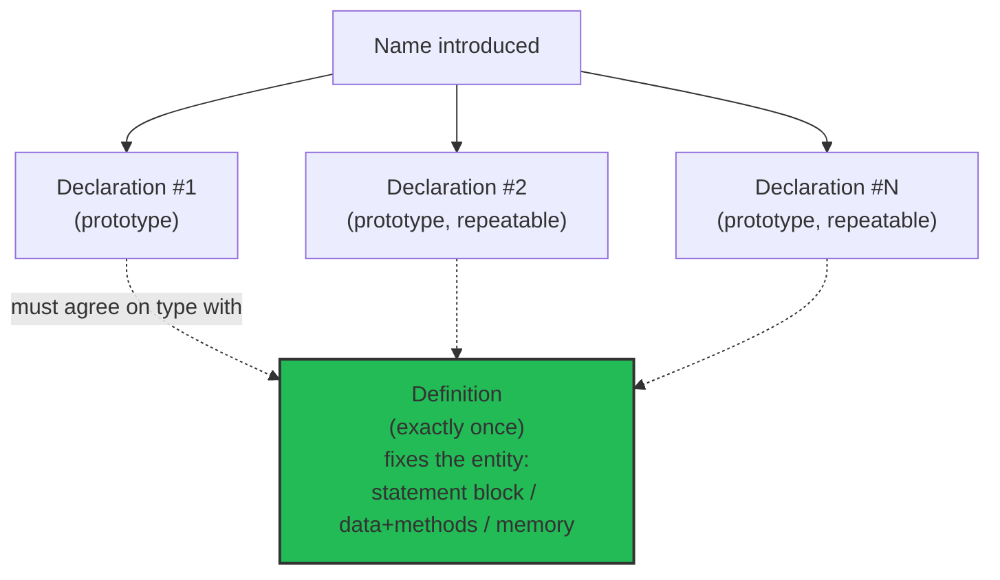
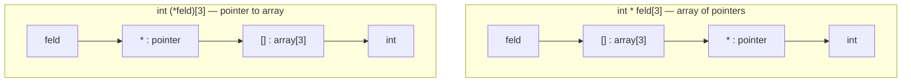

# Type, Declaration, Definition



The vocabulary the whole language rests on: a **type** (*Typ*) constrains what a
name may hold, a **declaration** (*Deklaration*) binds a name to a type, and a
**definition** fixes the entity behind the name.

## Basic terms

| German | English | Meaning |
|---|---|---|
| Typ | type | Defines the permissible values and operations. Every name and every expression has a type. |
| Deklaration | declaration | Introduces a name into the program and specifies a type for the named entity. |
| Objekt | object | Something in main memory that stores a value of a certain type. |
| Wert | value | A set of bits, interpreted according to the type. |
| Variable | variable | A named object. |

## Declaration vs. definition

- Every **definition** is also a **declaration** — but not the other way round.
- A declaration (prototype) links a *name* with *types*. It may appear many times.
- A definition fixes an **entity** for the name and must appear **exactly once**.
  The entity is, for functions, the statement block; for classes, their data and
  methods; for basic types, their allocated memory.

See [[concepts/function-declarations]] for the prototype/definition distinction
applied to functions.

## General structure of a declaration

A declaration is assembled from:

1. Optional **specifier** — e.g. `static`, `virtual`
2. **Base type** — e.g. `vector<double>`, `const int`
3. **Declarator** (*Deklarator*), optionally with a name — e.g. `p[7]`, `n`
4. Optional function specifier suffix — e.g. `const`, `noexcept`
5. Optional **initializer** or function body — e.g. `={7,5,3}`, `{return x;}`
6. Semicolon (except for functions and namespaces)

## Declarator operators

| Position | Operator | Meaning |
|---|---|---|
| prefix | `*` | pointer (*Zeiger*) |
| prefix | `*const` | constant pointer (*konstanter Zeiger*) |
| prefix | `*volatile` | volatile pointer |
| prefix | `&` | lvalue reference (*L-Wert-Referenz*) |
| prefix | `&&` | rvalue reference (*R-Wert-Referenz*) |
| prefix | `auto` | function with trailing return type |
| postfix | `[]` | array |
| postfix | `()` | function |
| postfix | `->` | trailing-return indicator |

**Postfix binds more strongly than prefix.** This single rule explains the
classic confusion:

```cpp
int * feld[3]; // Array aus drei Zeigern, int* (feld[3]);
int (*feld)[3]; // Zeiger auf Array aus drei Integers.
```

See [[concepts/complex-declarations]] for the full parsing procedure.

The two readings as a binding tree — `[]` (postfix) attaches directly to the
name, `*` (prefix) attaches only to the *result* of that:



Resolving a declarator, step by step (see [[concepts/complex-declarations]] for
the general procedure):

```text
1. Find the declared name.
2. Attach any postfix operator ([] or ()) directly adjacent to the name first.
3. Attach prefix operators (*, &, &&) only after all adjacent postfix
   operators are consumed, or when parentheses force a different grouping.
4. Apply the base type last.
```

## Related

- [[concepts/initialization-and-assignment]]
- [[concepts/complex-declarations]]
- [[concepts/function-declarations]]
- [[concepts/type-aliases]]
- [[concepts/scope-and-storage-classes]]
- [[concepts/operators-and-precedence]]

## Sources

- [[sources/grigat-oop-teil1]] §0.2.1.1 (Typ, Deklaration, Variable), §0.2.3.3–0.2.3.5
