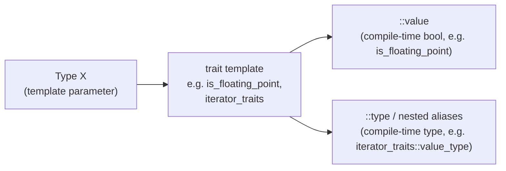

## Definition

**Type functions** (*Typfunktionen*), also called **traits** (German gloss: *Merkmal, Eigenschaft, Wesenszug* — characteristic/feature/trait), are compile-time facilities that determine properties of types or generate composite types from them. The standard library bundles many such type functions into template classes called traits — `<type_traits>` for general type-property queries, and others such as `iterator_traits` (§0.5.8.1–0.5.8.2) for binding a family of related properties to a single type parameter.

## Problem it solves

Generic code (templates, see [[concepts/templates]]) must sometimes behave differently depending on *what kind* of type it was instantiated with — e.g. only accept floating-point types, or only pick an optimized code path for pointer types — without giving up the ability to be instantiated for arbitrary types. Type traits let this happen entirely at compile time (*Übersetzungszeit*), with zero runtime cost, typically in combination with `static_assert()` (see [[concepts/assertions]]).

## `<type_traits>` — a small selection (§0.4.5.3)

| Kleine Auswahl | Erläuterung |
|---|---|
| `is_integral<X>` | Ist X integraler Typ? (Is X an integral type?) |
| `is_floating_point<X>` | Ist X Gleitkommatyp? (Is X a floating-point type?) |
| `is_array<X>` | Ist X ein integriertes Array? (Is X a built-in array?) |
| `is_pointer<X>` | Ist X ein Zeiger? (Is X a pointer?) |
| `is_member_function_pointer<X>` | Zeiger auf nicht-statische Memberfunktion? (Pointer to non-static member function?) |
| `is_class<X>` | Ist X class oder struct? (Is X a class or struct?) |
| `is_function<X>` | Ist X eine Funktion? (Is X a function?) |
| `is_rvalue_reference<X>` | Ist X eine R-Wert-Referenz? (Is X an R-value reference?) |



This is the same shape used by [[concepts/iterator-traits]]: a type goes in, and a compile-time type or constant comes out — only the trait template and the names of the nested members differ between `std::is_*` traits and `iterator_traits`.

Typical use is a compile-time check inside a template, failing the build with a clear message if the type is unsuitable:

```cpp
template<typename T> void f(T& a) {
static_assert(std::is_floating_point<X>::value,"Gleitkommatyp erwartet");
//...
}
```

## Traits of the standard library (§0.5.8.1)

Traits serve to **bind properties to a type** — they are a kind of bundle of type functions grouped under one name. The standard library makes heavy use of them: `allocator_traits`, `char_traits`, `iterator_traits`, `regex_traits`, `pointer_traits`, `time_traits`, `type_traits`.

**`iterator_traits`** is the canonical example: a template class that defines the set of properties any iterator type must expose, so generic algorithms can query them uniformly rather than hard-coding assumptions per container (see [[concepts/iterators]], [[concepts/iterator-traits]]).

```cpp
template<typename Iterator> struct iterator_traits {
    using difference_type = typename Iterator::difference_type;
    using value_type = typename Iterator::value_type;
    using pointer = typename Iterator::pointer;
    using reference = typename Iterator::reference;
    using iterator_category= typename Iterator::iterator_category;
};
```

Because the compiler by default interprets a name like `Iterator::difference_type` as a *value* (dependent variables, *abhängige Variablen*, are interpreted this way), but it is actually a **type**, the `typename` keyword is required immediately before it when the name depends on a template parameter:

```cpp
template<typename Iter>
Iter search(Iter p, Iter q,
            typename iterator_traits<Iter>::value_type val) {
    typename iterator_traits<Iter>::difference_type m = q-p;
    // ...
}
```

```
Using a trait inside generic code:
1. Given a template parameter T (or Iterator), do not assume its internal
   type aliases directly — query them through the trait, e.g.
   iterator_traits<Iter>::value_type, so non-conforming or specialized types
   can still be supported via trait specialization.
2. Prefix any such dependent type name with `typename`, since the compiler
   otherwise assumes dependent names are values, not types.
3. Combine with static_assert() on a std::is_* trait to reject unsuitable
   types at compile time with a clear diagnostic message.
```

## Consequences / trade-offs

- All checks happen at compile time: zero runtime overhead, but diagnostics appear as (sometimes verbose) compiler errors rather than runtime messages.
- Traits decouple generic algorithms from concrete iterator/type implementations — an algorithm written against `iterator_traits<Iter>` works for any `Iter` that specializes the trait correctly, even types that were never designed with that algorithm in mind.

## Misuse & anti-patterns

- Forgetting `typename` before a dependent type name inside a template — a very common compile error for beginners working with traits.
- Writing runtime `if`/`else` branches to dispatch on type properties that are already knowable at compile time — prefer `static_assert` or template specialization instead, since type information does not change at runtime.

## Related

- [[concepts/assertions]]
- [[concepts/templates]]
- [[concepts/iterators]]
- [[concepts/iterator-traits]]
- [[concepts/template-specialization]]

## Sources

- [[sources/grigat-cpp-concepts-generic]] §0.4.5.3, §0.5.8.1
