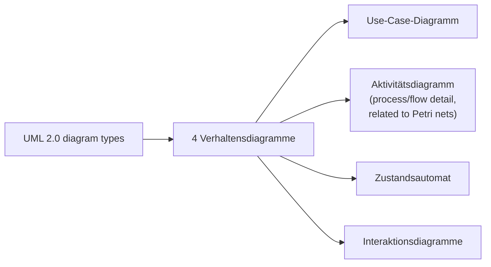

## Definition

An **activity diagram** (*Aktivitätsdiagramm*) is one of UML's four behavior
diagrams. The notes describe it in a single line: a detailed visualization of
processes/flows (*detaillierte Visualisierung von Prozessen/Abläufen*),
related to *Petri-Netze* (Petri nets) — see [[concepts/uml-overview]] for
where it sits in the full diagram taxonomy.

## Problem it solves

Where a sequence diagram fixes the messages exchanged *between objects* over
time, an activity diagram models a *process* — the flow of control (and
optionally data) through a sequence of actions, independent of which objects
perform them.

## Consequences / trade-offs

Not discussed in the excerpted notes beyond its one-line role in the
taxonomy, and its noted kinship with Petri nets (which model concurrent,
token-based flows).

## Misuse & anti-patterns

Not discussed in the excerpted notes.

## Related

- [[concepts/uml-overview]]
- [[concepts/uml-state-machine]]
- [[concepts/uml-sequence-diagram]]
- [[concepts/uml-use-case-diagram]]
- [[concepts/uml-class-diagram]]

## Open questions

The source covers activity diagrams only at the overview/taxonomy level — a
single sentence plus the pointer to Petri nets, with no worked example and no
notation detail (swimlanes, decision nodes, fork/join bars, etc.). This page
intentionally stays short rather than inventing such detail. A future source
would be needed to expand it.

## Sources

[[sources/grigat-uml-patterns]] §0.6.1.2
