## Definition

UML (Unified Modeling Language) represents a class as a box divided into three
compartments: class name, data (attributes), and methods (§0.3.2.3).

## The three-compartment box

The notes describe "Abbildung 3: UML-Diagramm: Klasse" for the `CAuto`
example (see [[concepts/class-and-object]]):

```
+-----------------------+
|        CAuto          |   <- class name
+-----------------------+
|       m_farbe          |   <- data / attribute (Membervariable)
+-----------------------+
|      getFarbe()        |   <- methods (Memberfunktion /
|   lackiere(farbe)      |      Elementfunktion)
+-----------------------+
```

As a Mermaid `classDiagram`, with visibility markers (see below):

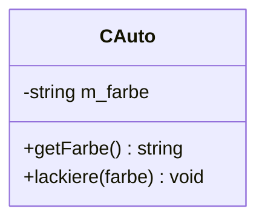

Explanation of the compartments:

- **Top**: the class name.
- **Middle**: data — often omitted from the diagram; called *Membervariablen*
  (member variables) in C++.
- **Bottom**: methods — called *Memberfunktion* or *Elementfunktion* in C++.
- If only the class name matters for a given diagram, the methods and data
  compartments may be omitted entirely.

## Visibility markers

The notes name `CAuto`'s `public`/`private` split (see
[[concepts/class-and-object]]) as the access-modifier concept that UML's
visibility markers annotate per member:

- `+` public
- `-` private
- `#` protected

> [!note]
> The excerpted notes describe the three-compartment box and the
> public/private distinction from the `CAuto` example, but do not show the
> `+`/`-`/`#` prefix characters explicitly inside a diagram. The mapping of
> `public → +`, `private → -`, `protected → #` is the standard UML convention
> used to annotate exactly the visibility distinction the notes draw for
> `CAuto`'s `getFarbe()`/`lackiere()` (public) vs. `m_farbe` (private).

## Example

`CAuto`, as introduced in [[concepts/class-and-object]]:

```cpp
class CAuto
{
  public:
    std::string getFarbe();
    void lackiere(std::string farbe);
  private:
    std::string m_farbe;
};
```

would be drawn with `+` in front of `getFarbe()` and `lackiere(farbe)`, and
`-` in front of `m_farbe`.

## Relationship arrow types (legend)

> [!note] Not drawn from the excerpted notes' figures — this is the standard
> UML legend for the relationship arrows commonly drawn *between* class boxes
> like the one above, included here because Mermaid's `classDiagram` supports
> them natively.

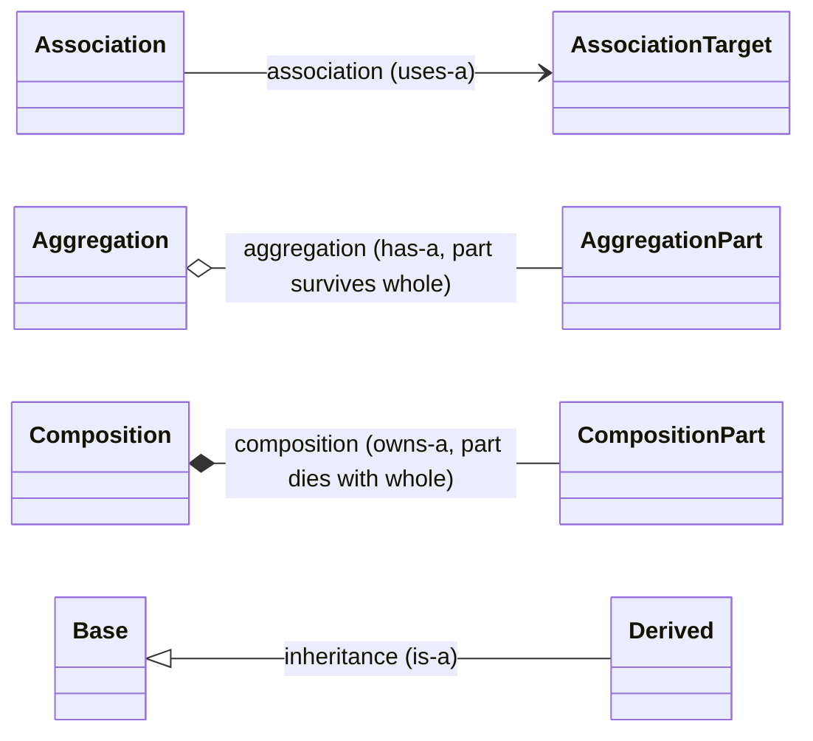

- **Association** (plain arrow) — one class merely refers to / uses another.
- **Aggregation** (hollow diamond) — a "has-a" relationship where the
  contained part can outlive the container.
- **Composition** (filled diamond) — a stronger "owns-a" relationship where
  the part's lifetime is bound to the container's.
- **Inheritance** (hollow triangle) — the "is-a" relationship; see
  [[concepts/polymorphism]] and [[concepts/vtable]] for how C++ implements it.

The sections below (§0.6.2.1–§0.6.2.12) give the sourced notation behind this
legend, worked through the lecture's "Party" example and the general grammars
for attributes, operations, generalization, association, aggregation,
composition, and dependency.

## Worked example: class diagram of a party (§0.6.2.1)

*Abbildung 23: Beispiel: Klassendiagramm einer Party* models a party with
classes `Feier` (celebration/party event), `Zutat` (ingredient),
`Partyteilnehmer` (party participant), `Häppchen` (snack/canapé), `Cocktail`,
`Barmixer` (bartender), the interface `Esser` (hand-annotated "abstrakte
Klasse"), `Gast` (guest), `Gastgeber` (host), and enumeration `Begeisterung`
(enthusiasm).

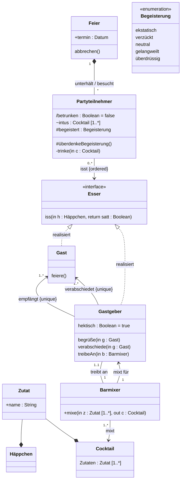

Key points from the worked example: `Feier` is composed of `Partyteilnehmer`
("unterhält"/"besucht"); `Zutat` is composed into both `Häppchen` and
`Cocktail`; `Esser` is an interface (hand-annotated "abstrakte Klasse",
abstract class) **realized** by both `Gast` and `Gastgeber`; `Begeisterung` is
drawn with the `«enumeration»` stereotype and lists its literals directly in
the class box.

## Class notation variants (§0.6.2.2)

*Abbildung 24: Darstellungen einer Klasse* shows four ways to draw a class
box:

- **(a) einfache Klasse** (simple class): just a box with the class name.
- **(b) Klasse mit Attribut und Operation**: three compartments — name,
  `attribut`, `operation()`.
- **(c) Abstrakte Klasse** (abstract class): class name shown in *italics*.
- **(d) Abstrakte Klasse, alternative Darstellung**: class name with an
  explicit `{abstract}` property tag below it.

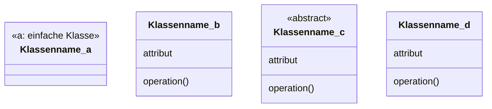

A class (*Klasse*) is defined by: a set of similar objects (*Menge von
gleichartigen Objekten*), common semantics (*Gemeinsame Semantik*), common
properties/attributes, and common behavior (*Gemeinsames Verhalten*). See
[[concepts/class-and-object]] and [[concepts/abstract-class]].

## Attribute syntax (§0.6.2.3)

An attribute (*Attribut*; in C++/Java: member variable) can be shown directly
inside the class box's attribute compartment, or as a separate box connected
to the class box by an open arrow (*Abbildung 25*, an alternative notation).

**Attribute declaration grammar:**

```
[Sichtbarkeit] [/] name [: Typ] ['[' Multiplizität ']']
    [= Vorgabewert] [{Eigenschaftswert}]
```

(Visibility, optional derived-attribute slash, name, optional type, optional
multiplicity in brackets, optional default value, optional property value in
braces.)

- **`/` prefix**: denotes a *derived attribute* — computed at runtime (*zur
  Laufzeit berechnetes Attribut*), not stored (*nicht abgespeichert*). Example:
  computing age (*Alter*) from date of birth and current system time.
- **name**: arbitrary characters are allowed in UML, but whitespace/special
  characters should be avoided for forward engineering into a programming
  language. Should start lowercase, usually *camelCaseNotation*.
- **Typ**: any available type, including other classes.
- **Multiplizität** (multiplicity): number of instances storable under the
  name; any natural number, with lower/upper bound separated by `..`; `*`
  means an arbitrary number; default is `[1..1]`; `[1..n]` may also be written
  `[n]`.
- **Vorgabewert** (default value): the attribute is automatically set to this
  value at the start.

### Visibility table (Tabelle 7)

| Sichtbarkeit | Symbol | Bedeutung |
|---|---|---|
| public | `+` | Zugriff von allen Systemkomponenten erlaubt (access allowed from all system components) |
| private | `-` | Zugriff nur innerhalb von Ausprägungen der Klasse erlaubt (access only within instances of the class) |
| protected | `#` | Zugriff von Ausprägungen der Klasse und Spezialisierungen erlaubt (access from instances of the class and its specializations) |
| package | `~` | Zugriff von Klassen desselben Pakets erlaubt (access from classes of the same package) |

See [[concepts/access-modifiers]] for the corresponding C++ concept.

### Property values (Eigenschaftswerte, selection)

- **readOnly**: value may not be changed.
- **ordered**: contents ordered, no duplicates.
- **bag**: contents unordered, duplicates allowed.
- **sequence**: contents ordered, duplicates allowed.
- **composite**: the attribute is responsible for destroying its contents.
- Self-defined (custom) property values are permissible.

### Class attribute (static attribute)

All instances of a class share the same storage location (*teilen sich
denselben Speicherplatz*) — called *statisch* (static) in some programming
languages. Represented in UML by underlining. See [[concepts/static-members]].

### Worked example (Abbildung 27)

```
BeispielKlasse
---------------
a : int
#b : bool
+pi : double = 3.14 {readOnly}   (underlined — class/static attribute)
-c : string[0..*] {sequence}
d : int {d<5}
```

- **a**: type `int`, visibility not specified.
- **b**: type `boolean`, protected.
- **pi**: static constant of type `double`.
- **c**: private, ordered collection (multiplicity `[0..*]`), duplicates
  allowed (`sequence`).
- **d**: type `int` with a constraint (`{d<5}`).

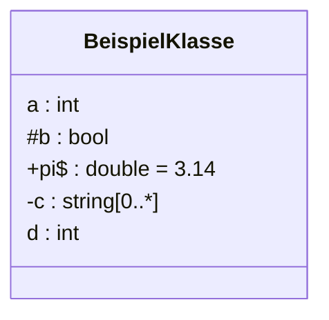

## Operation syntax (§0.6.2.4)

An operation (*Operation*; in C++: member function, in Java: method) is
written as:

```
Sichtbarkeit Name (Parameterliste) : Rückgabetyp {Eigenschaftswert}
```

**Operation specification grammar:**

```
[Sichtbarkeit] Name (Parameterliste) : Rückgabetyp [{Eigenschaftswert}]
```

**Parameter list grammar:**

```
[Übergaberichtung] Name : Typ ['[' Multiplizität ']']
    [= Vorgabewert] [{Eigenschaftswert}]
```

- **Sichtbarkeit**: same visibility symbols as attributes (`+`/`-`/`#`/`~`).
- **Name**: naming uses verbs, either infinitive (`anzeigen()` — "to show") or
  imperative (`zeigeAn()` — "show!").
- **Übergaberichtung** (parameter passing direction):
  - **in**: parameter is only read (*wird nur eingelesen*).
  - **out**: parameter is only output (*wird nur ausgegeben*).
  - **inout**: parameter is both read and written.
  - **return**: return parameter.
- **Rückgabetyp** (return type): a scalar type or class.
- **Eigenschaftswert** (property value): additional properties, as with
  attributes.
- **Klassenoperation** (class operation / static method): executed directly on
  the class rather than an instance, represented by underlining — see
  [[concepts/static-members]].

### Worked example (Abbildung 29)

```
BeispielKlasse
---------------
---------------
+ f()
- g (in a: int=5) : int {readOnly}
```

- **f**: no input or return parameter, public.
- **g**: input parameter of type `int` (read, "lesend"); without an explicit
  default, a value of 5 is assumed; returns `int`; `readOnly` (the operation
  has no side effects on system state); visibility private.

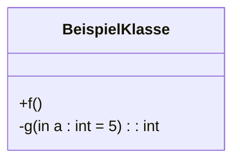

## Interfaces and realization (§0.6.2.5)

*Abbildung 30: Darstellung einer Schnittstelle* — an interface (*Schnittstelle*,
in Java: `Interface`) is drawn with the `«Schnittstelle»` (interface)
stereotype; its operation name is shown in italics to indicate it is abstract.

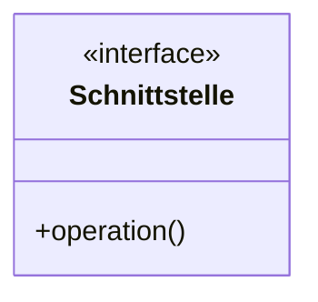

An interface is an **abstract class**: instances (objects) are not allowed.
Concrete classes **realize** (*realisieren*) the interface — realization
(*Realisierung*) is a special form of specialization. *Abbildung 31* gives two
equivalent notations for the implementation/realization relationship:

- **(a)**: `Klasse1` → (dashed line, hollow triangle) → `«Schnittstelle»
  Schnittstelle` ← (dashed arrow, `«uses»`) ← `Klasse2`: `Klasse1` realizes
  the interface, `Klasse2` merely uses it.
- **(b)**: the same relationship drawn with the alternative "ball-and-socket"
  (*lollipop*) notation.

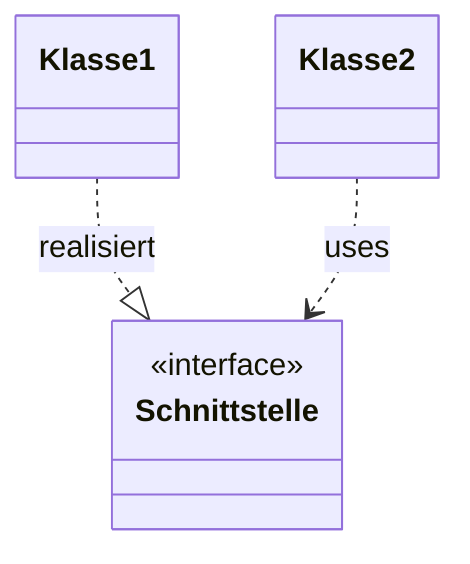

See [[concepts/abstract-class]] and the pattern pages
[[patterns/adapter]]/[[patterns/strategy]]/[[patterns/observer]], which all
realize an abstract interface class in exactly this way.

## Parameterized classes / templates (§0.6.2.6)

*Abbildung 32* shows a parameterized class (*Parametrisierte Klasse*) with its
template parameters in a dashed box at the top-right corner:

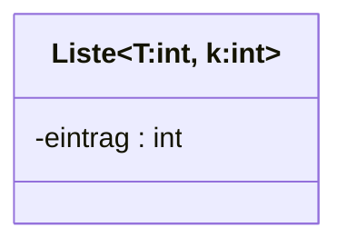

Parameterized classes correspond to **Templates** in C++ (see
[[concepts/templates]]) and to **Generics** in Java.

## Generalization / specialization (§0.6.2.7)

Generalization/specialization (*Generalisierung*/*Spezialisierung*; in
C++/Java: *Vererbung*, inheritance) is drawn with a hollow-triangle arrow
pointing from the specialization up to the generalization. *Abbildung 33*
shows class `Auto` (car) with subclasses `Cabrio` (convertible) and `Bus`
(bus):

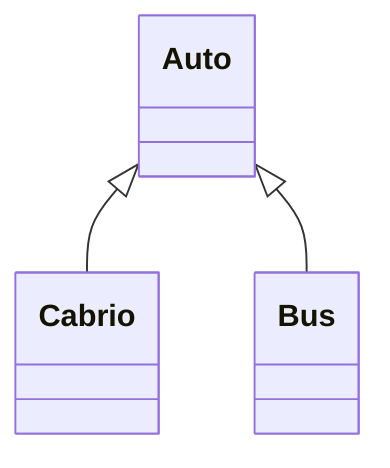

- `Auto` is a **generalization** of `Cabrio`; `Cabrio`/`Bus` are
  **specializations** of `Auto`.
- *Vererbung* (inheritance): properties (attributes, associations, …) of
  `Auto` carry over to `Cabrio`, `Bus` — see [[concepts/inheritance]].
- *Polymorphie* (polymorphism): an instance of `Auto` can be *substituted* by
  instances of `Cabrio`, `Bus` (the "is-a"/*"ist-ein"*-relationship) — see
  [[concepts/polymorphism]].

### Generalization sets (Generalisierungsmenge)

The set of specializations sharing a common generalization, e.g. the
generalization set "Fahrzeugtypen" (vehicle types) for *Partitionen*
(partitions) `Cabrio`/`Bus`. A generalization set carries properties:

- **(in-)complete**: (not) all meaningful specializations are mentioned.
- **disjoint**: instances belong uniquely to *one* subtype — e.g. a `Cabrio`
  is not also a `Bus`.
- **overlapping**: the inverse of `disjoint` — an instance may belong to more
  than one subtype simultaneously.

## Associations: roles, multiplicity, navigability (§0.6.2.8–0.6.2.9)

*Abbildung 34* shows an association (*Assoziation*) example between class
`Person` and class `Cocktail`, with two association lines joined by an
`{xor}` constraint (a `Person` plays exactly one of the two roles at a time):

- Role "Barmixer" on the `Person` side (multiplicity `1`), association name
  "Getränkeerzeugung" (beverage production), role "gemixt von" on the
  `Cocktail` side (multiplicity `1..*`).
- Role "Partygast" on the `Person` side (multiplicity `1..*`), association
  name "Getränkekonsum" (beverage consumption), role "konsumiert von" on the
  `Cocktail` side (multiplicity `1..*`).

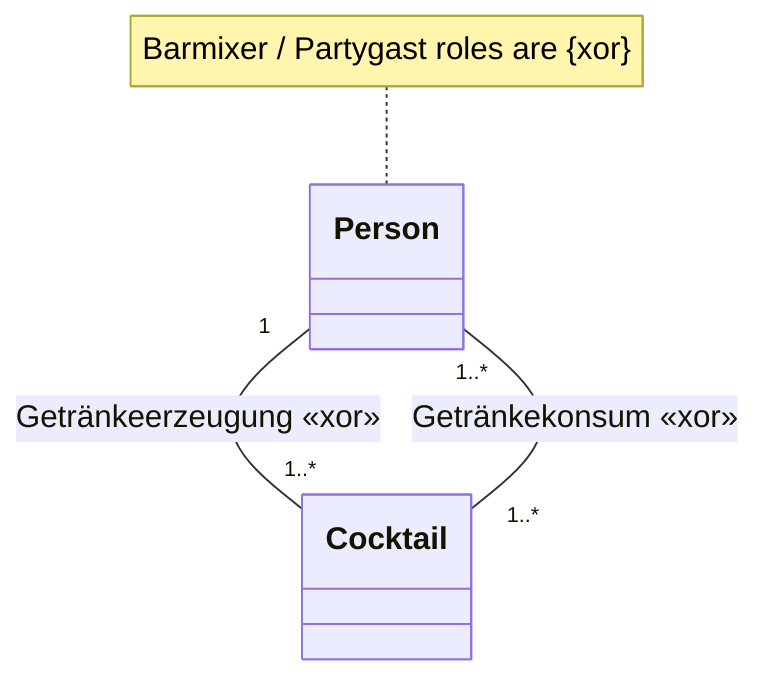

**Optional elements of an association:**

- *Assoziationsname* (association name), e.g. "Getränkeerzeugung".
- *Rolle* (role), e.g. "Barmixer".
- *Multiplizität* (multiplicity), e.g. `1`.
- *Einschränkung* (constraint), e.g. `{XOR}` — a bartender cannot
  simultaneously be a party guest.
- *Eigenschaften* (properties), similar to attributes.

### Navigable associations

*Abbildung 35* shows three degrees of navigability:

- **(a) unspezifiziert** (unspecified): `Klasse1 — Klasse2`, plain line, no
  arrowheads.
- **(b)**: `Klasse3 → Klasse4` — `Klasse3` knows `Klasse4`; the reverse is
  unspecified.
- **(c)**: `Klasse5 ✕→ Klasse6` — `Klasse5` knows `Klasse6`, but `Klasse6`
  explicitly does **not** know `Klasse5`.

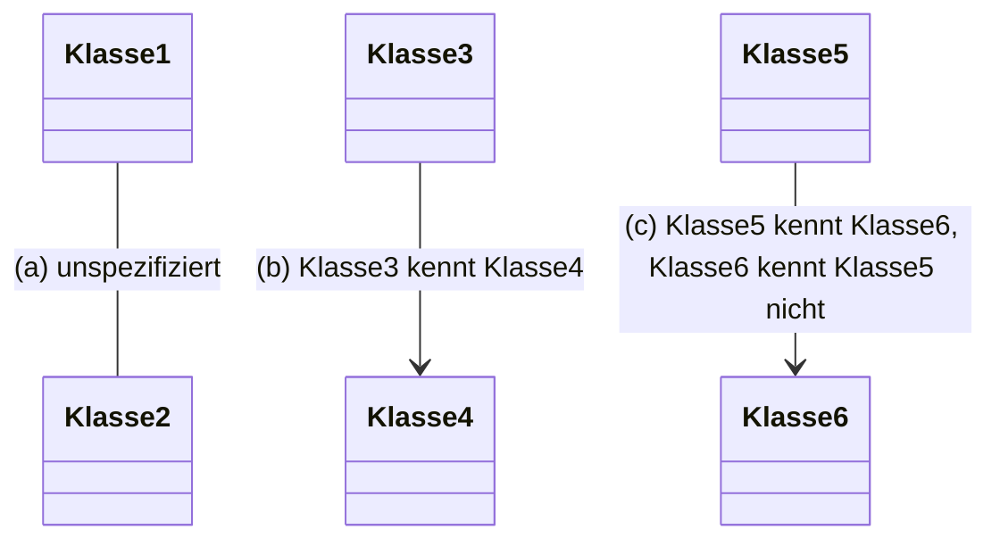

## Aggregation vs. composition (§0.6.2.10)

*Abbildung 36* contrasts the two "has-a" relationships:

- **(a) Aggregation**: `Party` ◇→ `Teilnehmer` (open/hollow diamond at the
  `Party` end), multiplicities `1..*` on both sides.
- **(b) Komposition**: `Cocktail` ◆→ `Zutat` (filled diamond at the
  `Cocktail` end), multiplicity `1` (Cocktail side) to `1..*` (Zutat side).

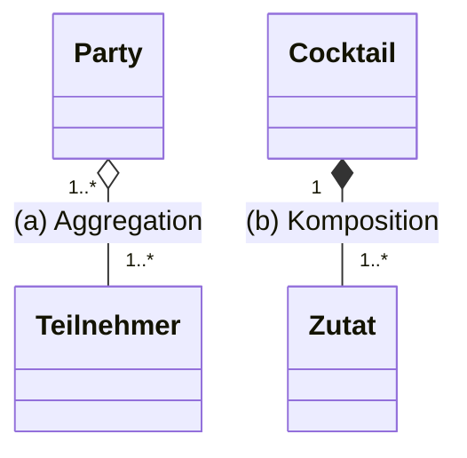

**Aggregation**: a "Teil-Ganzes-Beziehung" (part-whole relationship); the
whole "besteht-aus" (consists-of) parts; an aggregated object can be part of
several (other) objects; lifetime of the participating objects is
independent of one another.

**Kompositionsaggregation** (short: Komposition/composition): expresses
physical inclusion (*physische Inklusion*); parts and whole form a unit
(*Einheit*); a part is assigned to at most one whole; the part's lifetime
depends on that of the whole. See [[concepts/composition]].

## Dependency (§0.6.2.11)

*Abbildung 37*: a dependency (*Abhängigkeit*) is drawn as a dashed, open
arrow:

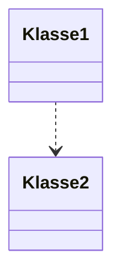

A dependency relationship serves only documentation purposes (*Dient nur der
Dokumentation*) and is **not** translated into the programming language: one
element needs another without a runtime relationship (association) existing
between them. If a runtime relationship *does* exist, an association should
be used instead (*Andernfalls Assoziation verwenden*).

## Comments (§0.6.2.12)

*Abbildung 38*: a class box connected via a dotted line to a folded-corner
note shape containing explanatory text.

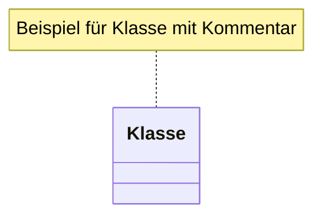

## `BeispielKlasse` end-to-end example

Combining the attribute and operation grammars above into the two worked
`BeispielKlasse` figures from the notes (Abbildung 27 and Abbildung 29):

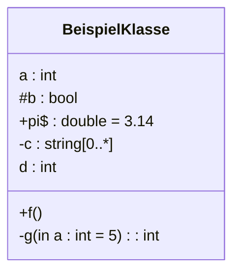

## Consequences / trade-offs

- A UML box is a compact, language-independent summary of a class's public
  contract, useful for design discussions before (or instead of) reading the
  C++ declaration.
- Omitting data/methods trades completeness for a high-level overview focused
  only on relationships between classes.

## Misuse & anti-patterns

- Treating the UML diagram as a substitute for the actual class declaration —
  it is a design-level summary, not a compilable artifact.
- Forgetting to update the diagram's visibility markers after changing a
  member's access level in the source.

## Related
- [[concepts/class-and-object]]
- [[concepts/abstract-data-type]]
- [[concepts/encapsulation]]
- [[concepts/inheritance]]
- [[concepts/composition]]
- [[concepts/abstract-class]]
- [[concepts/polymorphism]]
- [[concepts/templates]]
- [[concepts/access-modifiers]]
- [[concepts/static-members]]
- [[concepts/uml-overview]]
- [[concepts/uml-sequence-diagram]]
- [[patterns/design-patterns-overview]]
- [[patterns/singleton]]
- [[patterns/adapter]]
- [[patterns/proxy]]
- [[patterns/strategy]]
- [[patterns/observer]]

## Sources
- [[sources/grigat-oop-teil1]] §0.3.2.3
- [[sources/grigat-uml-patterns]] §0.6.2.1–§0.6.2.12
