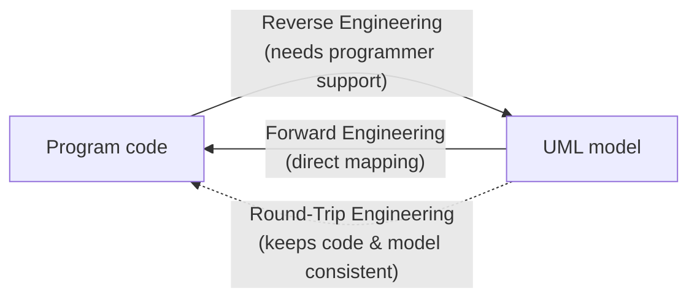
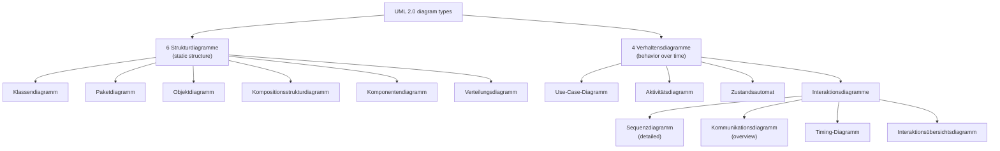

## Definition

**UML** (*Unified Modeling Language*) is an international standard of the OMG
(*Object Management Group* — the notes write "Open Management Group", which is
the commonly used but inaccurate expansion) for modeling complex software
systems. The current standard, in force since March 2005, is **UML 2.0**.

## Problem it solves

Software systems are too complex to discuss, document, or specify purely in
source code or prose. UML provides a shared graphical notation so that
*Modellierung* (modeling), *Dokumentation* (documentation), *Spezifizierung*
(specification), and *Visualisierung* (visualization) of a system's structure
and behavior can happen independently of any one programming language.

### What UML is *not*

- Not a *Programmiersprache* (programming language).
- Not a purely formal language (*rein formale Sprache*).
- Not specialized to one particular application domain.
- Not complete (*vollständig*) — it does not claim to capture everything about a system.

## Forward, reverse, and round-trip engineering

- **Forward Engineering**: generating program code from a UML model. Directly
  possible because mappings from UML to programming languages exist.
- **Reverse Engineering**: generating a UML model from program code. Only
  possible with support of a programmer — i.e. not fully automatic — because
  program code in general (*i. A.*) contains **less** information than a UML
  model (e.g. a design-level intent such as "this is a has-a relationship with
  independent lifetimes" is not recoverable from the code alone).
- **Round-Trip Engineering**: the combination of forward- and
  reverse-engineering. UML tools ensure consistency between code and model as
  both evolve.

## Diagram types ("there is more than just class diagrams")

UML 2.0 defines ten diagram types in two families: six **structure diagrams**
(*Strukturdiagramme*), describing the *static* structure of a system, and four
**behavior diagrams** (*Verhaltensdiagramme*), describing how the system acts
over time. The behavior family's interaction diagrams further split into four
sub-types.

### 6 structure diagrams

1. **Klassendiagramm** (class diagram) — the static structure of classes and
   their relationships; see [[concepts/uml-class-diagram]].
2. **Paketdiagramm** (package diagram) — logical grouping of model elements;
   models dependencies and inclusion.
3. **Objektdiagramm** (object diagram) — example objects and attribute
   assignments at a specific point in time (*Zeitpunkt*).
4. **Kompositionsstrukturdiagramm** (composition structure / architecture
   diagram) — top-down modeling of the system.
5. **Komponentendiagramm** (component diagram) — organization and dependencies
   of individual technical system components; models *interfaces*
   (*Schnittstellen*).
6. **Verteilungsdiagramm** (deployment diagram) — the runtime environment
   (*Laufzeitumfeld*) of the system (hardware, servers); high level of
   abstraction.

### 4 behavior diagrams

1. **Use-Case-Diagramm** (use case diagram) — external view (*Außenansicht*)
   of the whole system; see [[concepts/uml-use-case-diagram]].
2. **Aktivitätsdiagramm** (activity diagram) — detailed visualization of
   processes/flows, related to *Petri-Netze* (Petri nets); see
   [[concepts/uml-activity-diagram]].
3. **Zustandsautomat** (state machine) — states, events, concurrency
   (*Nebenläufigkeiten*), conditions, entry- and exit-actions; see
   [[concepts/uml-state-machine]].
4. **Interaktionsdiagramme** (interaction diagrams), with four sub-types:
   - **Sequenzdiagramm** (sequence diagram) — detailed, time-ordered
     representation of information exchange between communication partners;
     see [[concepts/uml-sequence-diagram]].
   - **Kommunikationsdiagramm** (communication diagram) — information
     exchange between communication partners, as an *overview*
     (*Überblick*) rather than a detailed timeline.
   - **Timing-Diagramm** (timing diagram) — exact *temporal* behavior of
     classes, interfaces, etc.
   - **Interaktionsübersichtsdiagramm** (interaction overview diagram) —
     connects interaction diagrams at a high level of abstraction.

## Consequences / trade-offs

- A single standard notation lets forward, reverse, and round-trip engineering
  tools agree on what a diagram means.
- Ten diagram types cover very different concerns (static structure vs. runtime
  behavior); a project rarely needs all of them, and over-modeling with
  diagrams nobody reads back is a common failure mode.
- Because UML is deliberately incomplete and not a programming language, it
  cannot replace the source code as the single source of truth — only forward
  engineering produces code directly, and even that needs a mapping.

## Misuse & anti-patterns

- Treating reverse-engineered UML as fully automatic — the notes explicitly
  state it requires programmer support, since code carries less information
  than the model.
- Drawing a "Kommunikationsdiagramm" when a detailed, time-ordered
  "Sequenzdiagramm" is actually needed (or vice versa) — they model the same
  kind of information exchange at different levels of detail.

## Related

- [[concepts/uml-class-diagram]]
- [[concepts/uml-sequence-diagram]]
- [[concepts/uml-use-case-diagram]]
- [[concepts/uml-activity-diagram]]
- [[concepts/uml-state-machine]]
- [[concepts/version-control]]
- [[patterns/design-patterns-overview]]

## Open questions

- The source does not elaborate on package, object, composition-structure,
  component, or deployment diagrams beyond the one-line descriptions above —
  no dedicated page is planned for those per the current ingest wave.

## Sources

[[sources/grigat-uml-patterns]] §0.6.1.1, §0.6.1.2
