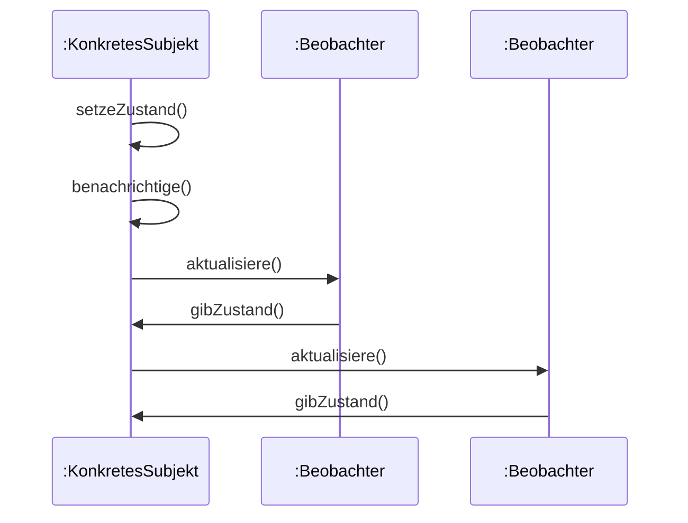

## Definition

A **sequence diagram** (*Sequenzdiagramm*) is one of UML's interaction
diagrams: it gives a *detailed* (as opposed to overview-level), time-ordered
representation of the information exchange between communication partners —
see [[concepts/uml-overview]] for where it sits in the full diagram taxonomy.

## Problem it solves

A class diagram shows *that* two classes are related (e.g. `Subjekt` knows its
`Beobachter`), but not *in what order* or *how many times* their operations
call each other at runtime. A sequence diagram fixes a single scenario and
shows the exact sequence of messages exchanged between specific objects over
time, reading top-to-bottom as time passes.

## The example in the notes: Beobachter notification

The only worked sequence diagram in the source notes is *Abbildung 48:
UML-Sequenzdiagramm: Beobachter*, which depicts the [[patterns/observer]]
pattern's notification flow. It shows `setzeZustand()` called on
`KonkretesSubjekt`, which internally calls `benachrichtige()` (a **self-call**),
which in turn calls `aktualisiere()` on each registered `Beobachter` in turn;
each `Beobachter` calls back `gibZustand()` on the subject to pull its new
state.



Reading the notation as it appears in this example:

- **Lifelines**: the vertical participants `:KonkretesSubjekt`, `:Beobachter`,
  `:Beobachter` — each one an (unnamed) object instance of the given class,
  shown by UML's `:ClassName` convention.
- **Messages**: horizontal arrows between lifelines, read top-to-bottom as
  time progressing; e.g. `KS->>B1: aktualisiere()` is `KonkretesSubjekt`
  calling `aktualisiere()` on the first `Beobachter`.
- **Self-call**: `KS->>KS: benachrichtige()` — `setzeZustand()` triggers
  `benachrichtige()` on the same object, drawn as a message looping back to
  its own lifeline.
- **Return / callback**: `B1->>KS: gibZustand()` is not a dashed UML "return"
  arrow in the source figure but a genuine second call — each `Beobachter`
  actively calls back into the subject to *pull* its new state, rather than
  the state being pushed as part of the notification.

## Numbered pseudocode of the flow

```
1. Caller invokes KonkretesSubjekt.setzeZustand(neuerZustand)
2. KonkretesSubjekt stores neuerZustand, then calls its own benachrichtige()
3. For each registered Beobachter b in the observer list:
     a. KonkretesSubjekt calls b.aktualisiere()
     b. b calls back KonkretesSubjekt.gibZustand() to read the new state
     c. b updates its own beobachterZustand from the result
```

## Consequences / trade-offs

- A sequence diagram pins down one concrete scenario precisely, including
  ordering and self-calls that a class diagram cannot express.
- It does not show the static relationships (multiplicities, inheritance)
  between the participants — for that, pair it with the corresponding
  [[concepts/uml-class-diagram]] (e.g. Abbildung 47 for this same Observer
  example).

## Misuse & anti-patterns

- Drawing a fully detailed sequence diagram when only an overview of which
  objects talk to which is needed — that is what the
  *Kommunikationsdiagramm* (communication diagram) is for; see
  [[concepts/uml-overview]].

## Related

- [[concepts/uml-overview]]
- [[concepts/uml-class-diagram]]
- [[patterns/observer]]
- [[concepts/uml-state-machine]]
- [[concepts/uml-activity-diagram]]

## Open questions

- The source does not separately describe the general sequence-diagram
  notation grammar (lifeline symbol, activation-bar rectangle, synchronous vs.
  asynchronous arrowheads, dashed return messages) the way it does for class
  diagrams' attribute/operation grammars — only the one worked Observer
  example (Abbildung 48) and its figure caption are given. The notation
  described above is read directly off that example, not from a separate
  explanatory section.

## Sources

[[sources/grigat-uml-patterns]] §0.6.1.2, §0.7.6.3
