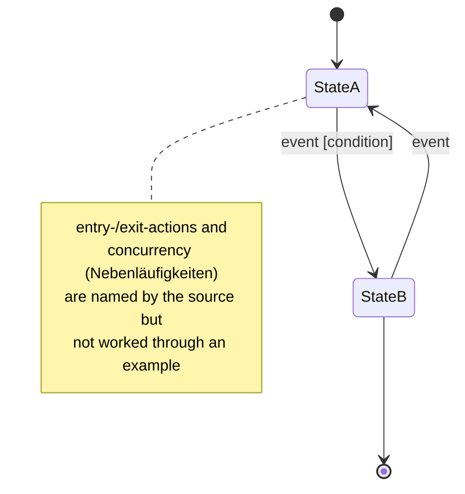

## Definition

A **state machine** (*Zustandsautomat*) is one of UML's four behavior
diagrams. The notes describe it in a single line: a state model
(*Zustandsmodell*) with states, events, concurrency (*Nebenläufigkeiten*),
conditions, and entry- and exit-actions — see [[concepts/uml-overview]] for
where it sits in the full diagram taxonomy.

## Problem it solves

Where an activity diagram models a process as a flow of actions, a state
machine models an object's lifecycle as a set of discrete **states**, with
**events** triggering transitions between them, optional guard **conditions**
on those transitions, and **entry-/exit-actions** executed on entering or
leaving a state.

## Consequences / trade-offs

Not discussed in the excerpted notes beyond its one-line role in the
taxonomy.

## Misuse & anti-patterns

Not discussed in the excerpted notes.

## Related

- [[concepts/uml-overview]]
- [[concepts/uml-activity-diagram]]
- [[concepts/uml-sequence-diagram]]
- [[concepts/uml-use-case-diagram]]
- [[concepts/uml-class-diagram]]

## Open questions

The source covers state machines only at the overview/taxonomy level — a
single sentence naming its ingredients (states, events, concurrency,
conditions, entry-/exit-actions), with no worked example and no concrete
notation (composite/concurrent regions, pseudostates, etc.). This page
intentionally stays short rather than inventing such detail. A future source
would be needed to expand it.

## Sources

[[sources/grigat-uml-patterns]] §0.6.1.2
