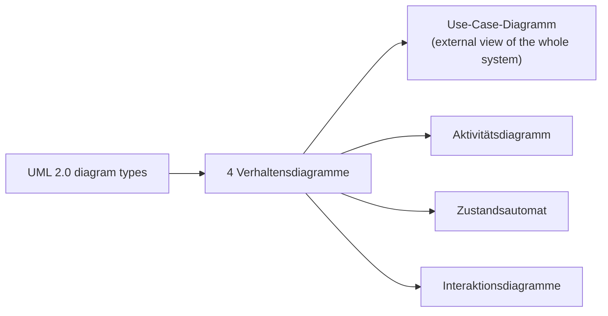

## Definition

A **use case diagram** (*Use-Case-Diagramm*) is one of UML's four behavior
diagrams. The notes describe it in a single line: it gives an **external view**
(*Außenansicht*) of the whole system — see [[concepts/uml-overview]] for where
it sits in the full diagram taxonomy.

## Problem it solves

Where a class diagram models the internal static structure, a use case
diagram is meant to capture what the system does *as seen from the outside*
(by its users/actors), without committing to how it is implemented internally.

## Consequences / trade-offs

Not discussed in the excerpted notes beyond its one-line role in the
taxonomy.

## Misuse & anti-patterns

Not discussed in the excerpted notes.

## Related

- [[concepts/uml-overview]]
- [[concepts/uml-class-diagram]]
- [[concepts/uml-activity-diagram]]
- [[concepts/uml-state-machine]]
- [[concepts/uml-sequence-diagram]]

## Open questions

The source covers use case diagrams only at the overview/taxonomy level — a
single sentence ("external view of the whole system") with no worked example,
no actor/use-case notation, and no further detail. This page intentionally
stays short rather than inventing notation details (actors, ovals, `<<include>>`/
`<<extend>>` relationships) that are not in the notes. A future source would be
needed to expand it.

## Sources

[[sources/grigat-uml-patterns]] §0.6.1.2
